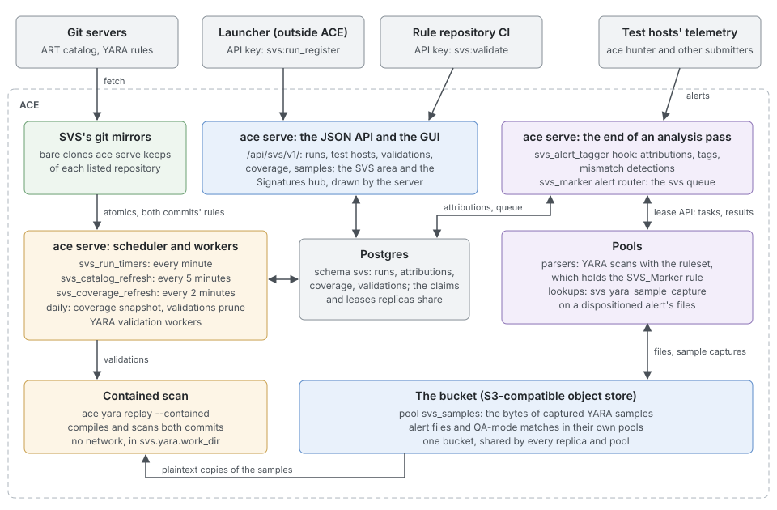
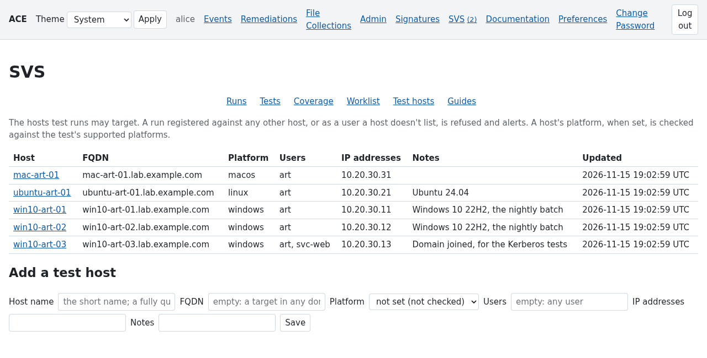
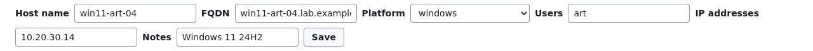
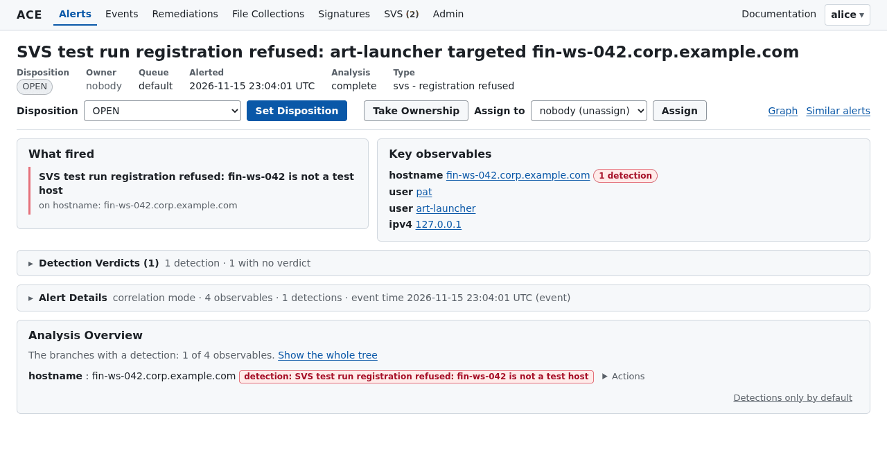
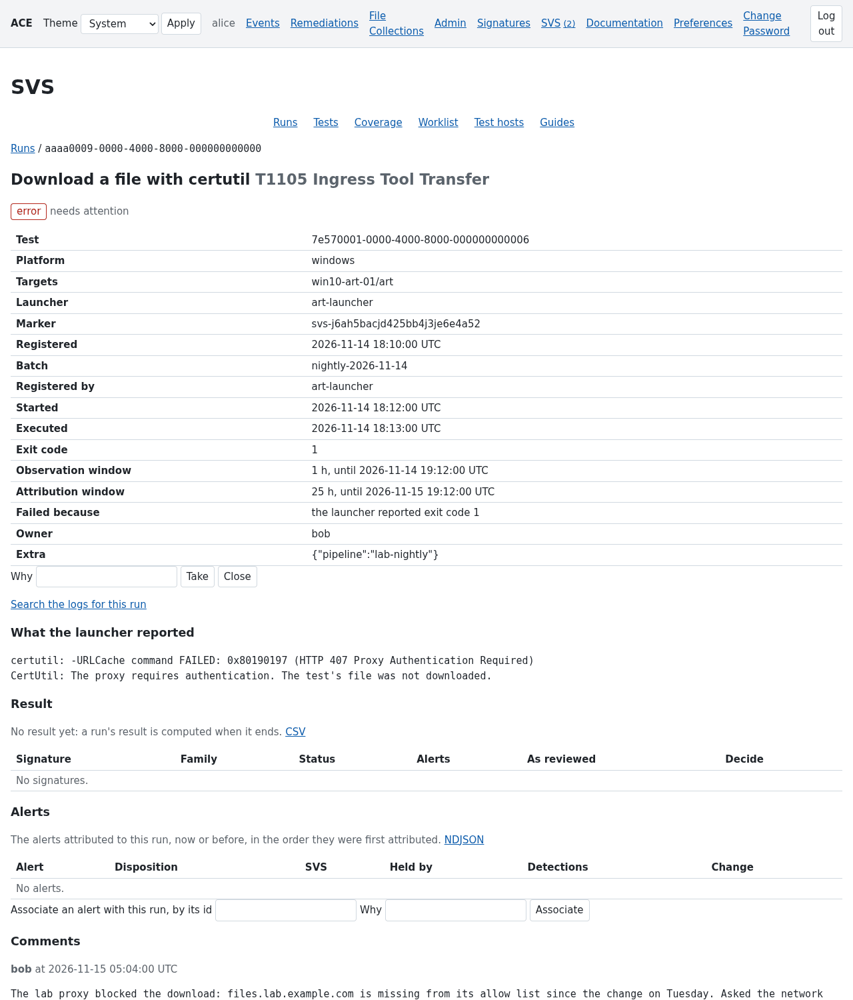
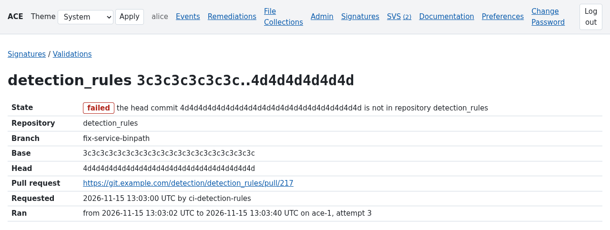
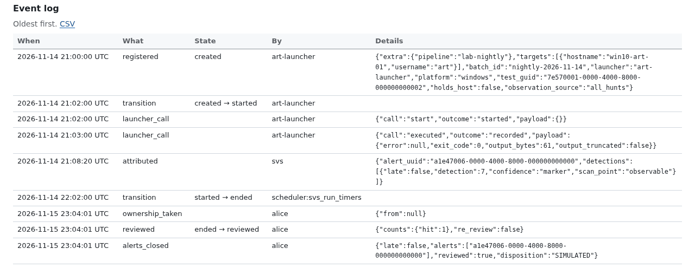
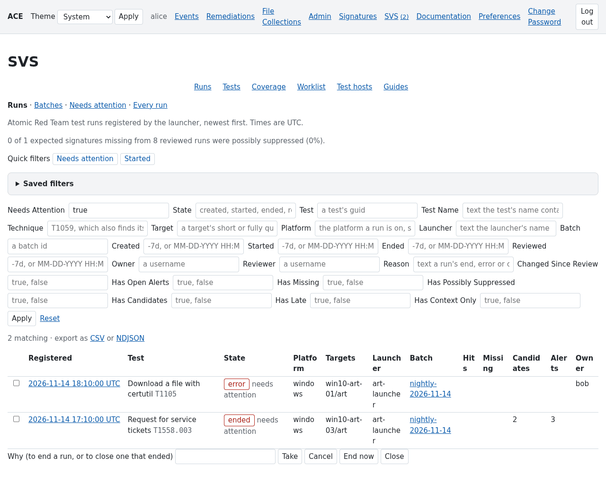

# SVS administrator's guide

This guide is for ACE administrators who set up the Signature Validation System (SVS) and keep it running.
It assumes you already run ACE: you know Docker Compose, the site overlay and the `ace` command line. It
doesn't explain what SVS is for or how analysts review runs. The [Beginner's guide](beginners.md) and the
[User's guide](users.md) cover that.

You will learn how to:

- name the processes and data flows SVS depends on;
- create the groups and the API keys SVS needs;
- configure the catalog, the runs, YARA validation and the scheduled tasks;
- manage test hosts and handle refused registrations;
- connect a launcher and a rule repository's CI;
- keep coverage, the ATT&CK release, the scheduled tasks and retention in order;
- read SVS's logs, run daily and weekly health checks, and fix the common failures.

The `ace` commands in this guide run in the core's container, which holds the database's and the bucket's
credentials and the overlay: `docker compose exec ace ace svs catalog status`. The `docker compose`
commands run on the host, in the ACE checkout. The examples use a lab with a launcher called
`art-launcher` and a YARA rule repository called `detection_rules`.

## How SVS runs

SVS has no service of its own. It is a set of parts inside `ace serve`, the pools and the hunter. Most
failures come from one part being misconfigured.



The diagram shows the parts inside ACE, the outside systems that call them, and the data flows between
them.

| Part | Where it runs | What it does for SVS |
|---|---|---|
| The JSON API | `ace serve` (the `ace` container) | Serves `/api/svs/v1/`: the launcher's calls, CI's validation requests, and the reads and writes behind every SVS screen |
| The GUI | `ace serve` | The SVS area ([Runs](/svs/runs), [Tests](/svs/tests), [Coverage](/svs/coverage), [Worklist](/svs/worklist), [Test hosts](/svs/test-hosts)) and the [Signatures](/signatures) hub's Samples and Validations pages |
| The `svs_alert_tagger` hook | `ace serve`, at the end of an analysis pass | Judges an alert once: writes its attributions to runs, the tags `svs_test`, `svs:marker_mismatch` and `svs:maintenance`, and a detection for each marker that doesn't agree with its run |
| The `svs_marker` alert router | `ace serve`'s routing worker | Reads the attributions and moves a fully attributed alert, or one in a maintenance window, to the `svs` queue |
| The scheduler | `ace serve` | Runs SVS's five tasks: the run timers, the catalog refresh, the coverage refresh, the daily snapshot and the validations prune |
| The validation workers | `ace serve`, when `svs.yara.repositories` lists a repository | Claim queued YARA validations, replay the samples in a contained process, store the report |
| The ruleset builder | `ace serve`, when `ACE_RS_SIGNATURES_REPO` names a signatures checkout | Adds the `SVS_Marker` rule to every ruleset, as the namespace `svs_marker`. The rule finds run markers inside files. |
| `svs_yara_sample_capture` | the `lookups` pool | Stores the YARA samples of dispositioned alerts |
| The hunter | `ace hunter` | Records each hunt's latency, which a run's windows are computed from, and asks SVS which run owns a match before it suppresses one |
| Postgres | the `postgres` container | Schema `svs`: runs, attributions, results, coverage, validations, test hosts |
| The bucket | the S3-compatible object store | Pool `svs_samples`: the bytes of captured YARA samples |

### What ace serve runs for SVS

`ace serve` starts the scheduler and, when a rule repository is listed, the validation workers. Every
replica of `ace serve` runs them, and the database gives each piece of work to one replica
([Running more than one replica](#running-more-than-one-replica)).

| Work | When | What it does |
|---|---|---|
| `svs_run_timers` | every minute | Moves runs whose start timeout or windows passed, computes a run's result as it ends and recomputes stale ones (up to 200 a pass), closes the alerts of closed runs as `SIMULATED` and of maintenance windows as `IGNORE`, expires maintenance windows, removes refusal records older than a day |
| `svs_catalog_refresh` | every 5 minutes | Fetches each catalog repository and reads `atomics/T*/T*.yaml` of a commit that changed |
| `svs_coverage_refresh` | every 2 minutes | Recomputes the worklist and ATT&CK coverage |
| `svs_coverage_snapshot` | daily, 05:00 UTC | Refreshes coverage and files the day's snapshot |
| `svs_validations_prune` | daily, 05:00 UTC | Removes validations finished more than `svs.yara.retention_days` ago |
| Validation workers | `svs.yara.poll_interval_seconds` (5) while idle | `svs.yara.max_concurrent_validations` workers (1) per replica |

> [!IMPORTANT]
> The run timers are a scheduled task. If `ace serve` is down, or `svs_run_timers` is disabled in the
> overlay, runs stay `started` past their observation window, never end, and nobody is asked to review
> them. Nothing in the GUI warns you (see [Known limitations](#known-limitations)), so the health checks
> below include a check for it.

## Roles, users and API keys

SVS is governed by five permissions, plus `signature:read`, `signature:download` and `alert:write`, which
the rest of ACE uses as well. They are grants like any other. An SVS permission does nothing until you
grant it.

| Permission | Grants |
|---|---|
| `svs:run_read` | The SVS area (Runs, Tests, Coverage, Worklist), run and test pages, the catalog, the test hosts list, and their read APIs |
| `svs:run_manage` | Taking ownership of, ending early, canceling, closing and reviewing runs; run comments; a test's expectations, ignores and observation window; resolving worklist rows; associating alerts with runs by hand |
| `svs:admin` | Adding, changing and removing test hosts; global ignores; retiring and deleting YARA samples |
| `svs:run_register` | The launcher's calls: validate, register, start, executed, cleanup, cancel, and a test host's maintenance windows |
| `svs:validate` | Requesting a YARA validation and reading its status (counts, rule names and rule uuids only) |
| `signature:read` | The Signatures hub, including the Samples and Validations pages and validation reports |
| `signature:download` | The bytes of samples and QA matches, in zips encrypted with the password `infected` |
| `alert:write` | Giving an alert back from its runs on the alert's page; relabeling a sample |

SVS has five more permissions (`svs:run_timers`, `svs:catalog_refresh`, `svs:coverage_refresh`,
`svs:coverage_snapshot`, `svs:validation_prune`). Only the scheduler's tasks hold them. Don't grant them
to people.

A few rules decide how you combine them:

- `svs:admin` does not include `svs:run_read`. The Test hosts tab is inside the SVS area, so an SVS
  administrator needs both.
- Give run reviewers `signature:read`, so they can open the samples and validation reports a run's
  signatures lead to.
- A key that belongs to a user can do only what both its own scope and its user's grants allow.
- A key that belongs to no user is an actor of its own and holds exactly its grants. It can make the
  launcher's calls, request validations, decide expectations and ignores, and resolve worklist rows. It
  can't take, cancel, end, close or review a run, or comment on one: those need a person.

### Recommended groups

Create one group for the people who review runs and one for the people who administer SVS. Analysts
usually already hold `alert:read` and `alert:write` through an existing group; add them here only if they
don't.

Groups, their grants and their members are managed under Administration, in
[Users & Roles](/admin/users). You need `admin:read` to open the area and `user:write` to change
anything. Create each group with the form on that page, then open the group's page to add its grants
(one `major:minor` pattern each) and its members.

| Group | Grants |
|---|---|
| `svs-analysts` | `svs:run_read`, `svs:run_manage`, `signature:read`, `signature:download` |
| `svs-admins` | `svs:run_read`, `svs:run_manage`, `svs:admin`, `signature:read` |

A reporting account that pulls data out of SVS gets `svs:run_read`, `alert:read` and `signature:read`, and
nothing that writes. A user's page lists every grant the user holds, with the permissions each pattern
covers, so check there what a person ends up with.

### The launcher's key

The launcher authenticates with an API key, sent as `Authorization: Bearer <token>`. Give it a key of its
own whose only grant is `svs:run_register`, so a leaked key can register runs against test hosts and
nothing else. A key that belongs to no user is enough:

```bash
docker compose exec ace ace user create-key art-launcher --grant svs:run_register
```

The command prints the key's id and its token. The token is shown once; store it in the launcher's secret
store. The launcher's key does not need `svs:run_read`: it gets each test's GUID from its own Atomic Red
Team checkout.

If you prefer a key that belongs to an account, create the user in Users & Roles, grant the user
`svs:run_register`, and create the key on the user's page with the same scope.

### The CI key

The rule repository's CI requests validations with a key of its own, limited to `svs:validate`. That key
can request validations and read their counts and rule names. No sample, file name or alert leaves ACE
through it.

```bash
docker compose exec ace ace user create-key svs-ci --grant svs:validate
```

To rotate a key, create a new one, update the secret, then revoke the old one. Users & Roles lists the
keys with no owner, and each key has a Revoke button; a user's keys are on the user's page.

## Configuration

SVS is configured in the site overlay, the YAML file `ACE_RS_OVERLAY` names. In the Compose stack that is
`overlay.yaml` in the directory `ACE_RS_SITE` names, mounted at `/etc/ace-rs`. SVS's settings are in the
`svs:` section, and its tasks' schedules in `scheduler:`. Both are checked strictly: an unknown or
misspelled key, or a value SVS can't run with, stops every process that reads the overlay, and the error
names the key.

> [!WARNING]
> Every process reads the overlay when it starts. After a change to `svs:` or `scheduler:`, restart
> `ace serve`, and the hunter if you run one. Run windows are computed when a run is registered, so a
> change to `svs.runs` applies to runs registered after the restart.

```bash
docker compose restart ace
docker compose logs --tail 50 ace
```

If the overlay is refused, `ace serve` exits and the log's last lines say which key and why.

### The svs block

| Key | Default | Meaning and when to change it |
|---|---|---|
| `log_search_url` | unset | The run page's link to your log search (below). |
| `attack_release` | `v20.0` | The ATT&CK release coverage is computed against. It must be one the build holds ([Upgrading the ATT&CK release](#upgrading-the-attck-release)). |
| `catalog.repositories` | `{}` | The Atomic Red Team repositories, by name ([Repositories](#repositories)). |
| `catalog.fetch_timeout_seconds` | `600` | Fetching a catalog repository and reading a commit from it. The first fetch clones. |
| `catalog.mirror_dir` | a directory under the system's temporary directory | Where SVS keeps its bare clone of each catalog repository. An absolute path. |
| `catalog.max_files` / `max_total_bytes` / `max_tests` | `10000` / 256 MiB / `100000` | Limits of one commit. A commit over one of them fails its refresh, and the catalog keeps what it had. |
| `catalog.max_file_bytes` | 10 MiB | A larger atomic file is skipped and counted. |
| `runs.start_timeout_minutes` | `30` | A run not started this long after registering goes to `error` and is closed. Raise it if your launcher prepares hosts between register and start. |
| `runs.observation_window.slack_minutes` | `30` | Added to the slowest expected signature's worst-case latency. |
| `runs.observation_window.floor_minutes` | `60` | The shortest observation window. |
| `runs.observation_window.ceiling_hours` | `72` | The longest observation window, and what a test's first run waits when a slow hunt is enabled. |
| `runs.attribution_extra_hours` | `24` | How long after the observation window alerts are still attributed, as late. Raise it if telemetry arrives very late. |
| `runs.max_extra_bytes` / `max_targets` | `16384` / `16` | Limits of one registration. |
| `runs.max_maintenance_minutes` | `240` | The longest maintenance window a launcher may open on a test host. |
| `yara.repositories` | `{}` | The rule repositories whose commits may be validated, by name ([Repositories](#repositories)). |
| `yara.scan_timeout_seconds` | `1800` | One commit's compile and scan over the corpus. Raise it as the corpus grows. |
| `yara.max_concurrent_validations` | `1` | Validation workers per replica. Raise it if pull requests queue up. |
| `yara.retention_days` / `prune_batch_size` | `90` / `100` | How long finished validations are kept, and how many one prune transaction removes (1 to 1000). |
| `yara.fetch_timeout_seconds` | `600` | Fetching into SVS's mirror; the first fetch clones. |
| `yara.max_archive_bytes` / `max_archive_members` | unset | Optional caps on one commit's export. |
| `yara.max_corpus_files` / `max_corpus_bytes` | `100000` / 16 GiB | The most samples one validation replays. A larger corpus fails the validation; it is never reported in part. |
| `yara.scan_memory_mb` | `4096` | Address-space limit of the contained scan, in MiB. |
| `yara.mirror_dir` | a directory under the system's temporary directory | SVS's own bare clone of each rule repository. An absolute path. |
| `yara.work_dir` | a directory under the system's temporary directory | Each validation's private directory, with a plaintext copy of every sample while it runs. An absolute path with no `.` in it. |
| `yara.poll_interval_seconds` | `5` | How long an idle worker waits before it looks for work again. |
| `yara.heartbeat_interval_seconds` | `30` | How often a running validation's lease is renewed. At most a third of `lease_seconds`, or the overlay is refused. |
| `yara.lease_seconds` | `300` | After this long without a heartbeat, another worker may take the validation over. |
| `yara.max_attempts` | `3` | Claims before an abandoned validation is failed instead. |

The mirrors default to the container's temporary directory, so a recreated container clones each
repository again. Point `catalog.mirror_dir` and `yara.mirror_dir` at a volume to keep them.

Some things are fixed and have no key: the test queue is always `svs`, samples are always in the bucket's
`svs_samples` pool, one sample download holds at most 500 files and 1 GiB, and an alert keeps at most 200
markers found in analysis output.

The observation window of a run comes from the test's own override, if an operator set one, then from the
slowest signature the test is expected to fire plus `slack_minutes` (within the floor and ceiling), and
for a test without expectations from the slowest enabled hunt, capped at the ceiling. Large
`ceiling_hours` values make every first run of a test wait that long.

The hunts' latencies are what the hunter recorded the last time it loaded its hunts. Until a hunter has
done that, every window is the floor, and a registration says so in its `warnings`.

### The log search link

`svs.log_search_url` adds a *Search the logs for this run* link to the run page. ACE never calls it. It
must be an `http` or `https` URL, and it may use only these placeholders, each URL-encoded: `{run_uuid}`,
`{marker}`, `{test_guid}`, `{earliest}` and `{latest}`. The last two are epoch seconds: when the run
started (or was registered), and when its attribution window ends (or when it was canceled or closed, or
now if that is still to come). Any other name in braces stops `ace serve` at start. Write a literal brace
as `{{` or `}}`.

```yaml
svs:
  log_search_url: https://logs.lab.example/search?q=svs_run%3D{run_uuid}&earliest={earliest}&latest={latest}
```

### The scheduler block

Each scheduled task has a default schedule and timeout. The overlay's `scheduler:` section changes them,
by task name. Schedules are five-field cron expressions in UTC.

| Key | Notes |
|---|---|
| `schedule` | When the task is due. One that doesn't parse stops `ace serve` at start. |
| `timeout_seconds` | A run past it is stopped and recorded `timed_out`. At least 1. |
| `enabled` | `false` stops the task running. Keep `svs_run_timers` on. |

```yaml
scheduler:
  svs_coverage_refresh:
    schedule: "*/5 * * * *"
  svs_coverage_snapshot:
    schedule: "30 4 * * *"
```

Raise `svs_coverage_refresh`'s interval if a refresh is slow. Replicas must share one overlay: a replica
with another schedule for a task works its due time out again.

### Repositories

The catalog and the rule repositories are named in the overlay with what git fetches. `ace serve` keeps
its own bare clone of each and fetches it when it needs it. It never reads a working tree.

```yaml
svs:
  catalog:
    repositories:
      atomic_red_team:
        url: https://github.com/redcanaryco/atomic-red-team.git
        branch: master
  yara:
    repositories:
      detection_rules:
        url: git@git.lab.example:detection/rules.git
        branch: main
        signature_dir: yara
        ssh_key: detection_rules_key

secrets:
  detection_rules_key: file:/run/secrets/detection_rules_key
```

| Key | Meaning |
|---|---|
| `url` | A URL or a path git can fetch from. A credential in it is never shown in an error or a log. |
| `branch` | For the catalog, the branch whose newest commit the catalog reflects. For a rule repository, the branch rules are merged into, fetched with every validation. |
| `signature_dir` | Rule repositories only: the directory, relative to the repository's top, whose directories are YARA namespaces. `yara` by default. |
| `ssh_key` | Optional. The name of an entry in the overlay's `secrets:` whose value is the SSH private key's text (`env:VARIABLE` or `file:/path`). |

A repository's name may hold letters, digits, `_`, `-` and `.`, and can't start with `.`. An `ssh_key`
that names no secret stops the overlay's load. A repository whose secret isn't set doesn't fetch, and its
refresh or validation fails saying so. Git is given the key as a private file for the length of one
fetch, and the server's host key is not checked. A repository without `ssh_key` fetches with
`ace serve`'s own environment.

### The svs_samples pool

Captured samples are live malware. Their bytes are in the bucket's `svs_samples` pool, held for as long as
a capture record holds them. The pool has no setting. ACE does not encrypt the bucket's objects, so
protect the bucket itself: encrypt it at rest, and restrict who can read it.

Every replica and every pool reads the same bucket, so a sample is available wherever it is asked for.

### What is always on, and the dispositions

These parts are built into the binary and have no switch:

| Part | Why it matters |
|---|---|
| The alert router `svs_marker`, priority 100 | Routes test alerts to the `svs` queue, ahead of the detection-queue router (500). A site's `alert_routers:` entry can't take its name. |
| The hook `svs_alert_tagger`, in correlation mode | Writes the attributions, the tags and the mismatch detections. While no run or maintenance window is live it costs one query per pass. |
| The module `svs_yara_sample_capture`, in dispositioned mode | Captures the YARA samples of graded alerts. |

Two overlay sections decide how SVS reads dispositions. Their defaults are what SVS needs:

| Setting | Why |
|---|---|
| `dispositions.SIMULATED` with `analyst_selectable: false` | The disposition SVS gives a test run's alerts. Analysts can't set it, or change an alert that has it. |
| `disposition_classification.SIMULATED: tp` | A reviewed run's YARA hits become TP samples. |

`disposition_classification` decides which dispositions grade an alert's detections as tp or fp, and so
every sample's label. Changing it relabels every detection at once, which is why `ace serve` logs the
dispositions and their classification at every start: at INFO when they are the defaults, at WARNING
("dispositions and their classification in effect: the overlay's") when the overlay changed them.

## Test hosts

A run can target only a test host. A registration against any other host, or as a user the host doesn't
list, is refused. Test hosts are rows in the database, not configuration, so you can add one without
restarting anything.

Open the [Test hosts](/svs/test-hosts) tab of the SVS area. The tab is shown only with `svs:admin`. It
lists each host with its FQDN, platform, users, IP addresses, notes and when it last changed. A host's
name links to its page, which has the form that changes it and the button that removes it.



### Adding a test host

1. Fill in the form under **Add a test host** (table below).
2. Click **Save**.



| Field | Meaning |
|---|---|
| Host name | The short name. One test host per short name. A fully qualified name is split into the short name and the FQDN. |
| FQDN | Set it. A target named by a fully qualified name then matches only this host, so a production host with the same short name in another domain never matches. Empty means a target in any domain matches. |
| Platform | `windows`, `linux` or `macos`, or *not set (not checked)*. A test whose supported platforms don't include it can't target the host, and the platform is what a run is judged on. |
| Users | Separated by commas or spaces, at most 100. The users runs may use on the host. Empty means any user. |
| IP addresses | Separated by commas or spaces, at most 100. An alert that names one of these involves the host, for marker checks and for attribution by context. |
| Notes | Free text |

Matching ignores case and treats `LAB\svc_art`, `svc_art@lab.example` and `svc_art` as the same user; ACE
stores the bare name, which is why the list shows `svc_art`. A target with no username matches only a host
that lists no users.

> [!TIP]
> Always set the platform. A run is on one platform, taken from its targets' hosts. When no host has a
> platform and the test supports more than one, the registration is refused with 400.

A second host with the same short name is refused. Removing a host doesn't change runs already registered
against it: they keep their targets. It ends the host's open maintenance window.

A change from a host's page applies only while nobody else has changed the host since the page was
loaded. If someone has, the change is refused; load the page again and repeat it.

### Using the API

The same table is at `/api/svs/v1/test-hosts` (`svs:run_read` to read, `svs:admin` to change), which suits
a site that builds test VMs on demand.

```bash
curl -X POST https://ace.lab.example/api/svs/v1/test-hosts -H "Authorization: Bearer $KEY" \
     -H 'Content-Type: application/json' \
     -d '{"hostname": "win10-art-01.lab.example", "usernames": ["LAB\\svc_art"],
          "ips": ["10.20.30.11"], "platform": "windows"}'
```

`POST` answers 201, 400 for a field it can't use, and 409 when the short name is already a test host.
`PUT /api/svs/v1/test-hosts/{id}` replaces a host's fields; with an `If-Match` header holding the host's
`updated_at` as you last read it, it answers 412 when the host changed since. `DELETE` removes it and
answers 204. `GET /api/svs/v1/test-hosts/export/csv` and `.../export/ndjson` export the table.

Every change writes a row to ACE's audit log (`service.audit` in Postgres) in the same transaction, with
the actor, the action (`create_test_host`, `update_test_host` or `delete_test_host`) and the values
before and after.

### Refused registrations

A registration whose target is not a test host, or names a user the host doesn't list, answers 403 with
the reason for each refused target, and no run is created. It also raises an alert in the `default` queue
through the normal alert path, because a launcher pointed at a production host is something an analyst
should see. The alert is never attributed to a run.

The alert's type is `svs - registration refused` and its description reads *SVS test run registration
refused: art-launcher targeted fin-ws-042*. Its detection is on the refused host's observable and names
the reason ("fin-ws-042 is not a test host"). The alert's details carry the caller, its address and key
id, the launcher, the reason and the request.



To stop a retrying launcher from flooding the queue, refusals are collapsed to one alert per caller and
host per clock hour. Every refusal, alerted or not, is logged at WARNING as `svs run registration refused`
with `caller`, `host`, `username`, `reason`, `launcher`, `svs_test`, `alerted` and `alert_uuid`.

When you see one:

1. Treat it as a real alert first: find out why the launcher targeted that host.
2. If the host should be a test host, add it, with its FQDN and users.
3. If it shouldn't, fix the launcher's target list. If you can't explain the request, revoke the key in
   Users & Roles.

## The Atomic Red Team catalog

ACE never runs a test. It reads Atomic Red Team repositories as a catalog: to check the test a run is
registered for, to show its name, description and commands, to check its supported platforms, and to know
its ATT&CK technique.

### Adding a catalog repository

1. Add the repository to `svs.catalog.repositories` ([Repositories](#repositories)).
2. Restart `ace serve`.
3. Read it now, without waiting for the next refresh, and check the result:

```bash
docker compose exec ace ace svs catalog refresh --repository atomic_red_team
docker compose exec ace ace svs catalog status
```

`refresh` prints what it read:

```text
atomic_red_team @ a0e3f9bc41d2: 1950 tests (1950 added, 0 changed, 0 removed, 0 skipped)
```

`status` prints one line per repository, configured or not:

```text
atomic_red_team: 1950 tests at a0e3f9bc41d2, read 2026-10-19 11:52:23 UTC, 0 skipped, 0 removed since
```

`refresh` reads only a repository whose commit changed; `--force` reads an unchanged one again and prints
each skipped test with its reason. It exits 1 when a repository could not be read.

### How the catalog is read

- **A test is its `auto_generated_guid`.** A test without one, or with one that isn't a UUID, is skipped
  with a WARNING. A GUID already taken by another test, in the same repository or another one, is skipped
  too: the first one read keeps it.
- **A test that disappears keeps its row**, marked removed, so its runs keep their test. If it comes back,
  it is restored. A removed test can't be registered (400).
- **A repository that can't be read** keeps its tests. The error is logged at ERROR, kept on the
  repository's row and shown by `ace svs catalog status` as *last error*. The next successful read clears
  it.
- **A commit over a limit** (`max_files`, `max_total_bytes`, `max_tests`) fails its refresh the same way.
  A file over `max_file_bytes`, a symbolic link and a submodule are skipped and counted.
- **A repository taken out of `svs.catalog.repositories`** is not read again. The next refresh removes its
  tests, logs a WARNING with the number removed, and `status` shows it as *no longer in
  svs.catalog.repositories; its tests were removed*. Listing it again brings the tests back.

> [!CAUTION]
> Because a repository dropped from the overlay has its tests removed, renaming a repository's key in
> `svs.catalog.repositories` retires every test under the old name until the new one is read. After
> editing the section, run `ace svs catalog status` and look for that WARNING.

### Custom repositories

A site's own atomics go in their own repository, in the Atomic Red Team layout (`atomics/T*/T*.yaml`) and
schema. Give every test a unique `auto_generated_guid`. A technique ID that the ATT&CK release doesn't
know is kept on the test; coverage leaves it out and logs a WARNING that lists the tests.

## Connecting a launcher

A launcher is whatever runs the tests: a script around `Invoke-AtomicTest`, a CI job, or a person with
`curl`. The [User's guide](users.md#running-an-atomic) describes running an atomic; this section covers
what you agree with whoever runs the launcher.

The launcher drives each run through `/api/svs/v1/runs` with its `svs:run_register` key:

| Step | Call | Notes |
|---|---|---|
| 0. Check | `POST /api/svs/v1/runs/validate` | Optional, a dry run. The register body; answers 200 with what registering would decide (`decision`, the `status_code` it would answer, each target judged) and creates no run, refusal or alert. |
| 1. Register | `POST /api/svs/v1/runs` | Body: `test_guid`, `targets` (each `hostname` and `username`), `launcher` (required, 1 to 256 characters), optional `batch_id` and `extra`. Answers 201 with `run_id`, `marker`, `platform`, `observation_seconds`, `attribution_seconds` and `warnings`. |
| 2. Put the marker in the test | none | As an input argument the test passes to its command, or as a trailing comment on the executor's command in a per-run copy of the test's YAML |
| 3. Start | `POST /api/svs/v1/runs/{run_id}/start` | Right before the test fires. The windows start now. |
| 4. Report | `POST /api/svs/v1/runs/{run_id}/executed` | Optional. `{"exit_code": 0}`; a non-zero exit code or an `error` string moves the run to `error`. `output` (at most 4 MiB) is kept with the run, up to 64 KiB of it. |
| 5. Cleanup | `POST /api/svs/v1/runs/{run_id}/cleanup` | Optional, once. Says the test's cleanup begins now; what fires afterwards is judged as the cleanup's. |
| 6. Abort | `POST /api/svs/v1/runs/{run_id}/cancel` | If the launcher gives up. A run canceled before start is closed at once, and its alerts are closed within a minute. |

```bash
curl -X POST https://ace.lab.example/api/svs/v1/runs -H "Authorization: Bearer $KEY" \
     -H 'Content-Type: application/json' \
     -d '{"test_guid": "5c16ceb4-ba3a-43d7-b848-a13c1f216d95",
          "targets": [{"hostname": "win10-art-01.lab.example", "username": "LAB\\svc_art"}],
          "launcher": "art-launcher 1.4 (Invoke-AtomicTest)", "batch_id": "training-2026-10",
          "extra": {"ticket": "LAB-1042"}}'
curl -X POST https://ace.lab.example/api/svs/v1/runs/$RUN/start -H "Authorization: Bearer $KEY"
curl -X POST https://ace.lab.example/api/svs/v1/runs/$RUN/executed -H "Authorization: Bearer $KEY" \
     -H 'Content-Type: application/json' -d '{"exit_code": 0}'
```

A failure's body is `{"error": "..."}`. A call that doesn't apply to the run's state (starting twice,
`executed` before `start`) answers 409, and the error names the current state. Registering or starting a
run on a test host another run or a maintenance window holds also answers 409; the error names each
holder and when its hold ends ("not started" while a run hasn't started). Every call on a run, accepted
or not, is in the run's event log with its payload.

A launcher that stages something on a host before a test can open a maintenance window on it
(`POST /api/svs/v1/test-hosts/{host}/maintenance`, at most `svs.runs.max_maintenance_minutes`) and end it
with `DELETE`. Alerts from the host inside the window go to the `svs` queue and are closed as `IGNORE`.

### What to agree with the launcher's owner

- **Call start promptly.** A run not started within `svs.runs.start_timeout_minutes` (30) goes to `error`
  and is closed at once with the reason *start timeout*. It never shows in *Needs attention*; find those
  runs on the Runs tab with the State filter `closed` and the Reason filter `start timeout`
  (`f=state:closed&f=reason:start%20timeout` in the API).
- **Put the marker where telemetry shows it.** A marker that never reaches ACE means nothing is attributed
  by marker. A marker only on the command line doesn't reach a YARA detection on a sibling file
  observable: put it in the file too, or accept that those detections are attributed only by context.
- **Run one test per host at a time.** ACE enforces it, because attribution by context works only when
  exactly one run could have caused an alert. A run holds its test hosts from registration until it is
  canceled before start, or once started until its observation window ends, whatever its state. A
  launcher that runs a host's tests one after another waits out each run's hold before it registers the
  next; an alert without a marker then goes to the run that started last on its host.
- **Mark tests that leave something behind.** A test that installs persistence, a scheduled task or a
  service can fire after its observation window. Check *The test leaves something behind* on the test's
  page, and its runs hold their hosts for their whole attribution window, so the next run on the host
  can't claim those alerts.
- **Use `batch_id` and `extra`.** The batch groups runs on the Runs tab's Batches view; `extra` (an
  object, at most `svs.runs.max_extra_bytes` as JSON) is shown on the run page and is the place for a
  ticket number or job id.
- **Read `warnings`.** A registration warns when its window is the floor because no hunter has recorded
  its hunts. The run page shows the warning too.

A run the launcher reported as failed shows the exit code, what the launcher reported and what the test
printed on its page. It stays in `error` until a person closes it or its attribution window passes;
asking launchers to call `executed` is what makes this visible.



## Setting up YARA validation in CI

Every stored sample is scanned with the rules at a pull request's base and head commits, and the two
scans are compared against the samples' labels. The report warns and never blocks.

### Repository layout

A rule repository's `signature_dir` is the directory the YARA pool's ruleset build loads: every directory
directly inside it is one namespace, read from the same path in each commit. A namespace a pull request
adds is validated with it. Check what SVS reads:

```bash
docker compose exec ace ace svs yara layout
```

```text
detection_rules: every directory of yara is a namespace
```

### Enabling it

1. Add the rule repository to `svs.yara.repositories` ([Repositories](#repositories)).
2. Restart `ace serve`. Its log says `svs validates this repository` for each one, and
   `svs validation worker started` for each worker.
3. Create the CI key ([The CI key](#the-ci-key)) and store it as a CI secret.
4. Add a job to the rule repository's CI (below).
5. Open a test pull request and check that its report appears under
   [Validations](/signatures/validations) in the Signatures hub.

### The CI job

ACE ships no CI client. The job makes two calls with its `svs:validate` key. It requests the validation:

```bash
curl -X POST https://ace.lab.example/api/svs/v1/yara/validations -H "Authorization: Bearer $KEY" \
     -H 'Content-Type: application/json' \
     -d '{"repository": "detection_rules", "base_sha": "'"$BASE"'", "head_sha": "'"$HEAD"'",
          "branch": "fix-service-binpath", "pr_url": "https://git.lab.example/detection/rules/pull/42"}'
```

`base_sha` and `head_sha` are full commit ids: the pull request's merge base and its own head, not the CI
checkout's merge commit. The answer is 202 with the new validation, or 200 with an existing one for the
same commits while the samples and labels are unchanged; a failed validation is never reused. Then the
job polls the status until `state` is `completed` or `failed`:

```bash
curl -s https://ace.lab.example/api/svs/v1/yara/validations/$UUID/status -H "Authorization: Bearer $KEY"
```

The status holds the counts per category, the rules with samples in each, the head's compile errors, and
`report_path`, the report's page in the GUI relative to ACE's host. A job that posts those as a pull
request comment, and passes whatever the validation found, matches how the report is meant to be used.

### Running a validation by hand

`ace svs yara validate` runs a validation synchronously in the current process, without the queue, prints
the report, and stores nothing. It is the quickest way to test the setup or reproduce a CI result.

```bash
docker compose exec ace ace svs yara validate --repository detection_rules \
    --base 3cb0544 --head 4f1c2b9 --branch fix-service-binpath
```

It exits 1 when the validation could not run: an unknown repository or commit, a failed fetch, export or
scan. Add `--json` for the whole result.

### When a validation fails

A failed validation is one that could not run at all; it says nothing about the rules. Its report shows
the error.



| Error | Cause and fix |
|---|---|
| `commit … is not in repository …: no fetched branch contains it, and the server would not send it by id` | The commit was never pushed, was rebased away, or lives only in a fork. Push it and re-run the CI job. |
| `repository … is not in svs.yara.repositories` | The name CI sends doesn't match a key of the overlay's section |
| `the scan timed out after … seconds` | The corpus outgrew `svs.yara.scan_timeout_seconds`. The message lists the namespaces already scanned. |
| `the scan exited with …` or `was killed by signal …` | The contained process failed; the message ends with its last output. A scan that ran out of memory points at `svs.yara.scan_memory_mb`. |
| `the corpus has more than … files` or `is larger than … bytes` | The samples exceed `svs.yara.max_corpus_files` or `max_corpus_bytes` |
| `svs.yara.work_dir (…) has a '.' in its path` | Move `work_dir`. `ace serve` refuses this at start. |
| `internal error; see the ace serve log` | Anything unexpected; the cause is in `ace serve`'s log at ERROR |

### The SVS node is a malware store

While a validation runs, `svs.yara.work_dir` holds a plaintext copy of every sample. The compile and scan
run in a contained process of the `ace` binary (`ace yara replay --contained`): one thread, no network,
reading only the validation's directory, writing only its own side of it, with its CPU time and memory
limited. The directory is deleted when the validation ends, and a directory a killed process left is
removed when the workers next start.

On every node that runs `ace serve` with validation enabled:

- exclude `svs.yara.work_dir` from antivirus scanning, or validations will fail or the samples will be
  quarantined;
- encrypt the disk;
- restrict shell access to the containers and their volumes.

## Coverage and the ATT&CK release

The scheduler's `svs_coverage_refresh` recomputes coverage and the declared-vs-measured worklist every two
minutes. Coverage therefore trails a review or a new expectation by up to that interval. A refresh is all
or nothing: if any part fails, nothing is written, the error is recorded and logged, and the next refresh
tries again. The [Coverage](/svs/coverage) tab shows what the last refresh did, and its error if it
failed.

```bash
docker compose exec ace ace svs coverage status     # the last refresh, its error, the rows per state, the worklist
docker compose exec ace ace svs coverage refresh    # refresh now
docker compose exec ace ace svs coverage snapshot   # refresh, then file today's (UTC) snapshot
```

`status` prints the time of the last refresh, the release it used, and the counts:

```text
refreshed 2026-10-19 12:43:04 UTC against ATT&CK v20.0 in 389ms: 1905 rows, 0 changed, 0 retired; 0 unknown and 0 ignored mitre: tags
  linux: 2 validated, 11 manual, 148 untested, 205 none
  windows: 2 failing, 5 validated, 18 manual, 282 untested, 179 none
worklist: 4 confirmed, 1 open, 1 kept, 1 remove_pending, 1 removed, 1 undeclared, 9 retired
```

The output above is shortened to two platforms. When the last refresh failed, a line *the latest refresh
failed: …* follows the first.

*Unknown* tags name a technique the release doesn't have; *ignored* tags aren't technique IDs (a tactic, a
template). Pass both to the rule authors.

### The daily snapshot

Coverage holds only the current state. A report of coverage over time needs history that can't be rebuilt
later, so the scheduler's `svs_coverage_snapshot` files a copy once a day, at 05:00 UTC. It refreshes
first; if the refresh fails, no snapshot is written and the task's run is recorded as failed. A second
snapshot on the same day replaces the day. A day the task didn't run has no snapshot and can't get one
afterwards. Snapshots are kept forever, about one row per technique and platform a day.

### Upgrading the ATT&CK release

ACE never fetches ATT&CK. Each supported release is an extract built into the binary, and
`svs.attack_release` names the one in use. `ace serve` refuses to start with a release the build doesn't
hold:

```text
svs.attack_release v21.0: this build has no extract of it (…); `ace svs attack extract v21.0` builds one to vendor
```

To move to a new release:

1. Get a build that holds the extract. It normally arrives with an ACE release. A developer builds one
   from MITRE's enterprise STIX bundle, downloaded by hand, with `ace svs attack extract`, and rebuilds
   ACE; `--previous` lists the techniques renamed since an earlier extract.
2. Set `svs.attack_release` to the new release in the overlay.
3. Restart `ace serve`.
4. Run `ace svs coverage refresh` and `ace svs coverage status`, and compare the counts with the previous
   day's.

```bash
ace svs attack extract v21.0 --input enterprise-attack-21.0.json \
    --previous crates/ace-core/data/attack/v20.0.json
```

A revoked technique counts as its successor, and its worklist resolutions move to the successor's row
when that row has none.

## Scheduled jobs and retention

`ace serve`'s scheduler runs every task. Each run is a row of `scheduler.runs` in Postgres: the task, the
time it was due, the node, its start and end, its outcome (`succeeded`, `failed`, `timed_out`, `stopped`
or `abandoned`), its error and a summary of what it did. Rows are kept for 90 days. Administration's
[Monitoring](/admin/monitoring) page lists every task with how its last run ended and how many have
failed since one succeeded, and the runs themselves, to whoever holds `monitoring:read`;
`GET /api/monitoring/v1/state` returns the same. The table can be read directly too:

```bash
docker compose exec postgres psql -U ace_rs -d ace_rs -c \
  "SELECT task, scheduled_for, outcome, error FROM scheduler.runs
   WHERE task LIKE 'svs%' ORDER BY id DESC LIMIT 20"
```

| Task | Schedule (UTC) | Timeout | What it does |
|---|---|---|---|
| `svs_run_timers` | every minute | 10 min | Moves runs on by time, computes results, closes alerts ([What ace serve runs for SVS](#what-ace-serve-runs-for-svs)) |
| `svs_catalog_refresh` | every 5 minutes | 25 min | `ace svs catalog refresh` |
| `svs_coverage_refresh` | every 2 minutes | 10 min | `ace svs coverage refresh` |
| `svs_coverage_snapshot` | 05:00 daily | 1 h | `ace svs coverage snapshot` |
| `svs_validations_prune` | 05:00 daily | 1 h | `ace svs yara prune`: removes validations finished more than `svs.yara.retention_days` (90) ago, with their results |
| `bucket_gc` | hourly | 50 min | Deletes bucket objects no hold keeps, after the pool's grace period. It frees a deleted sample's bytes when the purge at deletion could not. |
| `yara_qa_prune` | 05:00 daily | 1 h | Removes QA matches past their retention |
| `bucket_verify`, `bucket_orphans` | 05:00 Mondays | 4 h | Re-hash a sample of objects; remove bytes with no index row |

A task that is due while the stack is down runs once when it comes back. `ace svs yara prune --dry-run`
counts what the prune would remove.

### Test alerts and SIMULATED

When a run is reviewed or closed, every alert fully attributed to it that is still open and that nobody
owns gets the disposition `SIMULATED`. An alert attributed to a closed run afterwards gets it within a
minute, from the run timers. A `SIMULATED` alert is frozen: analysts can't change its disposition. A
reviewer who gives the alert back from the run reopens it.

ACE has no alert retention yet: `SIMULATED` alerts are neither archived nor deleted. Their detections are
what the verdicts, sample labels and run attributions are derived from.

### What is kept

| Data | Kept |
|---|---|
| Runs, their events, results and attributions | Forever |
| Coverage rows and snapshots | Forever (rows retire, never deleted) |
| Validations and their reports | `svs.yara.retention_days` after they finished |
| Samples (`svs_samples` pool) | As long as their capture rows exist; deleting a sample (`svs:admin`) purges it |
| Refusal records | One day; the refusal's alert stays |
| The audit log | Forever |
| Scheduler runs | 90 days |

## Running more than one replica

SVS has no primary node. Every replica of `ace serve` runs the scheduler, the hook, the router and the
validation workers, and Postgres gives each piece of work to one of them:

- **Scheduled tasks.** A due task's row is claimed by one replica, and the claim leases the task for the
  run's timeout and a minute. Two replicas never run a task at once. A run whose process died is marked
  `abandoned` by the next claim after its lease.
- **Validations.** A worker claims a queued validation and renews its lease every
  `svs.yara.heartbeat_interval_seconds`. If the worker stops, another takes the validation over after
  `svs.yara.lease_seconds`, at most `svs.yara.max_attempts` times before it is failed. A replica that
  shuts down returns its validation to the queue. Each replica runs
  `svs.yara.max_concurrent_validations` workers.
- **Runs.** Every change of a run's state locks the run's row and checks the state it finds, so a timer
  and a launcher's call that race change the run once. Registration and start lock the test hosts first,
  so two registrations for one host are decided one at a time.
- **Attribution.** The hook judges an alert in one transaction, wherever the pass ended. A registration
  and a pass that ends at the same moment are ordered by a database lock, so either the alert is judged
  with the run, or its pass ended before the run existed.
- **Coverage.** A refresh takes the one lock of the coverage state, so two refreshes, or a refresh and a
  worklist resolution, run one after the other.

What you must do:

1. Give every replica the same overlay. A replica with another schedule for a task works its due time out
   again, and a replica with other `svs.runs` values registers runs with other windows.
2. Give every replica the same build, so they hold the same ATT&CK releases.
3. Point every replica at the same Postgres and the same bucket. Samples then need nothing more: the
   bucket is shared, so the API and a validation read a sample from any replica.

Each replica keeps its own git mirrors and its own validation work directory. Those are local caches, and
a replica clones a repository the first time it needs it.

## Logs

ACE's processes log to standard error as `tracing` records: a message and named fields.
`docker compose logs ace` shows them. `ACE_RS_LOG` sets the level (the Compose stack sets `info`; the
binary's own default shows only warnings and errors, which hides most of the records below). Every record
about a run carries `svs_run` (the run's uuid), and `svs_test` and `svs_marker` wherever they are known,
which is every record in the table below. One search on `svs_run=<run uuid>` returns everything ACE did
about a run, across replicas.

```bash
docker compose logs ace | grep c8874a46-d445-4cd3-9abb-c1f296a51b89
docker compose logs ace | grep svs-4zq5otxbasx7j22an2dkuoevhu
```

ACE keeps no log files and ships logs nowhere. To search by field, collect the containers' output with
your own log pipeline. Spans are exported over OTLP when `ACE_RS_OTLP_ENDPOINT` is set.

A person's or a key's change is also a row of the audit log, `service.audit`, written in the same
transaction as the change: the actor, the action (the service function's name, such as
`register_svs_run` or `review_svs_run`), the target, and the values before and after. The log record tells
you something happened; the audit row is the record of who did it.

In a record, an actor is written `user:<id>`, `api_key:<id>` or `internal:<component>`. The scheduler's
tasks are `internal:scheduler:svs_run_timers` and so on.

### The records

The records you will search for most:

| Record | Level | Fields beyond the run's own |
|---|---|---|
| `svs run transition` | INFO | `from_state`, `to_state`, `actor`, `reason` |
| `svs launcher call` | INFO; a refused registration at WARNING | `call`, `outcome`, `launcher`, `caller`; `platform` on a registration; `state` on a conflict; `exit_code` for `executed` |
| `svs run registration refused` | WARNING | `caller`, `host`, `username`, `reason`, `launcher`, `alerted`, `alert_uuid` |
| `svs marker in an alert` | INFO; `svs marker in an alert does not match its run` at WARNING | `alert_uuid`, `scan_point`, `result` |
| `svs router decision on an alert` | INFO | `alert_uuid`, `stage`, `decision`, `queue`, `confidence`; `svs_maintenance` for a window |
| `svs context attribution of an alert refused: N runs could claim it` | WARNING | `alert_uuid`, `candidate_runs` |
| `svs attribution written` / `svs attribution removed` | INFO | `alert_uuid`, `detection`, `confidence`, `late`, `source` |
| `svs alert associated with a run` / `svs alert disassociated from a run` / `svs context attribution kept` | INFO | `alert_uuid`, `actor`, `actor_user_id`, `actor_key_id`; `reason` on the first two |
| `svs run changed since review` | INFO | `alert_uuid` |
| `svs run: a hunt suppressed a match` / `svs run: a hunt dropped a duplicate match` | INFO | `hunt_uuid`, `group_value`; `dedup_key` on a duplicate |
| `svs run result computed: …` | INFO | `counts` |
| `svs run is missing expected signature …` | INFO | `signature_uuid`, `signature_family`, `possibly_suppressed`, `suppressing_alert_uuid` |
| `svs run: N alerts closed as SIMULATED, N left alone` | INFO | `alert_uuids`, `left_alone`, `late`, `actor` |
| `svs run reviewed: …` | INFO | `actor`, `counts`, `re_review`, `alerts_closed`, `fp_verdicts` |
| `svs run ownership taken` | INFO | `actor`, `previous_owner` |
| `svs coverage refreshed: …` | INFO | `attack_release`, `rows`, `changed`, `retired`, `duration_ms`, `worklist_rows`, `worklist_changed`, `actor` |
| `svs coverage of <technique> on <platform>: <from> -> <to>` | INFO | `technique`, `platform`, `from_state`, `to_state` |
| `svs coverage snapshot of <date> written: N rows` | INFO | `snapshot_date`, `rows`, `attack_release`, `actor` |
| `svs catalog of <repository> refreshed` | INFO | `repository`, `commit`, `tests`, `added`, `changed`, `removed`, `skipped` |
| `svs worklist row of signature … on …: <from> -> <to>` | INFO | `signature_uuid`, `technique`, `from_status`, `to_status` |
| `svs worklist resolution set` / `svs worklist resolution cleared` (a person's) | INFO | `signature_uuid`, `technique`, `resolution`, `actor` |
| `svs worklist resolution … of signature … on … cleared: the tag is back` (a refresh's) | INFO | `signature_uuid`, `technique`, `cleared_resolution`, `actor` |
| `svs validation <uuid> completed in Ns` / `failed: …` | INFO; WARNING or ERROR | the uuid is in the message |

Records the timers and the workers write when something goes wrong start with `unable to` or name the
step, at ERROR: `an svs timer step failed`, `unable to compute the result of an svs run`,
`svs catalog refresh of <repository> failed`.

### The hunt completion record

When a hunt you expected to fire didn't, check whether it ran over the run's window at all. The hunter
logs `recorded a hunt's run` at INFO for every execution, with `hunt` (the hunt's name), `roots` (the
alerts it made) and `suppressed`. The hunter knows nothing of runs, so search its log by the hunt's name
and the run's window.

When a hunt drops a match that a run owns, the hunter logs `svs run: a hunt suppressed a match` or
`svs run: a hunt dropped a duplicate match`, with the run's fields, `hunt_uuid` and `group_value`. A missing
expected hunt whose match was dropped shows on the run's result as possibly suppressed.

### Finding a run's logs from its page

Each run page shows the run's search keys among its facts: the run's uuid at the top, the **Test**, the
**Marker**, the **Targets** and the observation and attribution windows with their end times in UTC.
Those are the values of `svs_run`, `svs_test` and `svs_marker` in the log. When `svs.log_search_url` is
set, *Search the logs for this run* opens your log search with the placeholders filled in.

The run's **event log**, at the bottom of the run page, is its history, not a debugging tool: one row
per registration, launcher call, transition, attribution, decision, review and close, with who and when.



Rows by `scheduler:svs_run_timers` are the timers, and rows by the launcher's key are its calls. A run
whose latest transition is `created → started` long after its window should have ended points at the run
timers.

## Health checks

### Daily

1. **The containers are up.** `docker compose ps ace lookups parsers`. A container you stopped by hand
   stays stopped despite `restart: unless-stopped`.
2. **The scheduler is working.** Run `ace svs coverage status`. The refresh time should be within a few
   minutes; an older time means `ace serve` is down, the task is disabled or it keeps failing. The query
   under [Scheduled jobs and retention](#scheduled-jobs-and-retention) shows each task's last runs and
   errors.
3. **The catalog reads.** `ace svs catalog status` shows no *last error* and a recent read for each
   repository.
4. **Runs are moving.** On the [Runs](/svs/runs) tab, filter on State `started`. Open the oldest: its
   Observation window fact says when it ends. A run still `started` more than two minutes after that
   means the run timers aren't running.
5. **Needs attention is under control.** The Runs tab opens on *Needs attention*: ended runs that wait for
   review, runs in error, reviewed runs changed since review, and closed or reviewed runs that still hold
   an open alert. Make sure someone owns what is there.
6. **Validations aren't stuck.** On [Validations](/signatures/validations), filter on state `queued` and
   `running`. A validation running longer than `svs.yara.scan_timeout_seconds`, or queued while nothing
   runs, points at the workers.
7. **Errors.** `docker compose logs --since 24h ace | grep -E "ERROR|WARN" | grep -i svs`, and in the
   default queue, any alert of type `svs - registration refused`.



The same checks through the API, for a monitoring script with an `svs:run_read` key (validations need
`signature:read`):

```bash
curl -s "https://ace.lab.example/api/svs/v1/runs?f=state:started" -H "Authorization: Bearer $KEY"
curl -s "https://ace.lab.example/api/svs/v1/runs/count?f=needs_attention:true" -H "Authorization: Bearer $KEY"
curl -s "https://ace.lab.example/api/svs/v1/yara/validations?f=state:queued,running" -H "Authorization: Bearer $KEY"
```

Compare each started run's `observation_ends_at` with the current time: a run past it by more than two
minutes hasn't been moved.

### Weekly

1. **Rulesets are being built.** The marker rule is part of every ruleset, so markers inside files are
   found only while `ace serve` builds rulesets: `ACE_RS_SIGNATURES_REPO` must name the signatures
   checkout, and the log says `building rulesets` at start.
2. **Samples are complete.** On [Samples](/signatures/samples), the table *Captures missing something*
   counts, per rule, the captures whose bytes could not be stored.
3. **The scheduled tasks succeed.** On [Monitoring](/admin/monitoring), or in `scheduler.runs`, look at
   `svs_coverage_snapshot`, `svs_validations_prune` and `bucket_verify`: one `succeeded` run for each day
   or week, and no failures since.
4. **Storage.** Check the size of the mirror directories and the validation work directory. The work
   directory should be empty while no validation runs.
5. **Test hosts are current.** Rebuilt or retired lab machines are updated on the Test hosts tab, with
   their IPs.
6. **A hunter has recorded its hunts.** A recent run's page shows no warning about its window being the
   floor.

## Troubleshooting

| Symptom | Likely cause | Fix |
|---|---|---|
| Registration answers 401 | The key is missing, revoked or mistyped. The header is `Authorization: Bearer <token>`. | Send the right key; create a new one |
| Registration answers 403 `this needs svs:run_register` | The key doesn't hold `svs:run_register`, or it belongs to a user who doesn't | Grant it to the key, and to its user if it has one |
| Registration answers 403 `registration refused: …` | A target isn't a test host, its FQDN doesn't match the host's, the user isn't listed, or no user was given for a host that lists users. A refusal alert is raised. | Fix the test host or the launcher's target ([Refused registrations](#refused-registrations)) |
| Registration answers 400 | The test isn't in the catalog or was removed; the test doesn't support a host's platform; the hosts' platforms differ or none is set; `launcher` missing; `extra` too large; too many targets; an unknown field in the body | Read the `error`; check `ace svs catalog status`; set the hosts' platform |
| `start` or `executed` answers 409 naming a state | The call doesn't fit the run's state: started twice, executed before start, or the run already timed out | Read the error; register a new run |
| Registration or `start` answers 409 `test host … is held by run …` | Another run holds a target's test host: one not started yet, or a started one whose observation window (its attribution window, for a test that holds the host) hasn't ended. A maintenance window holds a host too. | Wait until the time the error gives and retry; cancel a holder that will never start |
| Run went to `error` and was closed with *start timeout* | The launcher didn't call `start` within `svs.runs.start_timeout_minutes` | Fix the launcher, or raise the timeout and restart `ace serve` |
| Run in `error` with an exit code | The launcher reported the test failed on the host | Fix the host, close the run, register a new one |
| Runs stay `started` past their window | `ace serve` is down, `svs_run_timers` is disabled in `scheduler:`, or its runs fail (`scheduler.runs`, and `an svs timer step failed` in the log) | Start `ace serve`; enable the task; fix the error |
| Every run's window is the floor | No hunter has recorded its hunts (the registration's `warnings` say so) | Run `ace hunter` against the signatures checkout |
| No alerts attributed to a run | The marker never reached the alerts; the alert names neither the target's host name nor one of its IPs; the event time is outside the window (host clock, slow ingestion); the marker is on a command line and the detection on a sibling file; the alert's pass ended before the run was registered | Search the log for the marker: no line means it isn't in any alert; a `result` other than attributed is the next row. Check the hunt's records. Associate alerts by hand on the run page. |
| An alert's status is `mismatch` | Its marker is unknown (another instance's run, a copy-paste), on a host that isn't the run's target, or outside the window (before `start`, after the attribution window) | Register the right targets; call `start` before the test fires; raise `attribution_extra_hours` for late telemetry. A mismatch is permanent, but a person can associate the alert by hand. |
| `test?` alerts pile up, or `svs context attribution … refused` warnings | Context attribution takes any alert about a target inside a run's window; when several runs' windows cover it, the one that started last takes it. Runs whose holds on a host overlapped attribute nothing. | Keep test hosts quiet; check *The test leaves something behind* on tests that do; reviewers mark noise as not a test |
| A run's alert stays in the default queue as `partial` | Some of its detections aren't attributed to the run | Expected. Analysts triage the other detections; the run stays in *Needs attention* until the alert is dispositioned. |
| A canceled run's alerts are still open | A launcher's cancel before start closes the run at once and its alerts on the timers' next pass | Wait a minute |
| Validations stay `queued` | `svs.yara.repositories` is empty on the running replicas, so no worker started; `ace serve` is down; or one long validation holds the only worker | List the repository and restart; raise `svs.yara.max_concurrent_validations` |
| Validation failed: `commit … is not in repository …` | CI ran before the branch was pushed, the commit was rebased away, or it exists only in a fork | Push the branch and re-run the CI job |
| Validation failed: `repository … is not in svs.yara.repositories` | The name CI sends doesn't match a key of the overlay's section | Fix the name CI sends or the overlay |
| A repository never fetches | Its `ssh_key` secret isn't set, the key isn't accepted, or the URL is wrong | Read *last error* in `ace svs catalog status`, or the failed validation's error; fix `secrets:` |
| `ace svs catalog status` shows a last error | The fetch failed, the branch doesn't exist, or the commit is over a limit | Fix the overlay or the repository, then `ace svs catalog refresh` |
| Tests vanish from the Tests tab after a config change | A repository was removed from or renamed in `svs.catalog.repositories`, so its tests were retired | Restore the name; the next refresh brings them back |
| Coverage doesn't change after a review | Coverage trails by two minutes; `ace serve` is down; the last refresh failed (`the latest refresh failed: …` in `ace svs coverage status`, and on the Coverage tab) | Wait one interval; fix the error and run `ace svs coverage refresh` |
| A worklist row changes status, or loses its resolution, by itself | Statuses are derived from the signatures' tags on every refresh: a merged removal turns *remove pending* into *removed*, a tag that comes back clears a *remove*, an unmeasured signature retires, an ATT&CK upgrade moves a resolution. Tags follow the ruleset build and the hunter's last load. | Read the `svs worklist row of signature … on …` records (`from_status`, `to_status`) |
| Samples show under *Captures missing something* | `file`: the alert's copy of the file was gone or changed before capture; `storage`: the bucket refused it | Check the bucket. A `storage` capture is tried again on the alert's next disposition. Missing files can't be recovered. |
| `ace serve` won't start: `svs.attack_release …: this build has no extract of it` | The overlay names a release the binary doesn't hold | Restore the previous `attack_release` or install a build that holds it |
| `ace serve` won't start after an overlay change | An unknown key or a refused value under `svs:` or `scheduler:` | The last log lines name the key; fix it |

## Known limitations

- **Nothing alerts when the timers have stopped.** While `svs_run_timers` doesn't run, runs stay `started`
  past their window. The [Monitoring](/admin/monitoring) page marks a task that is behind and one whose
  last run failed, and the `monitor_scheduler` check logs each task's state every minute as a
  `scheduler.task` record (`overdue_seconds`, `failures_since_success`), but nothing in ACE raises an
  alarm: alert on those records where your logs are collected, or use the daily checks above.
- **No command reads the overlay back.** A wrong value shows when `ace serve` refuses it at start, or in
  what SVS then does.
- **Logs are not collected.** ACE writes to standard error; searching by field needs your own log
  pipeline.
- **No CI client ships.** A rule repository's CI calls the validation API itself.
- **No CLI for runs or test hosts.** Use the GUI or `/api/svs/v1/runs` and `/api/svs/v1/test-hosts`.
- **No alert retention.** `SIMULATED` and `IGNORE` alerts stay until ACE gains a cleanup.
- **An alert whose pass ended before its run was registered is not judged again.** Associate it by hand on
  the run page.

## Next steps

- New to SVS? The [Beginner's guide](beginners.md) explains what SVS is for and the words it uses.
- Analysts who run atomics and review their results use the [User's guide](users.md), starting at
  [running an atomic](users.md#running-an-atomic).
- To change or extend SVS, read the [Developer's guide](developers.md).
