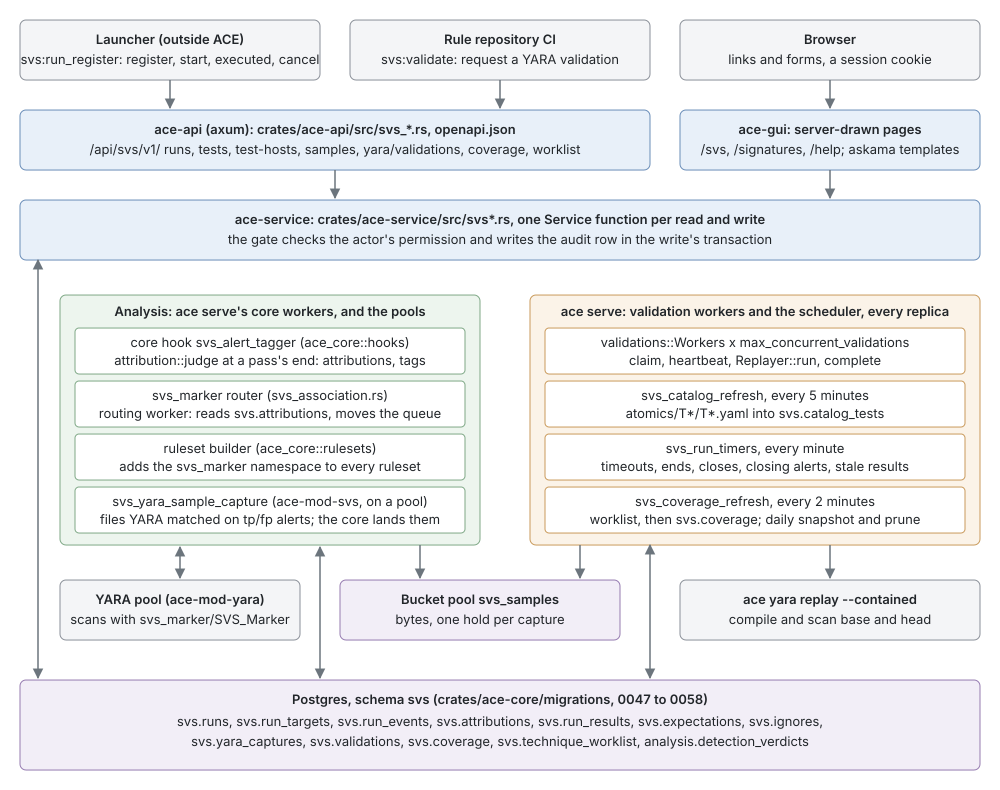
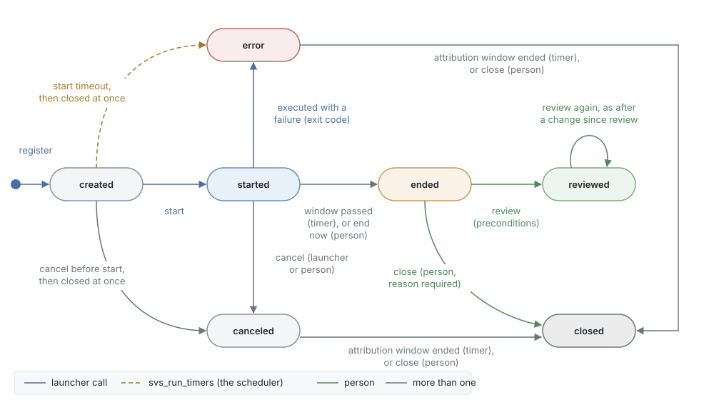
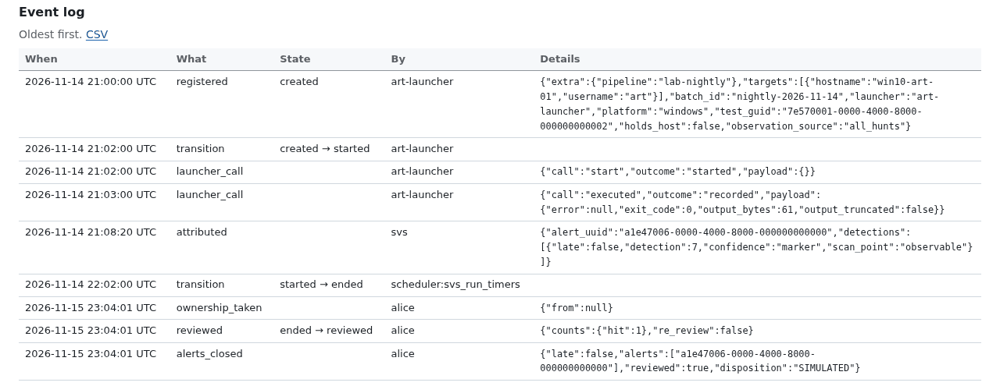
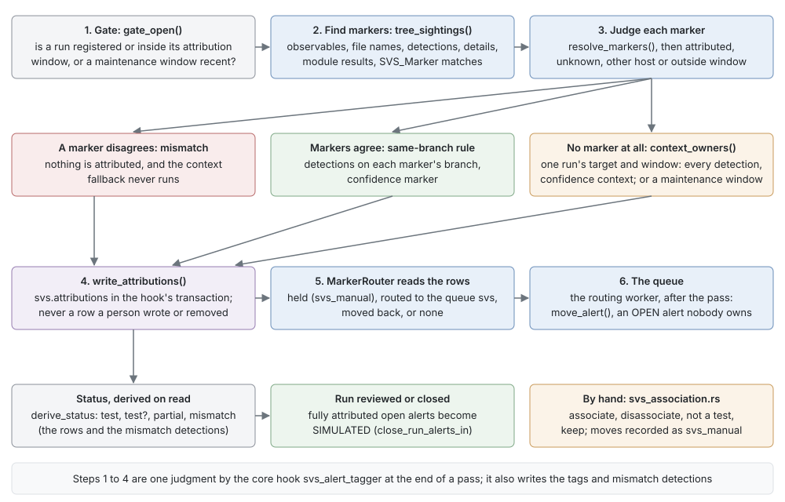
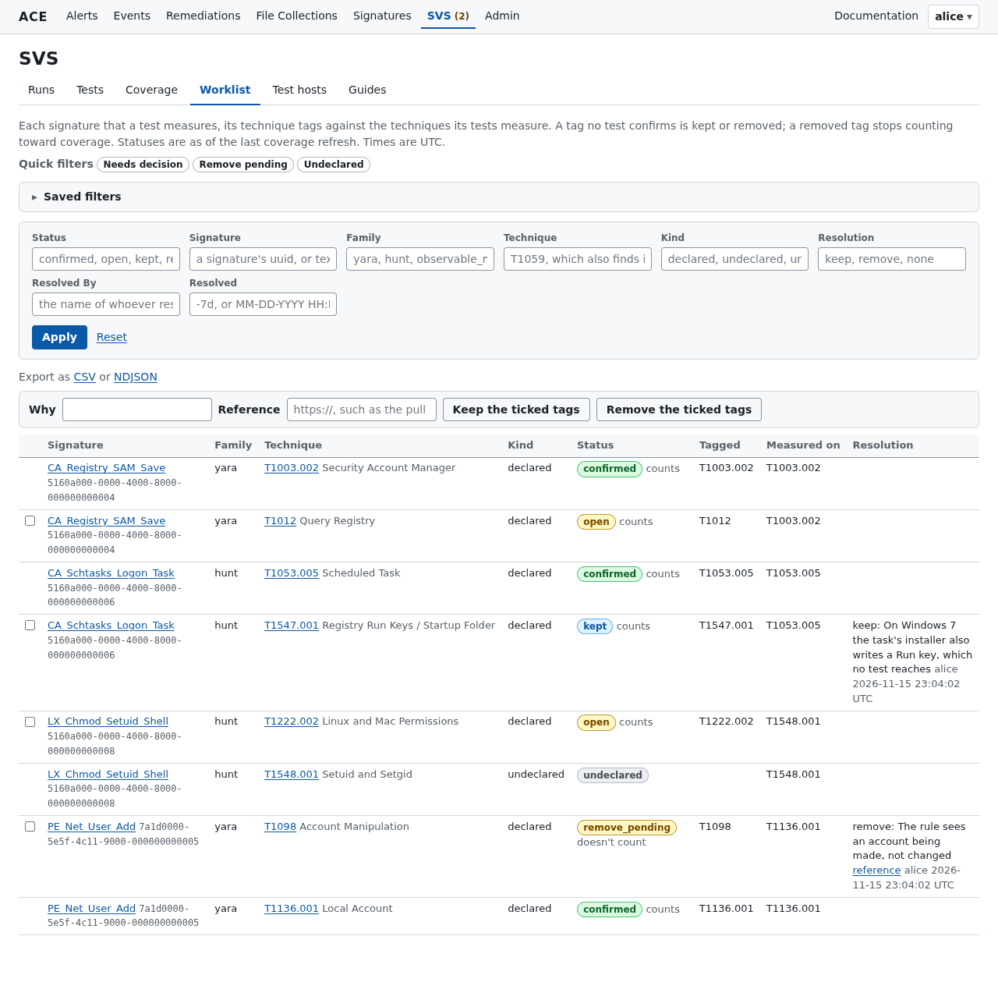
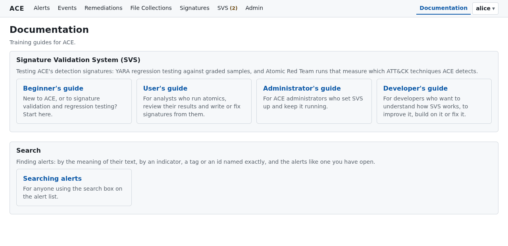

# SVS developer's guide

This guide is for developers who want to understand how the Signature Validation System (SVS) works, so
that they can improve it, build on it or fix it. You know Rust, sqlx, axum and askama; you may not know ACE
yet. The guide walks the code from the outside in: what the parts are, where each one lives, which rules
hold them together, and which files to touch for the common changes.

You will learn:

- where the design record is and how to read it;
- how a run, an alert, a sample and a validation flow through the core, the service, the API, the scheduler
  and the database;
- the rules that every SVS write follows (one service function per write, state changes under a row lock,
  derived state that is never stored);
- how the GUI, the API and the filter screens fit together;
- how to test a change and update these guides;
- what is still open.

If you have not used SVS yet, read the [Beginner's guide](beginners.md) first, and keep the
[User's guide](users.md) at hand for what each page does. ACE itself is described in `DESIGN.md` at the
repository root, and `PLAN.md` records what each step built.

## Where to start

SVS has a design record and module documentation. Read them before you change behavior: almost every rule
in the code has a recorded reason, and the comment next to it usually says what it is.

| Document | What it is |
|---|---|
| `PLAN.md`, step 7.10 | What was built, in nine batches: each batch's migration, modules, routes, pages, permissions and scheduled tasks, and where it departs from the design it was ported from. The paragraph *Who owns an event (#842)* after the list explains the largest departure. |
| `PLAN.md`, steps 6.7, 7.13 and 7.14 | The scheduler, alert routing and detection verdicts, which SVS builds on. |
| `DESIGN.md` | ACE's architecture: the core, the pools, the bucket, the service layer, the API and the GUI. |
| The module documentation | Every SVS module opens with a `//!` comment that states its contract, the tables it writes, its bounds and what differs from the original. `crates/ace-core/src/svs.rs` lists the modules. |
| `crates/ace-core/src/reads.md` | What a pool's module may read from the core and write back, including the capture module's `svs-capture-state` read and `svs-capture` write. |
| `crates/ace-api/openapi.json` | Every API route, payload and status, derived from the code and kept current by a test. |
| `crates/ace-core/migrations/0047_svs.sql` to `0058_svs_coverage.sql` | The schema, with a comment on each table and function. |

SVS was ported from ace3, and the code's comments name the ace3 function each piece came from. The original
design, with the decisions that the comments cite by ID (such as `FR-15`), is ace3's
[docs/SVS.md](https://github.com/ACE-Collective/ace3/blob/main/docs/SVS.md) and
[docs/SVS_REVIEW.md](https://github.com/ACE-Collective/ace3/blob/main/docs/SVS_REVIEW.md). Read them for
why a rule exists. For what the code does now, `PLAN.md` and the module documentation are the record.

How to read them:

1. Start with the vocabulary in the [Beginner's guide](beginners.md). The words (verdict, sample, label,
   run, marker, attribution, expectation) have exact meanings, and the code uses them the same way.
2. Read the batch of `PLAN.md` step 7.10 for the part you are changing, then the module documentation it
   names.
3. When a comment says "what differs from ace3", the difference was decided, not overlooked. Check the
   batch's text before you change it.
4. When a document and the code disagree, the code is what runs. Fix whichever is wrong, in the same
   change.

> [!NOTE]
> Read a module's `//!` comment before its code. It is kept current, and it is often the shortest correct
> description of the mechanism.

## Architecture

SVS is not a service with a single entry point. It is a hook in the core, a router, an analysis module, a
set of scheduled tasks, a group of API routes and a set of pages, all over one set of service functions
and one schema in Postgres.



The diagram shows who calls whom. In words, the main flows are:

1. **A test run.** A launcher outside ACE registers a run (`POST /api/svs/v1/runs`,
   `Service::register_svs_run`), gets its marker, starts it and runs the test.
2. **Alerts.** The telemetry reaches ACE as alerts through hunts and submissions. At the end of each
   analysis pass over an alert, the core's hook `svs_alert_tagger` judges it once and writes its
   attributions to `svs.attributions`, its tags and its mismatch detections. The routing worker then runs
   the `svs_marker` router, which reads those rows and moves the alert to the test queue.
3. **Ending and reviewing.** The scheduler's `svs_run_timers` ends the run when its observation window
   passes, or a person ends it early, and its result is computed. A person reviews it, which gives its
   alerts the disposition `SIMULATED`.
4. **Samples.** Each disposition queues the capture module again. On an alert whose disposition
   classifies as tp or fp, `SIMULATED` included, `svs_yara_sample_capture` keeps every YARA-matched file
   in the bucket's `svs_samples` pool.
5. **Validations.** A rule repository's CI requests a validation. A validation worker of `ace serve`
   replays every sample under the base and head commits in a contained process and stores the report.
6. **Coverage.** The scheduler's `svs_coverage_refresh` recomputes the worklist and then coverage, and
   `svs_coverage_snapshot` files a daily copy.
7. **Pages.** Every GUI page is drawn on the server from the same service functions the API calls.

Four properties hold across all of this, and most bugs come from breaking one of them:

- **State is derived on read wherever possible.** A detection's effective verdict, a sample's label, an
  alert's SVS status, a run's needs-attention flag and a test's state are never stored. Only decisions
  people make (overrides, expectations, ignores, resolutions) and facts that happened (attributions,
  events, captures) are rows.
- **Every state change is decided under a lock.** A run moves in one transaction that locks its row, checks
  the state it found and updates `WHERE id = $1 AND state = $2`. A validation and a scheduled task are
  claimed with `FOR UPDATE SKIP LOCKED`. A worklist row is resolved under the coverage refresh lock. A
  timer that fires twice, a racing launcher call or a second replica changes nothing.
- **One judgment per alert.** Who owns an event is decided by one function, `context_owners`, over the
  database, in its caller's transaction and with no cache. The hook and the hunter call it. Everything
  else reads `svs.attributions` and never judges again.
- **Every read and write is a service function.** The API and the GUI run no SQL. A function of
  `ace_service::Service` checks the actor's permission and, for a write, adds the audit row in the same
  transaction (`gate.read` and `gate.write`). A side step that may fail, such as closing a run's alerts
  after a review, runs in a savepoint, so its failure leaves the main step committed and retryable.

## Code map

### crates/ace-core/src/svs

The model: what SVS decides, and the writes the core itself makes. `svs.rs` holds the values every part
shares (`RunState`, `RunEventKind`, `AttributionConfidence`, `AttributionSource`, `SvsStatus` with
`derive_status`, the tags, the built-in signature uuids, `SVS_QUEUE` and the router's name and priority).

| File | What it holds |
|---|---|
| `attack.rs`, `attack/extract.rs` | The pinned ATT&CK release: `AttackCatalog`, `attack_catalog`, technique and platform normalization, and the builder of an extract. |
| `attribution.rs` | Who owns an event: `Event::derive`, `context_owners`, the gate, finding and judging markers, `evaluate`, `write_attributions`, the hook's `judge`, and `record_suppressed_matches` for the hunter. |
| `catalog.rs` | The Atomic Red Team catalog: reading `atomics/T*/T*.yaml` of a commit from SVS's mirror, with its bounds. |
| `coverage.rs` | Computing coverage rows from the tests' states, the `mitre:` tags and the release: `compute_rows`. |
| `hosts.rs` | Test hosts: normalization and matching a run's target against a host. |
| `log_search.rs` | The run page's link to the site's log search (`svs.log_search_url`). |
| `marker_rule.rs` | The built-in `SVS_Marker` YARA rule, as a built-in the ruleset builder adds. |
| `markers.rs` | The marker format: `new_marker`, `find_markers`, `find_markers_in_match`. |
| `results.rs` | A run's result without the database: each signature's status, the untracked built-ins, and `Precondition` (`If-Match`). |
| `runs.rs` | What a registration and a launcher's calls decide without the database: `RunsConfig`, a run's platform, `HostHolder`, whole-second times, the kept output, `TIMER_BATCH`. |
| `samples.rs` | A sample's label (`aggregate_label`), and how a capture lands: `prepare`, `land`, `lock_sample`. |
| `signatures.rs` | Signature names, families and `mitre:` tags, from the built-ins table, the recorded hunts and the ruleset's rules. |
| `test_state.rs` | A test's state per platform: `judge`, `WORST_FIRST`, `history`. |
| `validations.rs` | The validation queue and its workers: `request_validation`, `claim`, `heartbeat`, `complete`, `fail`, `release`, `fail_abandoned`, `corpus_version`, `engine_fingerprint`, `Workers`. |
| `windows.rs` | Observation and attribution windows, hunt latencies, and the hunts the hunter recorded (`recorded_hunts`). |
| `worklist.rs` | The declared-vs-measured worklist: `compute_worklist`, `derive_status`, `plan_refresh`. |
| `yara.rs` | `ValidationConfig`, built from the overlay's `svs.yara`. |

### crates/ace-core/src/svs/yara

| File | What it holds |
|---|---|
| `corpus.rs` | Reads every stored capture with its sample's label and writes the plaintext replay tree. |
| `diff.rs` | Compares base and head scans against the labels: `Category`, `categorize`, `diff`. |
| `layout.rs` | Which directory of a repository holds the namespaces the YARA pool loads. |
| `replay.rs` | `Replayer::run`: one validation, from fetch to diff. It writes nothing to the database. |
| `repository.rs` | `Mirror`: SVS's own bare clone of a repository, and exporting a commit from git's objects. |

### crates/ace-service/src

The service side: the database reads and writes, each a function of `Service` with its permission and its
audit row.

| File | What it holds |
|---|---|
| `svs.rs` | Test hosts, and an alert's SVS status: `alert_svs_statuses`, `alert_svs_view`. |
| `svs_samples.rs` | Listing samples, and the actions on one: relabel, reset, confirm, retire, unretire, delete, download. |
| `svs_validations.rs` | Requesting a validation, its status, the list, the report and its rows, the download and the prune. |
| `svs_catalog.rs` | The tests list, one test, the repositories' status and the catalog refresh. |
| `svs_runs.rs` | Registration, the launcher's calls, `transition`, `add_event`, one run per host, refusals, maintenance windows and `run_svs_timers`. |
| `svs_results.rs` | Computing a run's result, the stale flag and generation, and the review's `sign_off`. |
| `svs_decisions.rs` | Expectations, ignores and a test's settings. |
| `svs_run_reads.rs` | The runs list and its filters (`run_filter`), batches, the event, result and attribution feeds, a run's results, history, alerts and comments, and the suppression share. |
| `svs_association.rs` | `MarkerRouter`, closing a run's and a maintenance window's alerts, and a person's associate, disassociate, not a test and keep. |
| `svs_review.rs` | A person's take, cancel, end and close of runs, and `review_svs_run` with `ReviewBlockers`. |
| `svs_test_state.rs` | `evaluate_tests` and `catalog_histories`: a test's state and run history for any number of tests. |
| `svs_coverage.rs` | The coverage refresh, its lock (`lock_refresh`), the snapshots and the coverage reads. |
| `svs_worklist.rs` | The worklist's refresh, its resolutions and its reads. |
| `filters.rs` | The filter model and every screen's filters (`FilterScreen::SvsRuns`, `SvsTests`, `SvsCoverage`, `SvsCoverageHistory`, `SvsWorklist`, `SvsSamples`, `SvsValidations`). |
| `permission.rs` | `CATALOG`: every permission, with the `svs:*` ones. |
| `routing.rs` | Alert routing: the `Router` trait, the routing worker and `move_alert`, which the marker router plugs into. |
| `detection_verdicts.rs` | Detection verdicts: `effective_verdict` and the verdict writes. |

### Everything else

| Path | What it holds |
|---|---|
| `crates/ace-core/src/hooks.rs` | The core's hooks task, which runs `svs_alert_tagger` at the end of a pass, and the gate check before the task is queued. |
| `crates/ace-core/src/rulesets.rs` | The ruleset builder, which adds the marker rule's namespace to every ruleset. |
| `crates/ace-mod-svs` | The analysis module `svs_yara_sample_capture`. |
| `crates/ace-yara/src/replay.rs` | The replay child: compiles one commit's rules and scans the replayed samples. |
| `crates/ace-yara/src/ruleset.rs`, `source.rs` | `BuiltIn` namespaces and `RuleSignature`, and each rule's uuid and content hash read with yara-x's parser. |
| `crates/ace-sdk/src/overlay.rs` | The site overlay's `svs:` section: `SvsSection`, `SvsYaraSection`, `SvsCatalogSection`, `SvsRunsSection`. |
| `crates/ace-app/src/svs.rs` | `ace svs yara validate`, `layout` and `prune`, `ace svs catalog refresh` and `status`, `ace svs coverage refresh`, `status` and `snapshot`, and `ace svs attack extract`. |
| `crates/ace-app/src/scheduler.rs` | The scheduled tasks, SVS's five among them. |
| `crates/ace-app/src/serve.rs` | `ace serve`: reads the overlay, builds the service, and starts the hooks worker, the routing worker, the scheduler and the validation workers. |
| `crates/ace-app/src/hunter.rs` | `ace hunter`, which records each hunt's latency for the windows and asks who owns a match. |
| `crates/ace-api/src/svs_*.rs` | The API's routes, one file per resource, with the request and response types. `lib.rs` mounts them and `export.rs` streams the exports. |
| `crates/ace-gui/src/svs.rs` | The SVS area's Runs tab, the run page, the bulk actions and the Test hosts tab. |
| `crates/ace-gui/src/svs_coverage.rs` | The Tests, Coverage and Worklist tabs. |
| `crates/ace-gui/src/svs_samples.rs`, `svs_validations.rs` | The Signatures area's Samples and Validations pages. |
| `crates/ace-gui/src/svs_alert.rs` | The alert page's SVS banner and the form that gives an alert back. |
| `crates/ace-gui/src/help.rs`, `crates/ace-gui/help/` | The Documentation area that serves these guides. |
| `crates/ace-gui/templates/svs/`, `templates/signatures/`, `templates/alert_svs.html` | The askama templates. |
| `crates/ace-core/data/attack/` | The ATT&CK extracts built into the binary, with MITRE's terms in `NOTICE`. |
| `crates/ace-core/migrations/` | The schema: `0047` to `0058`. |

## Data model

SVS's tables are in the Postgres schema `svs`. Each is created by one migration, and the comment above it
names the module that writes it. Keep that true when you add a writer, because a table's rules (lock
order, conditional updates, what is logged and audited) live in that module.

| Part | Table | One line |
|---|---|---|
| Labels | `analysis.detection_verdicts` | An analyst's explicit TP or FP override on one detection, keyed on the detection's row id (migration 0046). |
| Labels | `analysis.detection_verdict_history` | Append-only record of every change to a stored override. |
| Samples | `svs.yara_captures` | One row per alert, file sha256 and rule uuid: the file, the match record and the scan context. |
| Samples | `svs.sample_retirements` | A sample retired for its rule; unretiring is soft. |
| Samples | `svs.sample_deletions` | The record of a deleted file; while it exists, capture never stores the sha256 again. |
| Validation | `svs.validations` | A validation request, its lease, its state and its report. |
| Validation | `svs.validation_results` | One listed sample and rule uuid outcome with its category and the label it had. |
| Runs | `svs.test_hosts` | The hosts a run may target. A table, not settings, so adding one needs no restart. |
| Runs | `svs.catalog_repositories`, `svs.catalog_tests` | The catalog repositories with the commit last read, and the tests by their `auto_generated_guid`. |
| Runs | `svs.runs`, `svs.run_targets` | Runs with their lifecycle timestamps, marker, windows, warnings, owner and reviewer; their targets. |
| Runs | `svs.run_events` | The append-only event log of each run. A trigger refuses an update. |
| Runs | `svs.maintenance_windows`, `svs.maintenance_alerts` | A test host's maintenance windows, and the alerts judged to belong to one. |
| Runs | `svs.registration_refusals` | Refused registrations per caller, host and hour. |
| Runs | `svs.attributions` | One attributed detection: run, alert (`root_id`), detection (`detection_id`), confidence, late, source, scan point, removal and keep. |
| Runs | `svs.suppressed_matches` | The matches a hunt dropped during a run, for its `group_by` suppression or as a duplicate. |
| Runs | `svs.run_comments` | Comments on a run. |
| Runs | `svs.expectations`, `svs.ignores`, `svs.test_settings` | Decisions about a test's signatures per platform, ignores (global or per test), and a test's observation window override and whether it holds its host. |
| Runs | `svs.run_results`, `svs.run_result_state` | One row per run and signature, live and as reviewed; and the run's stale flag and generation. |
| Runs | `analysis.queue_changes` (core) | Every queue move, with the router that made it; `svs_manual` marks a person's move through SVS. |
| Coverage | `svs.coverage`, `svs.coverage_state` | One row per technique and platform; and the single refresh lock row. |
| Coverage | `svs.coverage_snapshots` | The daily copy of `svs.coverage`. |
| Coverage | `svs.technique_worklist` | One row per signature and technique of a measured signature; only the resolution is a decision. |

The migrations also add columns outside the schema: `hunts.hunts.svs` (what SVS reads of each hunt),
`yara.rulesets.signatures` and `built_ins` (each rule with a `uuid` meta, and which built-in namespaces a
ruleset holds), and on `analysis.roots` the `tags`, `owner_id`, `owned_at` and `svs_gate_extra_seconds`
columns.

Several rules exist once, as SQL functions, so every query shares one definition:

| Function | What it decides |
|---|---|
| `svs.unreviewed_run(root)` | The alert is attributed to a run that is not reviewed. |
| `svs.fully_attributed(root)` | Every detection of the alert has an attribution that holds. |
| `svs.run_needs_attention(run)` | The run is in the Needs attention view. |
| `svs.run_matches(run, filters)` | The runs screen's filters, for the list, the count, the batches and the feeds. |
| `svs.coverage_matches`, `svs.coverage_snapshot_matches`, `svs.worklist_matches` | The coverage, coverage history and worklist screens' filters. |
| `svs.samples(tp, fp, through)`, `svs.sample_label`, `svs.sample_label_source` | The samples with their labels. |
| `analysis.detection_verdict`, `analysis.detection_verdict_source` | A detection's effective verdict and its source. |

Two keys need care. An attribution names its alert by the root's id and its detection by
`analysis.detections.id`, and both cascade: an attribution goes with its alert. A verdict is keyed on the
same detection id, so two detections that look alike on one observable are two rows with two verdicts.

> [!IMPORTANT]
> A migration is a new SQL file in `crates/ace-core/migrations/`, numbered after the last one. Never edit a
> migration that was committed: to change a function, a later migration replaces it. sqlx checks every
> query against the migrated schema when the code compiles, from the offline data in `.sqlx/`. After you
> change a migration or a query, run `cargo sqlx migrate run` and `cargo sqlx prepare --workspace` in the
> dev container and commit what changed in `.sqlx/`.

A new permission is an entry in `CATALOG` in `crates/ace-service/src/permission.rs`. A permission that
only one of ACE's components holds, such as `svs:run_timers`, is granted to it by the migration that
brings the task: `0058_svs_coverage.sql` ends with the grants of `scheduler:svs_coverage_refresh` and
`scheduler:svs_coverage_snapshot`.

Every SVS table has `updated_at`, set by the `svs.touch()` trigger on every change, because
`changed_since` pulls page on `(updated_at, id)`. `svs.run_events` has one too, so the event feed can be
pulled incrementally. Its rows are appended by `add_event` in `svs_runs.rs`, which the service's modules
call, and by the hook's own `add_event` in `attribution.rs`.

## Labels and verdicts

Each detection is graded TP or FP. Only explicit overrides are stored; everything else is derived when
read. The rule exists twice: as `effective_verdict` in `crates/ace-service/src/detection_verdicts.rs` and
as the SQL functions `analysis.detection_verdict` and `analysis.detection_verdict_source`. The test
`sql_agrees_with_rust` in `crates/ace-service/tests/service.rs` holds the two together:

```text
effective(detection) =
    NULL                    if class(alert.disposition) is unclassified
    NULL                    if the alert is attributed to a test run that is not Reviewed
    FP   inherited_single   if class(alert.disposition) == fp      # overrides are masked
    override  explicit      if an override row exists              # tp alerts only
    TP   inherited_single   if the alert has detections from one signature only
    TP   inherited_multi    otherwise
```

- The disposition class comes from the site overlay's `disposition_classification:`, held by the service
  as `Dispositions`. `SIMULATED` is tp.
- The unreviewed-run rule is `svs.unreviewed_run`: an attribution that holds to a run whose state is not
  `reviewed`. Every query passes it to the verdict functions. It is what makes closing a run teach
  nothing, even though closing gives the alerts `SIMULATED`.
- The verdict sources are `explicit`, `inherited_single` and `inherited_multi`. `inherited_multi` is the
  weakest: a TP inherited on an alert where several signatures fired, which nobody confirmed.
- Writes go through `set_detection_verdict`, `clear_detection_verdict` and `set_detection_verdicts`,
  which accept an override only on a tp alert whose disposition analysts can set, and record each change
  in the history in the same transaction. A review uses `write_verdicts_as` to give ignored detections
  FP in the reviewer's name without that check.

A sample's **label** for a rule aggregates the effective verdicts of its contributing detections: on each
alert a capture of the pair came from, the detections of that rule on the file observable with that
sha256. The strongest source that has any vote decides (`explicit`, then `inherited_single`, then
`inherited_multi`). Disagreement at that strength is `conflicted`, and the newest vote never silently
wins. `crates/ace-core/src/svs/samples.rs` holds the rule as `aggregate_label`, and migration 0048 holds
it as `svs.sample_label`, `svs.sample_label_source` and `svs.contributing_detections`, which `svs.samples`
uses. The test `sql_agrees_with_rust_over_the_whole_corpus` checks that they agree. If you need the
verdict or the label anywhere, call these functions; do not restate the rule.

## Sample capture

The module `svs_yara_sample_capture` (`crates/ace-mod-svs`) is a lookup module on each file of a
dispositioned root. Each disposition queues it again (`Orchestrator::stop_for_disposition`). It stores no
result and leaves the tree as it is.

1. It reads what it needs of the database through its `svs-capture-state` read: the alert's disposition
   class and whether an unreviewed run holds the alert. An unclassified alert, or one attributed to a run
   that is not reviewed, is skipped.
2. It lists one candidate per rule uuid: a YARA detection on the file, with the match from the file's
   YARA result. A rule without a uuid, or with one longer than 36 characters, is not captured.
3. It hands the candidates to the core as its `svs-capture` write, which lands with the task's end.
   `samples::prepare` reads the file's bytes before the end's transaction, and `samples::land` writes the
   captures in it: the bytes copied into the pool with a hold named after the capture row
   (`capture_hold`), and the `svs.yara_captures` row with its match record.
4. `land` checks `svs.sample_deletions` under the sample's advisory lock (`lock_sample`), which a
   deletion takes too. A capture that races a deletion writes nothing.

Why it is shaped this way:

- **Idempotent on the unique key.** The module runs again on each disposition. A stored row is left
  alone; a `missing` row is tried again on the alert's next disposition.
- **One transaction.** The capture lands in the transaction that ends the task, so there is no pending
  row and nothing to undo. A capture whose bytes cannot be had keeps its row as `missing`, with the reason
  `file` or `storage`, and is counted per rule.
- **Labels are never stored.** A relabel writes verdict overrides on the contributing detections
  (`relabel_svs_sample`), a reset clears them, a confirm upgrades inherited votes to explicit. The label
  changes because its inputs did.
- **Deleting is a purge.** `delete_svs_sample` removes the captures for every rule and their retirements,
  records `svs.sample_deletions`, and purges the bytes from the pool whatever holds them. A purge that
  does not finish leaves `purged_at` empty and is retried when the sample is deleted again.

The pool is the bucket's `svs_samples` pool (`samples::SVS_SAMPLES`). The bucket is shared by every
replica, so a capture made through any pool is readable by every validation worker.

## YARA validation

Validation replays the whole corpus under the whole base ruleset and the whole head ruleset, and compares
the results per sample and rule uuid against the labels.

**The queue** (`crates/ace-core/src/svs/validations.rs`). `request_validation` returns, in order: a
validation queued or running for the same repository, base and head (`active_key`); a completed one whose
`corpus_version` and `engine_fingerprint` are both still current; or a new queued row. A failed
validation is never reused.

- `corpus_version` digests the greatest change time and the row count of every input: the stored
  captures, the verdict history, the retirements, the deletions, the captures' alerts and the test runs
  they are attributed to. The counts are there because a cleared verdict or a deleted alert bumps no
  change time.
- `engine_fingerprint` digests the replay's code (`ace_yara::replay::engine_digest` and the comparison),
  how dispositions classify, the per-file scan timeout and which directory of the repository is loaded.
  Any change to the replay code rescans.
- `claim` takes the oldest queued validation, or a running one whose lease expired with attempts left,
  with one conditional update under `FOR UPDATE SKIP LOCKED`. Lease times come from the database's clock,
  never the worker's.
- `heartbeat` extends the lease while the claim still holds. `release` requeues without counting the
  attempt, because a shutdown is not the validation's fault. `fail_abandoned` fails a validation that was
  claimed `max_attempts` times without finishing. `complete` stores the report and its rows in one
  transaction and refuses when another worker took over.

**The replay** (`crates/ace-core/src/svs/yara/replay.rs`, `Replayer::run`):

1. `repository::Mirror` fetches the branch into SVS's own bare clone under `svs.yara.mirror_dir` and
   exports each commit from git's objects, regular files only. It is never the checkout the ruleset build
   reads, so a validation cannot change what production scans.
2. `layout` says which directory of the repository holds the namespaces: the repository's
   `signature_dir` in `svs.yara.repositories`, `yara` by default.
3. `corpus::read_corpus` reads every stored capture with its sample's label in one repeatable-read
   transaction, and `write_units` copies each distinct sha256, file path and tag set out of the bucket
   into the working directory. A second unit of the same bytes is a hard link to the first copy.
4. The replay child runs once per commit: this binary again, as `ace yara replay --contained`, with one
   thread, no network, reading only the working directory and writing only its side's directory, its CPU
   time and memory held, and killed at `scan_timeout_seconds` or when the validation is cancelled. It
   compiles each file on its own, drops a file that fails, then compiles the survivors per namespace, as
   the ruleset build does (`crates/ace-yara/src/replay.rs`).
5. Rules are read from source for their uuids and content hashes (`ace_yara::source`, on yara-x's
   parser), and `diff::diff` categorizes every pair.

The categories (`diff::Category`) are `regression`, `regression_unconfirmed` (a regression on an
`inherited_multi` label), `new_fp`, `new_fp_other_rule`, `rule_removed`, `scan_error`, `recovered`,
`improvement`, `already_broken`, `new_match_real_hit`, `unlabeled_change`, and the counted-only
`known_fp`, `retired`, `not_testable` and `unchanged`. A *match* means the rule would make a detection:
it matched, it is enabled, and its modifiers include neither `qa` nor `no_alert`. A side that could not
scan the file is a `scan_error`, never a miss.

The bounds fail the validation instead of reporting on part of the corpus: `max_corpus_files`,
`max_corpus_bytes`, `max_archive_bytes`, `max_archive_members`, `fetch_timeout_seconds` and
`scan_memory_mb`, all under `svs.yara`.

> [!CAUTION]
> The working directory holds every sample in plaintext while a validation runs, and is deleted when the
> replay ends. The contained process is the boundary between a pull request's rules and the host. Never
> widen what it may read, write or reach to make a replay work.

`ace svs yara validate` runs the same replay from the command line, stores nothing and prints the report.
`ace svs yara layout` prints the directory each configured repository loads.

## Test runs

A run is one registered execution of one catalog test against one or more test hosts, with its own marker
and lifecycle.



The transitions are in `crates/ace-service/src/svs_runs.rs` (launcher calls and timers) and
`svs_review.rs` (people). The launcher's routes are under `/api/svs/v1`:

| From | To | Trigger | Function |
|---|---|---|---|
| (none) | created | `POST /runs` | `register_svs_run` |
| created | started | `POST /runs/{run_id}/start` | `start_svs_run` |
| started | error | `POST /runs/{run_id}/executed` with a non-zero exit code or an error | `svs_run_executed` |
| created, started | canceled | `POST /runs/{run_id}/cancel`, or a person | `cancel_svs_run`, `cancel_svs_runs` |
| canceled | closed | in the same transaction, when canceled before start | `cancel_svs_run`, `cancel_svs_runs` |
| created | error, then closed | `svs.runs.start_timeout_minutes` passed | `run_svs_timers` |
| started | ended | `observation_ends_at` passed, or a person ends it now with a reason | `run_svs_timers`, `end_svs_run`, `end_svs_runs` |
| canceled, error | closed | `attribution_ends_at` passed (or it never started) | `run_svs_timers` |
| ended, canceled, error | closed | a person; a reason is required on an ended run | `close_svs_runs` |
| ended, reviewed | reviewed | a person signs off, or signs off again | `review_svs_run` |

`executed` with exit code 0 and no error records the call and the exit code but changes no state.
`POST /runs/{run_id}/cleanup` records when the test's cleanup began. `POST /runs/validate` decides a
registration as registering would and only reads.

**Transitions name their from-state.** Each change is one transaction. It locks the run's row
(`locked_run`), checks the state it found, and calls `transition(conn, run, from, to, ...)`, which
updates `WHERE id = $1 AND state = $2` and appends a `transition` event. A transition that matches no row
returns `false` and changes nothing, so a timer that fires twice, or a launcher call racing a timer,
moves the run once. A launcher call that does not apply is answered 409 and is still recorded as a
`launcher_call` event with the outcome `conflict`.

**Markers** (`crates/ace-core/src/svs/markers.rs`). A marker is `svs-` followed by 26 base32 characters
(128 random bits), stored lower case. `find_markers` is case-insensitive and rejects a candidate with a
letter or digit right before or after it, so a marker inside a longer token is not found. A marker is not
a secret; it only attributes when the alert agrees with its run (next section).

**Windows** (`crates/ace-core/src/svs/windows.rs`). The observation window is the worst-case latency of
the slowest expected signature plus `slack_minutes`, clamped to `floor_minutes` and `ceiling_hours`
(`svs.runs.observation_window`). A hunt's latency is `frequency + time_range + offset` (`hunt_latency`,
with `cron_interval` for cron frequencies); every other signature fires while the alert is analyzed and
counts as zero. A test with no expectations yet uses the slowest enabled hunt, and an override in
`svs.test_settings` replaces the computation. `ObservationSource` says where the window came from:
`override`, `expected` or `all_hunts`. The attribution window is the observation window plus
`attribution_extra_hours`. Both are fixed at registration and stored as seconds. Starting a run stores
`observation_ends_at` and `attribution_ends_at`, from the whole second (`whole_second`), because an
event's time often is a whole second. A person's early end is the one thing that moves a window
afterwards: it sets `observation_ends_at` to the end and leaves `attribution_ends_at` alone.

Only `ace hunter` knows where the hunts are. It records what SVS reads of each hunt file in
`hunts.hunts.svs` each time it loads its hunts, and a registration reads those rows in its own
transaction (`recorded_hunts`). Until a hunter has recorded its hunts, a window is the floor, and the
registration says so in `warnings`, which is kept on the run.

**Timers** (`run_svs_timers`, the scheduler's `svs_run_timers`, every minute). Each pass: times out
created runs, ends started runs, closes canceled and error runs whose attribution window passed, expires
maintenance windows, closes late alerts of closed runs and the alerts of maintenance windows, prunes old
refusal rows, and recomputes stale results. Each kind of move reads at most `TIMER_BATCH` (500) rows and
moves each in its own transaction. A move that fails is logged and counted, and the next pass tries it
again.

**Closing a run's alerts** (`close_run_alerts_in` in `svs_association.rs`). The run's alerts that are
open, owned by nobody, and fully attributed get `SIMULATED`. Full attribution is checked again under the
alert's lock, which a disassociation takes too. The write is `Service::disposition`'s own writer
(`disposition_in`), so the capture module is queued again. `SIMULATED` is a disposition only ACE sets:
the timers close as their own component, a person's close and a review as the component `svs`, with the
person named in the run's `alerts_closed` event and the audit row. A launcher's cancel before start
closes the run at once, and the next timer pass closes its alerts, within a minute. A maintenance
window's alerts get `IGNORE` the same way.

**Run events.** Every change appends a row to `svs.run_events`. The kinds are `RunEventKind` in
`crates/ace-core/src/svs.rs`: `registered`, `transition`, `launcher_call`, `attributed`,
`attribution_removed`, `alerts_closed`, `result_computed`, `candidate_decision`, `associated`,
`disassociated`, `context_kept`, `ownership_taken` and `reviewed`. The event log is the run's change feed
(`GET /api/svs/v1/runs/events`) and its history on the run page, which lists each event's time, kind,
states, actor and details, oldest first.



**One run per test host** (`host_holders`). A run holds its targets' test hosts from registration until
it starts, times out or is canceled, and once started, until its claim ends: the observation window, or
the attribution window when the run holds its host (copied from the test's settings at registration). An
open maintenance window holds its host too. `register_svs_run`, `start_svs_run` and
`open_svs_maintenance` lock the hosts' `svs.test_hosts` rows in id order (`lock_hosts`), then look for
holders, and answer 409 when a host is held. `validate_svs_run` reports the same as `host_busy`.

**Registration refusals.** A target that is not a test host, or a user the host does not list, is refused
with 403. `refuse` inserts a row per caller, host and hour into `svs.registration_refusals`; only the
call whose insert succeeds makes the alert, in a savepoint of the same transaction, with a detection of
the built-in signature `REGISTRATION_REFUSED_SIGNATURE` on the refused host's observable. The SVS
built-ins (`RUN_SIGNATURES`) are never attributed or counted in a result, which keeps a refusal alert
out of the test queue even while a run is live on that host.

## Attribution and routing

Attribution decides which detections of an alert belong to which run. Routing decides which queue the
alert is in. They are separate steps: the hook attributes, and the router reads what it wrote.



### Where it runs

- **The hook.** `svs_alert_tagger` is a core hook (`crates/ace-core/src/hooks.rs`), in the modes that
  list it. When an alert's pass has nothing left to run, the hooks task calls
  `attribution::judge(root)` once, in its transaction. `judge` writes the attributions, the root's tags
  `svs_test`, `svs:marker_mismatch` and `svs:maintenance`, a root detection for each marker that
  disagrees, and the alert's maintenance record.
- **The gate before the task.** In a mode whose only hook is `svs_alert_tagger`, `queue::check_completion`
  queues the hooks task only while the gate is open (`gate_open`). A pass with nothing registered queues
  none.
- **In file contents.** The ruleset builder adds the `SVS_Marker` rule (`modifiers = "no_alert"`) to
  every ruleset as the namespace `svs_marker` (`marker_rule::BUILT_IN`). Its matches land in the file's
  YARA result, where `judge` reads them as `file_contents` sightings.
- **The router.** After the pass, the routing worker (`ace_service::routing`) runs the routers in
  priority order and the first decision wins. `MarkerRouter` is `svs_marker` at priority 100, ahead of
  the built-in `detection_queue` at 500. Every binary's `App` adds it. A decision moves the alert through
  `move_alert`, and only while it is `OPEN` and nobody owns it.
- **The hunter.** `Service::record_hunt_run` asks `context_owners` who owns each match of a hunt run, in
  its transaction. It keys a grouped hunt's suppression by the run or window that owns a match, and
  records the matches the hunt dropped in `svs.suppressed_matches`.

### How an alert is judged

`attribution::evaluate` reads the database and writes nothing:

1. **The gate.** `gate_open` asks one question: is any run registered or inside its attribution window,
   or was a maintenance window open within `attribution_extra_hours`? Nothing is cached. The read takes a
   Postgres advisory lock shared; registering a run and opening a maintenance window take it exclusive
   before they insert (`lock_gate_to_open`). So a pass that ends beside a registration either sees the
   run, or committed before the run existed.
2. **Sightings.** `tree_sightings` collects markers from observable values and file names, from
   detections' descriptions and details, from the root's details, and from the details of the modules'
   results, read at the end of the pass. Each sighting records its node: the observable it was on, or
   none for the root.
3. **Judgement.** `resolve_markers` maps markers to runs. Each marker is then `attributed`, `unknown`,
   `other host` (the alert involves none of the run's targets) or `outside window` (judged on the event's
   time). `Event::derive` is the one place an event's hosts and time come from.
4. **Mismatch ends it.** If any marker disagrees, the status is `mismatch` and nothing is attributed, not
   even by context. Otherwise an alert carrying run A's marker outside A's window could be attributed by
   context to run B on the same target.
5. **Markers that agree** attribute by the same-branch rule: a detection is attributed when its node and
   the marker's node are on one branch of the tree, meaning one of them is the root, they are the same
   observable, or one is above the other. Confidence is `marker`.
6. **No marker at all** falls back to context: the runs whose window covers the event time and whose
   targets the alert involves. `context_claimant` picks the run: the only candidate, or the one that
   started last when every other candidate's claim on the host ended before it started. Every detection
   is attributed to it with confidence `context`. When the claims overlap, nothing is attributed and a
   warning names every candidate run. An event inside a test host's maintenance window belongs to the
   window, and no run owns it.
7. A run a person disassociated the alert from is never attributed it again, and attributions a person
   wrote or removed are left alone.

The work is bounded, because an alert's tree is hostile input: at most 1,000 rows of each kind that hold
marker-shaped text, 200 markers from module output, 256 markers judged, 256 hosts an event, 500 runs and
500 windows considered, and a root over 10,000 detections is not judged. The constants are at the top of
`attribution.rs`.

The status is `derive_status` in `crates/ace-core/src/svs.rs`: none attributed is no status, some is
`partial`, all is `test`, or `test?` when context is all there is. `svs.fully_attributed` is the same
rule in SQL. A mismatch is read from the alert's mismatch detections, which are never taken back.

### Writing and routing

`write_attributions` brings the hook's rows in line with the evaluation, in the hook's transaction. It
locks the involved runs in id order first, so two alerts of one run wait their turn; `Db::transaction`
retries the whole transaction when Postgres picks it as a deadlock victim. It inserts new rows, marks
rows that no longer hold as removed (keeping them), changes a row only while it is still the hook's,
appends `attributed` and `attribution_removed` events, flags a reviewed run `changed_since_review`, and
marks every touched run's result stale. It judges `late` by the run's row as it locks it.

`MarkerRouter` then decides, from `svs.attributions` and `svs.maintenance_alerts`:

- **held (manual)**: the alert's latest queue move was made by a person through SVS (the router name in
  `analysis.queue_changes` is `svs_manual`). The router returns the alert's current queue, which also
  stops any later router from moving it.
- **routed**: every detection is attributed, or the alert belongs to a maintenance window; the decision
  is the test queue, `svs` (`SVS_QUEUE`, a constant).
- **moved back**: an alert this router put in the test queue that no longer qualifies goes back to the
  queue it came from.
- **none**: partial, mismatch or nothing; the next router decides.

### After routing

- Closing or reviewing a run gives its fully attributed open alerts `SIMULATED` (previous section). A
  `partial` alert stays in its queue and keeps the run in *Needs attention*.
- `Service::change_svs_association` (`svs:run_manage`) is the person's side. *Associate* writes `manual`
  attributions for every detection, as certain as a marker, and moves the alert to the test queue when it
  is now fully attributed. *Disassociate* removes the attributions, moves the alert back to its previous
  queue and reopens a `SIMULATED` alert as `OPEN`. *Not a test* is the same for an alert held by context
  alone. *Keep* confirms context attributions, which review requires. Each locks the runs in id order and
  then the alert, records its move with the router name `svs_manual`, and writes an audit row.
  `Service::release_alert_from_svs` (`alert:write`) is the alert page's version, over every run that
  holds the alert.

> [!WARNING]
> Keep the judgment in one place. If you need to know whether an alert is a test alert, read
> `svs.attributions` or call `svs.fully_attributed`. Do not call `evaluate` from a router, a page or a
> report, and do not cache its answer: two judgments made at different moments can disagree.

## Results, expectations and test state

**Results** (`crates/ace-core/src/svs/results.rs`, `crates/ace-service/src/svs_results.rs`). A run's
result is one `svs.run_results` row per signature. What fired is the run's attributions that hold, by the
signature of each attributed detection, minus the untracked signatures (the generic, legacy, uuid-less
YARA and flagged-observable built-ins, plus the SVS built-ins). Each fired signature is `ignored`, `hit`,
`rejected` or `candidate`, in that precedence. A signature that fired only in the test's cleanup is
`cleanup`. Each expected signature that did not fire is `missing`, or `possibly_suppressed` when it is a
hunt that the hunter recorded dropping a match of during the run, or a hunt that alerted within its
suppression period before the window closed. `compute` writes only what changed; a signature that left
the live result keeps its row only while it holds a reviewed status.

**Stale and generation.** Anything that changes what a result would be marks the run stale in its own
transaction: attribution writes, a run ending, an expectation or ignore decision. Marking bumps
`generation` and sets `stale` in `svs.run_result_state`, in run id order so concurrent writers lock in
the same order. A computation reads the generation before it reads anything else and clears `stale` only
if the generation is unchanged when it finishes, so a change that lands mid-computation leaves the run
stale for the next timer pass. A result is computed as its run ends, and the timers recompute up to
`RECOMPUTE_BATCH` (200) stale results a pass.

**Expectations** (`crates/ace-service/src/svs_decisions.rs`). Decisions are per test and platform:
`expected` or `rejected` (never proposed again). A candidate is not a row: it is a status of a run's
result, so nothing goes stale when a decision is removed. Ignores are per test (on every platform,
`svs:run_manage`) or global (`svs:admin`); an ignored signature is never a candidate and never missing.
Every change marks the affected runs stale, appends `candidate_decision` where a run is named, and
writes an audit row. Who decided is the actor, so an API key that belongs to no user may decide. Writes
accept a `Precondition` (see *The API*).

**Review** (`review_svs_run` in `svs_review.rs`). What stands in the way of a review is an outcome, not
an error: another person's ownership, the run's state, or its blockers. Then, in one transaction:

1. it checks the state is `ended` or `reviewed`;
2. it checks `ReviewBlockers`: the result is not stale (and was computed at all), no signature is a
   `candidate`, and every context attribution was kept or marked not a test. A run that was never
   computed is marked stale so the next timer pass computes it;
3. `sign_off` sets the reviewer and the time, takes the run when nobody owns it, and clears
   `changed_since_review`;
4. it copies the live columns of `svs.run_results` into the `reviewed_*` columns, the result as signed
   off;
5. it appends a `reviewed` event with the counts;
6. in a savepoint, it closes the run's alerts as `SIMULATED` and gives the detections of ignored
   signatures that have no verdict an FP verdict in the reviewer's name.

A failure in step 6 never undoes the sign-off: the alerts stay open, the run stays in *Needs attention*,
and reviewing again finishes the job.

**A person's actions** (`take_svs_runs`, `cancel_svs_runs`, `end_svs_runs`, `close_svs_runs`). Each takes
up to 500 runs and answers for each one: done, left alone for its owner, a conflict with why, or unknown.
Each run is its own transaction and audit row. A run someone else owns is left alone unless the caller
names its owner in `confirmed_takes`. Only a person may act: a user's session or key. A key that belongs
to no user is refused.

**Test state** (`crates/ace-core/src/svs/test_state.rs`). Nothing here is stored. `judge` evaluates a
test on one platform from its latest reviewed run there, as signed off: `awaiting_review`,
`no_expectations`, `failing` (a missed expected signature, possibly suppressed included), `stale` (the
test or an expected rule changed since that run was reviewed) or `validated`. A test's state is
`never_run` or the worst of its platforms' (`WORST_FIRST`). `evaluate_tests` and `catalog_histories` in
`svs_test_state.rs` read any number of tests in a fixed number of queries.

**Run summaries** (`svs_run_reads.rs`). `RunSummary` counts signatures per status, live and as reviewed,
and alerts by confidence and lateness, for a page of runs or batches. `svs_suppression_share` reads the
share of missing results that were possibly suppressed, from the results as signed off. Above 10%, over
50 reviewed runs or 90 days, preventing hunt suppression for test targets is worth reconsidering.

## Coverage and the worklist

Coverage is materialized. The scheduler's `svs_coverage_refresh` calls `Service::refresh_svs_coverage`
every two minutes, and `ace svs coverage refresh` runs one at once. In one transaction it:

1. takes the refresh lock: the single `svs.coverage_state` row, locked `FOR UPDATE` (`lock_refresh`).
   Worklist resolutions and snapshots take the same lock, so nothing computes from what another writer is
   about to change;
2. reads the catalog tests that are not removed and evaluates them (`evaluate_tests`);
3. reads the signatures' `mitre:` tags: the recorded hunts' tags, and the tags of the current ruleset's
   rules, which do not count for a disabled rule or one in QA mode;
4. refreshes the worklist (`svs_worklist::refresh_in`), because a tag resolved *remove* stops counting;
5. computes every row from the inputs alone (`coverage::compute_rows`), writes only the rows that
   changed, so `updated_at` moves only on a real change, and retires rows the computation no longer
   produces instead of deleting them;
6. records the refresh on `svs.coverage_state`. A failure changes no row and is recorded on the state
   row.

A row's state is the worst of what counts toward it and toward its sub-techniques on the same platform,
in the order `failing`, `stale`, `validated`, `manual`, `untested`; `none` when nothing counts. A test
contributes its state on the platform; an expectation no reviewed run has judged yet makes it `stale`; a
counting `mitre:` tag makes the technique's rows `manual`.

**The worklist** (`crates/ace-core/src/svs/worklist.rs`). For every measured signature (one expected of
a catalog test) there is a row per technique: `declared` (a tag, resolved against the release),
`undeclared` (a measured technique no tag covers) or `unknown` (a tag naming an id the release does not
have). Everything except the resolution is derived on each refresh by `derive_status`: `confirmed`,
`open`, `kept`, `remove_pending`, `removed`, `undeclared`, `unknown` or `retired`. A tag on a parent
technique is confirmed by a test of a sub-technique, not the other way round. A row shows as
`remove_pending` from the *remove* decision until the tag is gone from the rule.
`resolve_svs_worklist_row`, `resolve_svs_worklist_rows` and `reopen_svs_worklist_row` take the refresh
lock, check the precondition and write the resolution. A refresh writes a resolution only to clear a
*remove* when the tag comes back after it was gone, or to move it when an ATT&CK upgrade revoked the
technique.



**Snapshots.** `Service::write_svs_coverage_snapshot` refreshes, then copies the live rows into
`svs.coverage_snapshots` under the day's date (UTC); a second snapshot the same day replaces the day. The
scheduler's `svs_coverage_snapshot` runs it daily, and `ace svs coverage snapshot` runs it by hand.
Nothing removes a day.

**The ATT&CK release** (`crates/ace-core/src/svs/attack.rs`). ACE never fetches ATT&CK.
`svs.attack_release` names an extract built into the binary from `crates/ace-core/data/attack/`, `v20.0`
by default, and `ace serve` refuses to start with a release the build does not have. A developer builds
an extract with `ace svs attack extract RELEASE --input BUNDLE`, from a STIX bundle downloaded from
MITRE. `AttackCatalog::resolve` maps a revoked id to its successor and keeps an unknown id as unknown.

> [!NOTE]
> The YARA tags and rule hashes come from the ruleset the pools scan with (`yara.rulesets.signatures`),
> and the hunts' from what the hunter recorded. Coverage, the worklist and the stale check of test states
> can therefore lag a rule repository commit: first by the ruleset poll (60 seconds by default) or the
> hunter's reload, then by the next refresh. A tag removed in a merged pull request can show as
> `remove_pending` for a few minutes.

## The scheduler and the workers

There is no SVS service process. `ace serve` (`crates/ace-app/src/serve.rs`) runs everything that is not
a request: the hooks worker, the routing worker, the validation workers and the scheduler. Every replica
runs all of them, and they share the work through claims in the database.

| Task | Schedule | Timeout | Work | Permission |
|---|---|---|---|---|
| `svs_run_timers` | every minute | 10 minutes | `run_svs_timers` | `svs:run_timers` |
| `svs_catalog_refresh` | every 5 minutes | 25 minutes | `refresh_svs_catalog` | `svs:catalog_refresh` |
| `svs_coverage_refresh` | every 2 minutes | 10 minutes | `refresh_svs_coverage` | `svs:coverage_refresh` |
| `svs_coverage_snapshot` | daily at 05:00 | 1 hour | `write_svs_coverage_snapshot` | `svs:coverage_snapshot`, `svs:coverage_refresh` |
| `svs_validations_prune` | daily at 05:00 | 1 hour | `prune_svs_validations` | `svs:validation_prune` |

**The scheduler** (`crates/ace-app/src/scheduler.rs`, with its tables in
`crates/ace-core/src/scheduler.rs`). A task's row is claimed with `FOR UPDATE SKIP LOCKED`, only when it
is due and no run holds its lease, so two replicas never start the same due time. Each task acts as its
own component, such as `scheduler:svs_run_timers`, which a migration grants the one permission it needs.
The overlay's `scheduler:` section changes a task's schedule.

**The validation workers** (`validations::Workers`). `ace serve` starts
`svs.yara.max_concurrent_validations` of them when `svs.yara.repositories` names a repository. Each calls
`fail_abandoned`, then `claim`, then `execute`, which heartbeats while `Replayer::run` runs. An idle
worker looks again after `poll_interval_seconds`. The overlay refuses a lease that could expire between
heartbeats.

**Shutdown.** When `ace serve` stops, a running validation's scan is killed and the validation goes back
to the queue without counting the attempt. The scheduler stops its running tasks and records their ends.

**By hand.** `ace svs catalog refresh`, `ace svs coverage refresh`, `ace svs coverage snapshot` and
`ace svs yara prune` each do one pass of their task, acting as that task's component. `ace svs catalog
status` and `ace svs coverage status` print where things stand.

## The API

Every SVS page reads through a service function that an API route also serves. The routes are mounted
in `crates/ace-api/src/lib.rs` under `/api/svs/v1/`: `samples`, `yara/validations`, `tests`,
`catalog/repositories`, `test-hosts`, `expectations`, `ignores`, `runs`, `coverage` and `worklist`. One
alert's side is under `/api/alerts/v1/alerts/{id}/svs`.

Each file `crates/ace-api/src/svs_<resource>.rs` holds the handlers and the request and response types
of one resource. A handler authenticates the request, calls one service function and maps the result;
it runs no SQL and decides nothing. The response types derive `ToSchema`, and `openapi.json` is the
document utoipa derives from them. The test `the_committed_document_is_current` fails when the file is
out of date, and `ACE4_WRITE_OPENAPI=1 cargo test -p ace-api` rewrites it.

**Statuses.** `crates/ace-api/src/error.rs` maps a `ServiceError` to a status: a refused parameter or
body is 400, a request that is not authenticated 401, a missing permission or a refused registration 403,
an unknown row 404, a conflict 409 and a stale precondition 412.

**Permissions.** The `svs:*` permissions are in `CATALOG` (`crates/ace-service/src/permission.rs`), with
a description of each. Samples and validation reports use `signature:read` and `signature:download`, the
sample label actions need `alert:write` as well, and the alert's side needs `alert:write`. The service
function checks the permission, not the handler. A CI key holds `svs:validate` only: it requests a
validation and reads its status (`GET .../validations/{uuid}/status`), which never names a sample. The
report (`GET .../validations/{uuid}`) needs `signature:read`.

**Listings.** A list endpoint pages by keyset with an opaque cursor, never by OFFSET, and returns its
rows under their own name with `next`. `.../export/csv` and `.../export/ndjson` stream every page in one
response (`crates/ace-api/src/export.rs`); everything that can be refused is refused before the first
byte, including a list past 100,000 rows, which is 413. A CSV cell that a spreadsheet would run as a
formula gets a leading `'`. `changed_since` pulls page on `(updated_at, id)` and hold back rows changed
in the last 5 seconds (`Service::with_feed_settle`): `updated_at` is stamped when the update runs, not
when it commits, and waiting is what makes the keyset safe. Delivery is at-least-once.

**Filters.** A filter is the same object in the GUI and the API: `{name, inverted, values}` entries,
encoded in URLs as `f=[!]slug:value[,value...]`. `crates/ace-service/src/filters.rs` holds each screen as
a `FilterScreen` with its `FilterSpec` list (name, slug, kind, options, hint), and `check` is the one
gate for a filter list: it refuses an unknown name or a value of the wrong shape and returns the
canonical spelling. `GET /api/filters/v1/screens/{screen}` returns a screen's filters. Entries are
ANDed, values ORed, repeats merged, and an inverted entry also matches a row with no value. The SQL of
the SVS screens is in the `svs.*_matches` functions: the service resolves a filter list to one JSON
document (`run_filter` in `svs_run_reads.rs`) and passes it as a bound parameter. No SQL is built from
text.

**Conflicting writes.** Writes that two people can make from one page accept HTTP preconditions.
`precondition` in `crates/ace-api/src/svs_decisions.rs` parses `If-Match` (the row's `updated_at` as
read) and `If-None-Match: *` (the client saw no row) into `ace_core::svs::results::Precondition`. The
service checks it under the row's lock, and a write that no longer holds is `ServiceError::StaleWrite`,
a 412 that writes nothing. A request without either header applies as before, which is what a script
wants; the GUI's forms always say what the page showed. Expectations, ignores, a test's settings, a test
host's change and a worklist resolution take them.

## The GUI

SVS has two homes. The **SVS** area (`crates/ace-gui/src/svs.rs` and `svs_coverage.rs`) holds the Runs,
Tests, Coverage, Worklist and Test hosts tabs, starting at [Runs](/svs/runs). The **Signatures** area
holds [Samples](/signatures/samples) and [Validations](/signatures/validations) beside Yara QA, gated by
`signature:read` like the rest of that area.

Every page is drawn on the server. A handler reads through service functions as the signed-in viewer,
fills an askama template, and returns HTML. Every control is a link or a form; there is no script-filled
table and no modal. askama checks each template against its struct when the code compiles and escapes
every value, and a value in a link is percent-encoded.

- **Access.** Each handler of the SVS area starts with `enter`, which requires `svs:run_read`: a user
  without it gets 403, and a visitor who is not signed in goes to the login. The base layout links to
  `/svs` for whoever holds `svs:run_read`. Forms that change something are shown only to a viewer who may
  post them, and the service checks the permission again.
- **Tabs.** `templates/svs/tabs.html` draws the tabs from `Tabs` (`open` and `admin`). Each tab links to
  its default view, such as `/svs/runs?f=needs_attention%3Atrue`. The Test hosts tab is shown to
  `svs:admin`.
- **Lists.** A list's filters are a `GET` form that `folded` turns into `f` values, its pages are First
  and Next links over the service's cursor, and the API's exports are linked beside it. A page shows 50
  rows (`SVS_PER_PAGE`).
- **Posts.** Each post is a same-origin `SignedIn` post through one service function, answered with a
  redirect to the page it came from. A form that could overwrite someone else's change carries the
  `updated_at` the page was drawn from, so a stale form is refused with 412. The bulk actions on the
  runs list post to `/svs/runs/bulk`; when a run was left alone for its owner, the answer is a page with
  the form that takes it and does the action again.
- **The run page.** `templates/svs/run.html`: the run's facts, what a review waits for, its result with
  the decisions as forms, its history, its alerts with the association forms, its comments and its event
  log.
- **The alert page.** `crates/ace-gui/src/svs_alert.rs` draws the SVS section when SVS touched the alert
  or its root has a tag: the status in words, the runs, the markers that disagree and the tags. It is
  one of the page's collapsed panels, with the status also in the page's header. With
  `alert:write`, a form posts to `/alerts/{id}/svs` to disassociate the alert or mark it not a test. The
  alert list shows the status as a word beside each alert's description. The alert page lists each
  detection's verdict with its menu as forms.

### The Documentation area

These guides are served at [/help](/help), readable by any signed-in user.



- A guide is a Markdown file, `crates/ace-gui/help/<set>/<guide>.md`, with its diagrams as SVG files and
  its screenshots as PNG files in `crates/ace-gui/help/<set>/images/`. All are embedded in the binary
  with `include_str!` and `include_bytes!`, so nothing is read from disk while ACE runs.
- The screenshots are of ACE's own pages showing made-up data. `tools/help-screenshots/run` draws them
  again when a page changes: it seeds a throwaway database from its fixtures, runs `ace serve` in the
  dev container, and captures each page with the Compose stack's headless browser. Its docstring says
  how.
- `crates/ace-gui/src/help.rs` is the registry: `GUIDE_SETS` lists each set with its guides, in order.
- A guide is rendered with pulldown-cmark. A GitHub alert block (`> [!NOTE]` and its kin) becomes a
  callout. A link `users.md#section` becomes `users#section`. Only an absolute `http` or `https` link
  opens in a new tab. An image links to its full-size file. Raw HTML is shown as text, never as markup.
- The routes are GET only: `/help` is the index, `/help/{set}/` redirects to the set's first guide,
  `/help/{set}/{guide}` is a guide, and `/help/{set}/images/{file}` is an image.
- Tests in `crates/ace-gui/tests/gui.rs` check that every registered guide renders, that every link,
  anchor and image resolves, and that `images/` holds nothing no guide uses.

To update a guide:

1. Edit the Markdown in `crates/ace-gui/help/svs/`. Keep headings stable, since they are anchors other
   guides link to. A heading's anchor is its text in lower case, without punctuation, with spaces as
   hyphens.
2. Link to another guide as `users.md#its-anchor`, and to a GUI page by its path, which must be a GET
   route of `crates/ace-gui/src/lib.rs`.
3. Reference a diagram as `images/<name>.svg`. Keep it a plain SVG with presentation attributes, no
   script and no external reference. Delete an image no guide uses any more, or the orphan test fails.
4. To add a guide or a set, add its file and its entry in `GUIDE_SETS`.
5. Run the GUI's tests in the dev container (see *Testing*).

## Logging

ACE logs to standard error as `tracing` events: the message describes the event, and the fields carry
the values. Every record about a run carries `svs_run` (the run's uuid), and `svs_test` (the test's
guid) and `svs_marker` wherever they are known, which is every record in this table. One search on
`svs_run` returns everything ACE did about a run, across replicas. The run page's log search link is
built from the overlay's `svs.log_search_url`.

| Record | Where | Fields beyond the run's |
|---|---|---|
| Transition, including timers | `log_transition` in `svs_runs.rs` | `from_state`, `to_state`, `actor`, `reason` |
| Launcher call (a refused registration at WARN) | `log_call`, `conflict` and `register_svs_run` in `svs_runs.rs` | `launcher`, `call`, `outcome`, `caller`; `platform` on a registration; `exit_code` on `executed` |
| Refused registration (WARN) | `refuse` in `svs_runs.rs` | `caller`, `host`, `username`, `reason`, `launcher`, `alerted`, `alert_uuid`; `svs_test` but no `svs_run`, since no run exists |
| Router decision | `MarkerRouter` in `svs_association.rs` | `alert_uuid`, `stage`, `decision`, `queue`, `confidence`, `svs_maintenance` |
| Marker in an alert (a mismatch at WARN) | `log_sightings` in `attribution.rs` | `alert_uuid`, `scan_point`, `result` |
| Context attribution refused (WARN) | `log_sightings` in `attribution.rs` | `alert_uuid`, `candidate_runs`, no single `svs_run` |
| Attribution written or removed | `write_attributions` in `attribution.rs` | `alert_uuid`, `detection`, `confidence`, `late`, `source`, `scan_point`, `reason` |
| A reviewed run changed since review | `write_attributions` in `attribution.rs` | `alert_uuid` |
| Alerts closed as `SIMULATED` | `close_run_alerts_in` in `svs_association.rs` | `alert_uuids`, `left_alone`, `late`, `actor` |
| Result computed (DEBUG per signature) | `log_computed` in `svs_results.rs` | `counts`; per signature `signature_uuid`, `signature_family`, `status`, `alert_count` |
| A person's association | `svs_association.rs` | `alert_uuid`, `actor`, `actor_user_id`, `actor_key_id`, `reason` |
| Ownership taken, run reviewed | `svs_review.rs` | `actor`, `previous_owner`; `counts`, `re_review`, `alerts_closed`, `fp_verdicts` |
| A hunt's dropped match | `record_suppressed_matches` in `attribution.rs` | `hunt_uuid`, `group_value`, `dedup_key` |
| Coverage refreshed, a row's change, a snapshot | `svs_coverage.rs` | `attack_release`, `rows`, `changed`, `retired`, `duration_ms`, `worklist_rows`, `worklist_changed`, `actor`; `technique`, `platform`, `from_state`, `to_state`; `snapshot_date` |
| Worklist changes | `svs_worklist.rs` | `signature_uuid`, `technique`, `from_status`, `to_status`, `resolution`, `actor` |

The `logging` test modules in `crates/ace-service/tests/service.rs`
(`svs_attribution_tests::association::review::logging` for the records about a run, and
`svs_results_tests::coverage::logging` for coverage and the worklist) drive each event and assert that
its record carries its fields. The table is a contract: if you add an SVS record about a
run, give it the run's three fields and add a case to that module. If you rename a field, you break every
site's saved searches.

People's actions (taking a run, associating an alert, resolving a worklist row, changing a test host or
an expectation) are rows of the audit log, written by the service function in the write's transaction,
with the actor and the row's fields before and after. A write function without an audit test fails
`every_write_function_has_an_audit_test`.

## Testing

Tests live in each crate:

| Where | What it covers |
|---|---|
| The `#[cfg(test)]` modules of `crates/ace-core/src/svs/` | The model: markers, hosts, windows, results, test state, coverage, the worklist, the diff, attribution and the marker rule. |
| `crates/ace-service/tests/service.rs` | The service against a real database. The modules `svs_catalog_tests`, `svs_runs_tests`, `svs_results_tests` (with `coverage` inside it), `svs_attribution_tests` (with `association` and `review` inside it), and the logging contract's `logging` modules inside `review` and `coverage`; the samples', validations', test hosts' and alert status tests are top-level tests of the same file. |
| `crates/ace-api/tests/api.rs` | The API: each route's statuses and payloads, in `every_documented_status_is_tested`, and the OpenAPI document. |
| `crates/ace-gui/tests/gui.rs` | The pages: the permission gates, the forms and what each page shows, and the guides. |
| `crates/ace-app/src/svs/tests.rs`, `scheduler/tests.rs` | The `ace svs` commands and the scheduled tasks. |
| `crates/ace-sdk/src/overlay.rs` | The overlay's `svs:` section: defaults, bounds and refused keys. |
| The tests of `crates/ace-yara` | The replay child, the built-in namespaces and reading rules from source. |

A comment above each ported test, or the head of its module, names the ace3 test it came from. A test
that needs the database makes its own with `TestDb::new()`, a copy of a migrated template, so tests run
in parallel and share nothing.

**Helpers.** The service's test modules define their own fixtures at the top: in `svs_runs_tests`,
`catalog_test` adds a catalog test, `launcher()` is a launcher's key and `timers()` the timers'
component. Read the head of the module you are adding to before you write a new helper.

**Running them.** Tests run in the `dev` container of `compose.yaml`, which has the toolchain and
reaches the stack's Postgres and bucket. From the host:

```bash
docker compose up -d --wait
docker compose exec -T dev cargo test -p ace-core --lib svs::
docker compose exec -T dev cargo test -p ace-service --test service svs_runs_tests
docker compose exec -T dev cargo test -p ace-api --test api every_documented_status_is_tested
docker compose exec -T dev cargo test -p ace-gui --test gui svs
```

The last argument is a filter on the test's path, so a module name runs the module and a test name runs
one test.

**The two-twin rules.** Where a rule exists as SQL and as Rust (effective verdicts, labels, full
attribution), add your case to the agreement test, not only to one side. Where a status is derived by
one function (`derive_status`, `svs.run_needs_attention`), test through that function.

**The API document.** A change to a route or a response type changes `openapi.json`; regenerate it and
commit it with the change. `every_documented_status_is_tested` fails when a documented status has no
test.

## Recipes

Each recipe lists the files to touch, in the order that keeps the tests passing.

### Add a run filter

1. Add a `spec(name, slug, kind, options, hint)` entry to `SVS_RUN_FILTERS` in
   `crates/ace-service/src/filters.rs`. Slugs are permanent, because share links carry them: choose
   carefully, and never rename one.
2. If its values are more than free text, validate and normalize them in the `FilterScreen::SvsRuns`
   branch of the same file, where `technique`, `test` and `target` are handled.
3. Add its condition to `svs.run_matches` in a new migration that replaces the function: a pair of lines
   for the key and its `not_` key, as a standalone condition on the run (subqueries, not joins), because
   the list, the count, the batches and the feeds all call it.
4. Put its values into the JSON document in `run_filter` in `crates/ace-service/src/svs_run_reads.rs`.
5. Refresh `.sqlx/` (`cargo sqlx migrate run`, then `cargo sqlx prepare --workspace`).
6. Add cases to `svs_results_tests` in `crates/ace-service/tests/service.rs`, for the filter and its
   inverse, and a case to the API's `svs_run_reads`.

The GUI's filter form is drawn from the screen's `FilterSpec` list, so check the Runs tab shows the new
field and add it to the page's test in `crates/ace-gui/tests/gui.rs`.

### Add a field to the runs API

1. If the value is stored, add the column to `svs.runs` in a new migration, add it to `Run` in
   `crates/ace-service/src/svs_runs.rs` and to the queries that fill it there and in `svs_run_reads.rs`
   (`ListRow`), and refresh `.sqlx/`. If it is derived, add it to `RunRow` or `RunSummary` in
   `svs_run_reads.rs` and read it for the whole page at once, so a page is still read in a fixed number
   of queries.
2. Add the field to `RunRowBody` in `crates/ace-api/src/svs_run_reads.rs`, or to `RunSeenBody` for what
   the list adds to a run, or to `RunDetailSeenBody` for the run page only, and fill it in the `From`
   implementation beside it.
3. Add its column to `HEADER` and its cell to `cells()` of `ExportRow for RunRowBody`, in the same
   position in both.
4. Regenerate `openapi.json` with `ACE4_WRITE_OPENAPI=1`.
5. Add API cases to `svs_run_reads` in `crates/ace-api/tests/api.rs`, and show the field in
   `templates/svs/runs.html` or `run.html` (through `RunLine` or the run's view struct in
   `crates/ace-gui/src/svs.rs`) if a page shows it. Renaming or removing a field is a breaking change
   for scripts that read the API.

### Add a run event kind

1. Add the kind to `RunEventKind` in `crates/ace-core/src/svs.rs`, with a comment saying what it records.
2. Add its name to the `CHECK` on `svs.run_events.kind`, in a new migration that drops and adds the
   constraint.
3. Append it with `add_event(conn, run, "your_kind", actor, None, None, Some(details), now)`
   (`crates/ace-service/src/svs_runs.rs`) in the same transaction as the change it records, in the module
   that owns that change.
4. Log the change with the run's three fields, and add a case to the `logging` test module (see *Logging*).
5. The run page lists every event with its kind and its details as JSON, so it needs no change. The
   feeds return the kind as text. Readers skip kinds they do not know, so a new kind is not a breaking
   change; changing the shape of an existing kind's `details` is.

### Add a new SVS screen tab

1. Build the service first: a module `crates/ace-service/src/svs_<resource>.rs` with a keyset list and
   its count as functions of `Service`, each through `gate.read` with its permission. Add tests in
   `crates/ace-service/tests/service.rs`.
2. Register its filter screen in `crates/ace-service/src/filters.rs`: a `FilterScreen` variant, its
   name, its permission and its `FilterSpec` list. Put the filter SQL in one `svs.<resource>_matches`
   function in a migration.
3. Add the API: `crates/ace-api/src/svs_<resource>.rs` with the list, its export and the response types,
   mounted in `crates/ace-api/src/lib.rs` under `/api/svs/v1/`. Regenerate `openapi.json` and add its
   statuses to `crates/ace-api/tests/api.rs`.
4. Add the page: a handler in `crates/ace-gui/src/svs_coverage.rs` or a new module, which starts with
   `enter`, folds the filter form with `folded` and passes `tabs("<name>", admin)` to its view; a
   template in `crates/ace-gui/templates/svs/`; and its GET route in `crates/ace-gui/src/lib.rs`.
5. Add the tab's link to `templates/svs/tabs.html`, with its default view, and its name to the `Tabs`
   documentation.
6. Add a test in `crates/ace-gui/tests/gui.rs` for the permission gate and what the page shows.

### Add a config setting

1. Add the field to the right struct in `crates/ace-sdk/src/overlay.rs` (`SvsSection`,
   `SvsRunsSection`, `SvsObservationWindow`, `SvsYaraSection` or `SvsCatalogSection`), with a doc comment
   and its default in the `Default` implementation. The structs deny unknown fields, so a key the overlay
   does not know stops startup.
2. Refuse a value SVS cannot run with in the section's `check`, which every process that reads the
   overlay runs.
3. Carry it into the config the code reads: `RunsConfig::from_section`, `WindowConfig::from_section`,
   `ValidationConfig::from_section` or `CatalogConfig::from_section` in `crates/ace-core/src/svs/`.
   `crates/ace-app/src/serve.rs` builds these from the overlay and hands them to the service
   (`with_runs`, `with_validation`, `with_catalog`).
4. Read it from that config at the point of use, not from the overlay or the environment, so a test can
   build the service with another value.
5. Add a case to the overlay's tests in `overlay.rs` for the default and the refused values, and
   describe the setting in the [Administrator's guide](administrators.md).

Do not make a setting of what a task's schedule already says. How often coverage refreshes and the
timers run is the overlay's `scheduler:` section.

## Known issues

- **Nothing on the SVS pages says a scheduled task has stopped.** While `svs_run_timers` does not run,
  runs stay `started` past `observation_ends_at`, results stay stale and maintenance windows do not
  expire. The Coverage tab shows what the last refresh did and when, but the Runs tab shows nothing. The
  scheduler records every run of a task in its own tables.
- **An alert whose pass ended before a run was registered is not judged again for that run.** The gate
  was closed when the pass ended, so no hooks task was queued. A later pass over the alert judges it.
- **Windows fall back to the floor until a hunter has recorded its hunts.** The registration says so in
  `warnings`, but a run registered then keeps its short window.
- **The test queue is a constant.** `SVS_QUEUE` is `svs`; it is not a setting, because the marker router
  joins the binary before the overlay is read.
- **Rule and hunt lag.** As described under *Coverage and the worklist*, coverage sees a rule repository
  commit only after the ruleset is built and the next refresh runs.

## Next steps

- If you are new to SVS's vocabulary, read the [Beginner's guide](beginners.md).
- To see the pages as analysts use them, and what each action does, read the [User's guide](users.md).
- To set SVS up (the overlay, test hosts, the launcher's key, CI and the scheduler), read the
  [Administrator's guide](administrators.md).
- Before you change a rule, read its batch in `PLAN.md` step 7.10 and the documentation of the module
  that holds it.
