# SVS user's guide

This guide is for the analysts and detection engineers who use SVS day to day: you launch Atomic
Red Team tests on the lab's test hosts, review what ACE saw, and write or fix signatures based on
the results. It assumes you already triage alerts in ACE. If SVS itself is new to you, read the
[Beginner's guide](beginners.md) first.

You will learn how to:

- register and drive a test run from a launcher;
- follow runs and find the ones that need you;
- review a run, decide its candidates and sign its result off;
- handle test alerts on the alert page;
- debug an expected signature that didn't fire;
- turn a result into a new or better signature, and read the validation report your change gets;
- keep sample labels, coverage and technique tags honest.

The examples use an invented lab: five test hosts (`win10-art-01` to `03`, `win11-art-01` and
`ubuntu-art-01`), a launcher called `art-launcher`, a batch of runs called `training-2026-10`, and
two analysts, Alice Chen and Bob Ortiz.

## Roles and permissions

What you can do depends on the permissions your ACE administrator gave you. A page, form or button
you don't see is usually a permission you don't hold.

| Permission | Lets you |
|---|---|
| `svs:run_read` | Open the SVS area: Runs, Tests, Coverage and Worklist, every run page and test page |
| `svs:run_manage` | Take runs, end them early, cancel, close and review them; decide candidates; keep, mark not a test, disassociate and associate alerts on a run's page; comment; set a test's observation window; remove a test's expectations and ignores; resolve worklist rows |
| `svs:admin` | Manage test hosts; ignore a signature for every test; retire and delete samples |
| `signature:read` | Open the Signatures area: Samples, Validations and Yara QA Results |
| `signature:download` | Download sample files (as zips protected with the password `infected`) |
| `signature:qa_purge` | Purge files stored for YARA rules in QA mode |
| `alert:write` | From an alert's page, *Disassociate from its test runs* and *Not a test*; on a sample, *Mark TP*, *Mark FP*, *Reset label* and *Confirm TP* |
| `svs:run_register` | The launcher's own calls. People rarely hold it: it belongs to the launcher's API key |

A typical reviewer holds `svs:run_read`, `svs:run_manage`, `signature:read`, `signature:download`
and `alert:write`.

Taking, canceling, ending, closing and reviewing a run, and commenting on one, are for a person: a
signed-in user, or an API key that belongs to a user.

## Running an atomic

ACE never runs a test. A **launcher** does: a script, a scheduled job or a person, outside ACE, that
runs Atomic Red Team tests on the lab's test hosts and tells ACE about each one through the API.
Your site has its own launcher; this section describes what any launcher does, so you can drive one
or read its output.

### The calls

Every call sends the launcher's API key as `Authorization: Bearer <key>`. The key needs
`svs:run_register`. A call that fails answers with `{"error": "..."}`, and the text says why.

| Step | Call | What it does |
|---|---|---|
| Optional | `POST /api/svs/v1/runs/validate` | Takes the register body and answers 200 with what registering would decide (`decision`, the `status_code` registering would answer, each target and what holds its host, the windows, any `warnings`), without creating a run or raising a refusal alert. For a launcher's dry run |
| 1. Register | `POST /api/svs/v1/runs` | Creates a run for one catalog test against one or more test hosts. Answers 201 with the `run_id` and the run's **marker** |
| 2. Mark | (on the test host) | The launcher puts the marker where the test's process telemetry shows it |
| 3. Start | `POST /api/svs/v1/runs/{run_id}/start` | The test is about to fire. The run's windows start now. No body |
| 4. Report | `POST /api/svs/v1/runs/{run_id}/executed` | Optional. `{"exit_code": 0}` when the test ran; a non-zero `exit_code` or an `error` moves the run to *error*. `output` may carry what the test printed |
| Optional | `POST /api/svs/v1/runs/{run_id}/cleanup` | The test's cleanup begins now. What fires from then on is counted as the cleanup's. Once per started run, no body |
| If needed | `POST /api/svs/v1/runs/{run_id}/cancel` | Stops a run that is created or started, if something goes wrong. No body |

The registration body:

| Field | Required | Meaning |
|---|---|---|
| `test_guid` | yes | The test's `auto_generated_guid` from the Atomic Red Team catalog (it is on the test's page in the Tests tab) |
| `targets` | yes | A list of `{"hostname": ..., "username": ...}`: the test hosts it runs on, and the user it runs as. `username` is required when the test host lists its users |
| `launcher` | yes | A name for the launcher, 1 to 256 characters, kept with the run and shown on its page |
| `batch_id` | no | A label shared by runs registered together, such as tonight's batch, 1 to 256 characters |
| `extra` | no | Any JSON object you want kept with the run (a ticket number, a job id); shown on the run page |

A field the body doesn't have a place for is refused.

With `curl`, using the example lab's values:

```bash
ACE=https://ace.example.com
KEY=...   # the launcher's API key, ace4k_...

curl -s -X POST "$ACE/api/svs/v1/runs" -H "Authorization: Bearer $KEY" \
     -H 'Content-Type: application/json' \
     -d '{"test_guid": "5c2571d0-1572-416d-9676-812e64ca9f44",
          "targets": [{"hostname": "win10-art-01.lab.example", "username": "LAB\\svc_art"}],
          "launcher": "art-launcher 1.4", "batch_id": "training-2026-10",
          "extra": {"ticket": "LAB-1042"}}'
# {"run_id": "cdd71a18-...", "marker": "svs-qiotmcqyniddyy5bujh5ngxpku", "state": "created", ...}

curl -s -X POST "$ACE/api/svs/v1/runs/$RUN/start" -H "Authorization: Bearer $KEY"
# ... the test runs on the host ...
curl -s -X POST "$ACE/api/svs/v1/runs/$RUN/executed" -H "Authorization: Bearer $KEY" \
     -H 'Content-Type: application/json' -d '{"exit_code": 0}'
```

The answer to each of these calls is the run: its `run_id`, `marker`, `state`, `platform`, `targets`,
`observation_seconds`, `attribution_seconds`, `warnings` and times.

### The marker

The marker is how ACE tells a test's alerts from real ones. It is `svs-` followed by 26 characters,
and the launcher puts it somewhere the test's telemetry will carry it:

- in an input argument the test passes to its command, when the test has a free-text or
  output-name argument (with `Invoke-AtomicTest`, through `-InputArgs`);
- or as a trailing comment on the test's command, in a per-run copy of the test's YAML: `& REM svs-…`
  for `command_prompt`, `# svs-…` for `sh` and `bash`, `<# svs-… #>` for `powershell`.

Keep a letter or a digit from touching the marker on either side: `art_svs-…` is found, `artsvs-…` is not.

The marker isn't a secret. It counts only for its own run, on its own target hosts, inside its time
window, so a marker that shows up anywhere else is reported as a **marker mismatch** rather than
silently accepted. ACE also finds markers inside files (a dropped script, a document) with a YARA
rule of its own, `SVS_Marker`.

### A reference launcher

Here is a minimal example of the ACE side of a launcher, in PowerShell around the Invoke-AtomicRedTeam
module. It is **an example your site adapts, not a supported tool**: it has no retries, it runs the
test locally on the test host it executes on, and it assumes the test takes the marker in an input
argument whose name you pass in. Run anything like it only on lab test hosts.

```powershell
# Example only: register a run, start it, run the atomic with the marker, report how it went.
param(
    [Parameter(Mandatory)] [string]$Technique,   # the test's technique, e.g. T1136.001
    [Parameter(Mandatory)] [string]$TestGuid,    # its auto_generated_guid, from the Tests tab
    [Parameter(Mandatory)] [string]$MarkerArg,   # the input argument that will carry the marker
    [string]$Ace = "https://ace.example.com",
    [string]$Key = $env:ACE_SVS_LAUNCHER_KEY,
    [string]$Batch = (Get-Date -Format "yyyy-MM-dd")
)
$headers = @{ "Authorization" = "Bearer $Key" }
$body = @{
    test_guid = $TestGuid
    targets   = @(@{ hostname = [System.Net.Dns]::GetHostEntry("").HostName; username = "$env:USERDOMAIN\$env:USERNAME" })
    launcher  = "example-launcher"
    batch_id  = $Batch
} | ConvertTo-Json -Depth 4

$run = Invoke-RestMethod -Method Post -Uri "$Ace/api/svs/v1/runs" -Headers $headers `
       -ContentType "application/json" -Body $body
Invoke-RestMethod -Method Post -Uri "$Ace/api/svs/v1/runs/$($run.run_id)/start" -Headers $headers

$exit = 0; $err = $null
try {
    # the marker rides in one of the test's input arguments, so its command line carries it
    Invoke-AtomicTest $Technique -TestGuids $TestGuid -InputArgs @{ $MarkerArg = "art_$($run.marker)" }
} catch { $exit = 1; $err = $_.Exception.Message }

$report = @{ exit_code = $exit; error = $err } | ConvertTo-Json
Invoke-RestMethod -Method Post -Uri "$Ace/api/svs/v1/runs/$($run.run_id)/executed" -Headers $headers `
    -ContentType "application/json" -Body $report
```

### When ACE says no

| Answer | Why | What happens |
|---|---|---|
| 401 | No key, or one that isn't valid | Nothing |
| 403 | A target isn't a test host, or the user isn't one the host lists | Nothing is registered. ACE records the refusal and raises a *registration refused* alert in the normal queue, once an hour for each caller and host, because a test tool pointed at a production machine is something an analyst should see |
| 403 | The key doesn't hold `svs:run_register` | Nothing |
| 400 | The body isn't valid JSON, has a missing or unknown field, the test isn't in the catalog or was removed from it, a target's platform isn't one the test supports, the targets are on different platforms, there are too many targets, or `extra` is too large | Nothing is registered and nothing is alerted |
| 404 | No run has that `run_id` | Nothing |
| 409 | The call doesn't fit the run's state (starting it twice, `executed` before `start`) | The error says the run's current state, and the call is in the run's event log |
| 409 | Another run or a maintenance window holds a target's test host, at registration or at start | Nothing is registered or started, and nothing is alerted. The error names each holder: the run and its state, and when its hold ends (or *not started*) |

A test host takes one run at a time, so a launcher that runs several tests on one host registers
the next only after the previous run's observation window ends.

A run that is registered but never started goes to *error* after `svs.runs.start_timeout_minutes`
(30 minutes by default) and is closed. ACE checks every minute. Every call on a run, accepted or not,
is in the run's event log, so a launcher problem is visible from the run page.

### How long a run waits

A started run has two windows. The **observation window** is how long it waits for alerts before it
ends. For a test with expectations it is the latency of the slowest expected signature plus some
slack, within a floor (60 minutes by default) and a ceiling (72 hours); for a test nobody has
reviewed yet it is the slowest enabled hunt's latency, because the first run is the one that
discovers what fires. The **attribution window** is longer (by 24 hours by default): an alert that
arrives after the run ended but inside it still counts, as *late*. Both are fixed when the run is
registered, and the registration's answer carries them.

A registration's `warnings` say when the window is only the floor because no hunter has recorded its
hunts yet; the run page shows the same under *Warnings*. Such a run may end before a slow hunt has
searched its time.

If you know nothing more will fire, you can end the run early instead of waiting (see
[Ending a run early](#ending-a-run-early)).

## Following runs

[SVS → Runs](/svs/runs) lists the runs, newest first, 50 to a page with *First* and *Next* links.
Each row shows when the run was registered (the link to its page), the test and its technique, the
run's state, its platform, targets, launcher and batch, its result (*Hits*, *Missing*, *Candidates*),
how many alerts it has, and its owner. Times are UTC.

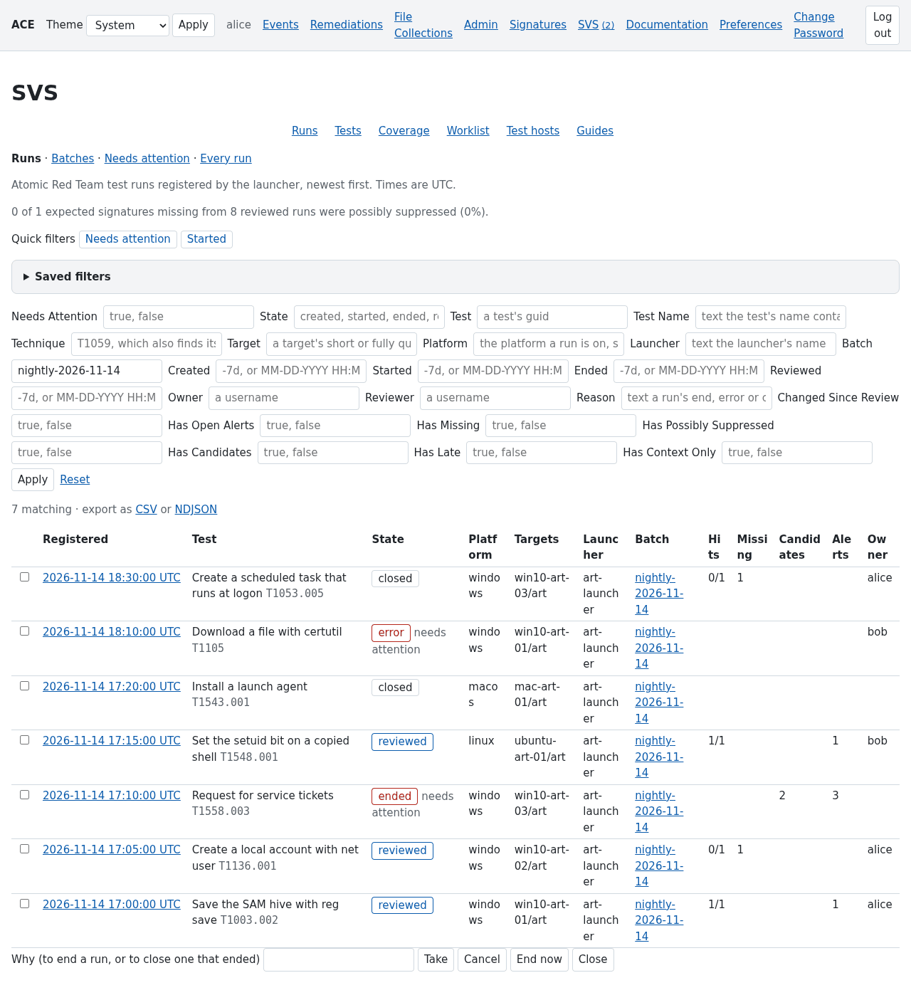

The result columns read like this:

- **Hits 1/1**: every expected signature fired.
- **Hits 0/1, Missing 1**: an expected signature didn't fire.
- **Candidates 2**: signatures fired that nobody has decided about.
- **empty**: there is no result yet (the run hasn't ended), nothing is expected, or there never will
  be one (it was canceled or failed).
- **stale** beside the hits: something changed and the result is about to be recomputed, within a
  minute.

Above the list, one line says how many of the expected signatures missing from reviewed runs were
possibly suppressed.

### Needs attention

The SVS link in the navigation bar and the Runs tab open on *Needs attention*, the runs that are
waiting for a person. The link shows how many there are, as `SVS (3)`, on every page; it shows no number
when there are none, and `99+` past 99. The number can be a few seconds old. They are:

- ended runs nobody has reviewed;
- runs in *error*;
- reviewed runs that changed since their review (a late alert, an association by hand);
- reviewed or closed runs that still hold open alerts.

Each such run says *needs attention* beside its state, in every view. Start your day there. *Every
run*, beside it, drops the filter.

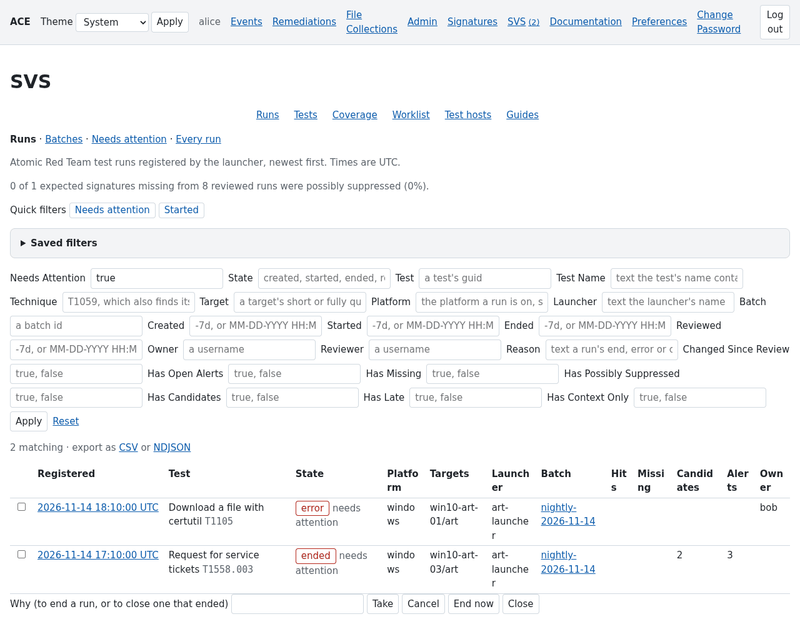

### Filters, batches and bulk actions

The filters are the text fields above the list; each field's placeholder says what it takes. Fill
them in and press *Apply*; *Reset* clears them. The page's address carries the filters, so a bookmark
or a pasted link opens the same view. Useful ones are *Batch*, *Test Name*, *Technique*, *Target*,
*State*, *Owner*, and *Has Missing*, *Has Candidates*, *Has Context Only* and *Has Late* (`true` or
`false`).

Above the fields are your *Quick filters*, links that apply a saved filter: the first time you open
the tab you get *Needs attention* and *Started*. To keep a view of your own, set its filters, open
*Saved filters* under the quick filters, name it and press *Save this filter*; tick *Quick filter* to
pin it beside the others. *Manage…* lists your saved filters for the tab, where you rename, pin,
unpin, reorder and delete them. The Tests, Coverage and Worklist tabs, and the Samples and
Validations lists, have the same section, each with its own filters.

*Batches* groups the runs the filters match by their `batch_id`: one row per batch, with its runs by
state, how many need attention, and its hits, missing and candidates. It is the quickest way to see
how last night's batch went. A batch's name opens its runs.

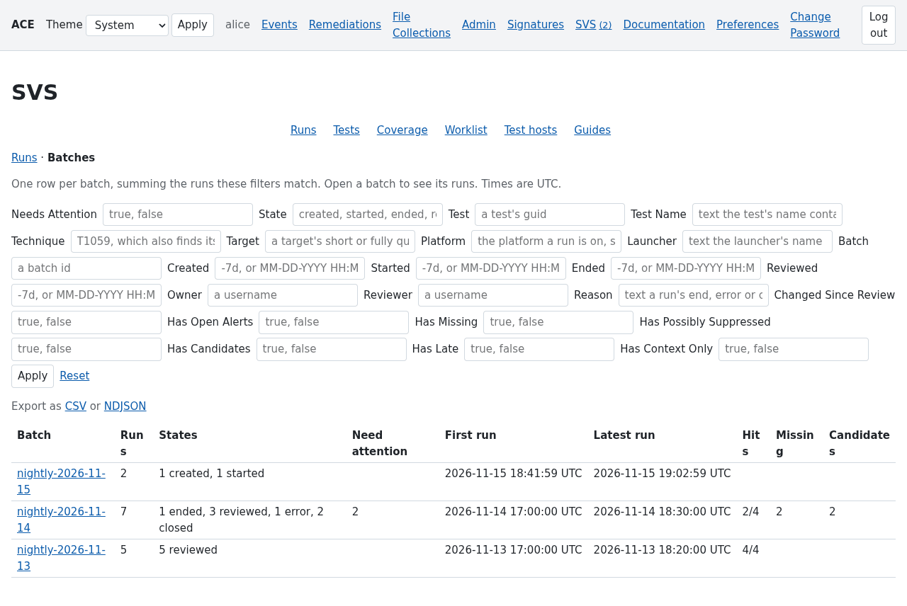

With `svs:run_manage`, each run has a check box. Tick runs and use the form under the list to act on
them at once: *Take*, *Cancel*, *End now* or *Close*. *End now*, and *Close* for a run that ended,
need the *Why* field filled in. When every ticked run was done you come back to the list. Otherwise
a page says what happened to each run: done, left alone because someone else owns it, not done and
why, or unknown. For the runs left alone, that page has a button that takes them from their owners
and does the action again. Review is never a bulk action, because each run's result has to be looked
at.

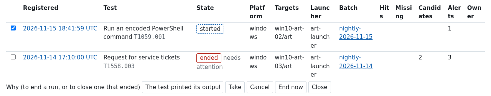

## The run page

Click a run's *Registered* time to open its page. From top to bottom:

1. **The header**: the test's name, its technique and the run's state.
2. **The facts**: the test's guid, platform, targets, launcher, the marker, when it was registered
   and by whom, the batch, its times, exit code, the two windows' lengths and ends, any warnings,
   why it ended early, failed or was closed, the owner, the reviewer, its alerts by how they were
   attributed, and the launcher's `extra`. A fact with nothing to say is left out.
3. **The actions** you may take: *Take*, *Cancel*, *End now* or *Close*, with a *Why* field when one
   of them needs a reason.
4. **Search the logs for this run**: a link into your log tool, when your administrator set one up.
5. **What the launcher reported** and **What the test printed**, when the launcher sent them.
6. **Result**: one row per signature that fired or was expected, with the run's earlier runs beside
   it and, for `svs:run_manage`, the decisions.
7. **Review**: what a review waits for, and the *Review* button.
8. **Alerts**: every alert attributed to the run, how, and what you can do with it.
9. **Comments**: notes from the people working the run.
10. **Event log**: everything that happened to the run, who did it and when, oldest first.

The page doesn't refresh itself: reload it to see alerts that arrived since. The result, the alerts
and the event log each have an export link; the page shows the first 500 result rows, 200 alerts and
200 events, and the exports have them all. With `signature:read`, *files captured from this run's
alerts* opens [Samples](/signatures/samples) narrowed to what those alerts captured (the first 64
alerts' when the run has more).

A started run's page, twenty minutes into its hour's observation window, with one alert attributed so
far:

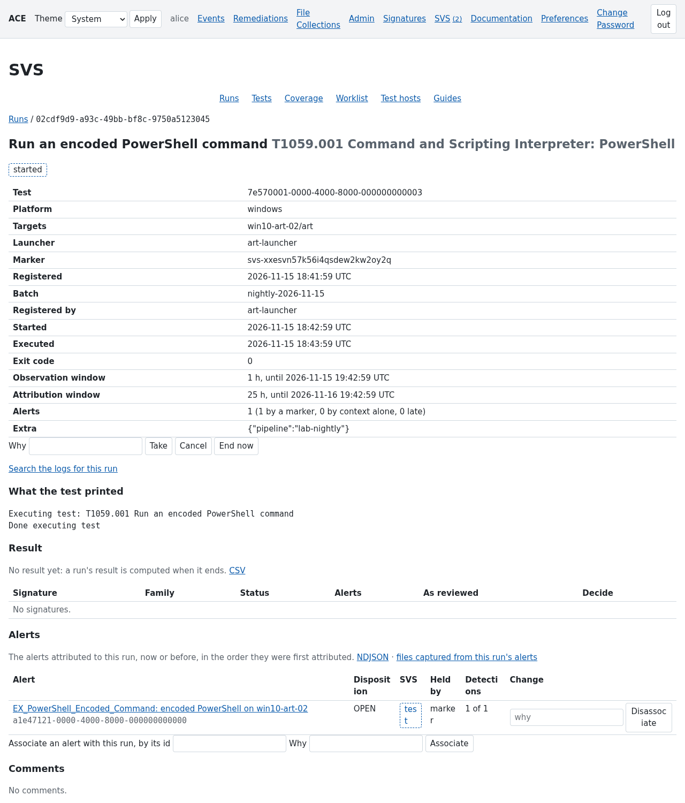

## Reviewing a run

Reviewing a run signs its result off: you confirm which signatures a test should fire, and ACE
learns from it. This walk-through uses an example run of *Request for service tickets* (T1558.003,
Kerberoasting) on `win10-art-03`, which ended and is waiting for a review.

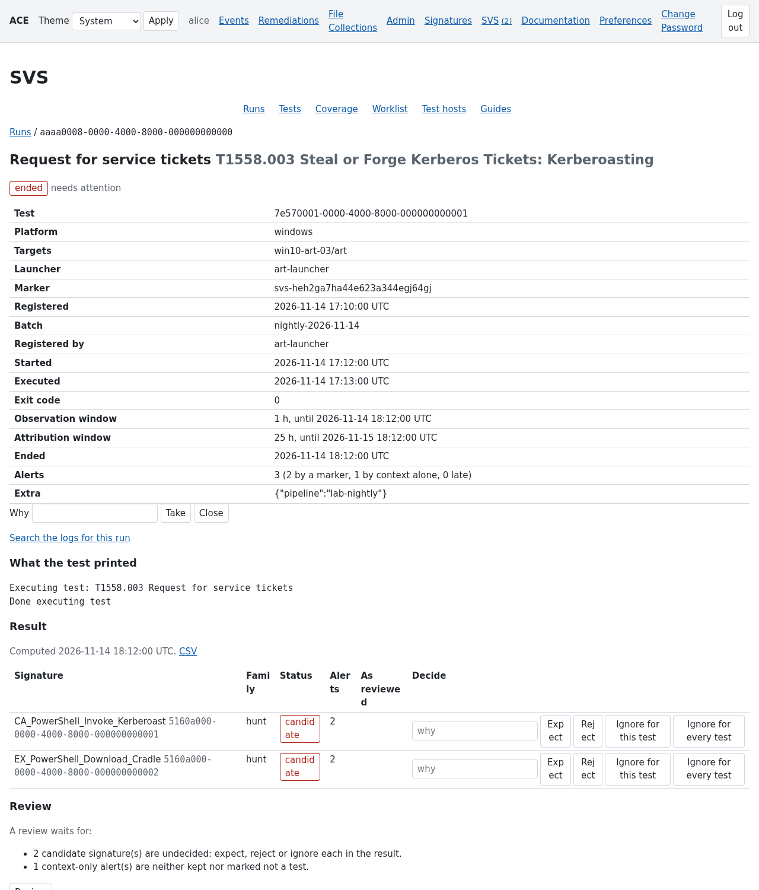

### Step 1: take ownership

Press **Take** in the run's actions. Ownership tells your team you are on it. If someone else owns
the run, ACE leaves it alone and shows a page with a button that takes it from them. If you review an
unowned run without taking it first, the review takes it for you. To review a run someone else owns,
tick *Take the run from …* beside the *Review* button.

### Step 2: see what is in the way

The **Review** section lists what has to happen before the run can be reviewed. A review pressed
while something is listed is refused, and says why.

A run can be reviewed when:

- its result is current (right after a change, the section says the result is being recomputed,
  which takes at most a minute; reload the page);
- every candidate is decided;
- every alert attributed by context alone is kept or marked not a test.

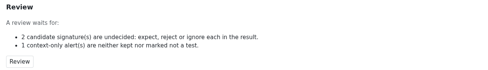

### Step 3: read the result

The **Result** table has one row per signature: its family (`builtin`, `hunt` or `yara`), its status,
how many of the run's alerts carry it, its status as last reviewed, and its status in each of the
test's earlier runs on this platform.

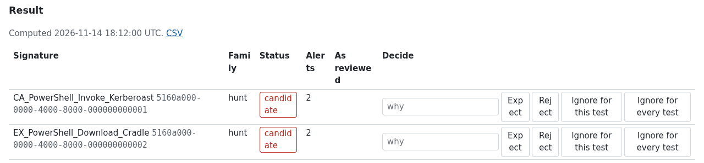

| Status | Meaning |
|---|---|
| `hit` | Expected, and it fired |
| `missing` | Expected, and it didn't fire |
| `possibly_suppressed` | Missing, but it is a hunt that alerted within its suppression period just before, so it may have been suppressed rather than blind. The row links to the alert that may have suppressed it. For a hunt that groups or deduplicates its alerts, the hunter recorded that it dropped a match on the run's host |
| `candidate` | It fired, and nobody has decided about it |
| `rejected` | It fired, and it was rejected for this test |
| `ignored` | It fired, and it is ignored for this test or for every test |
| `left the result` | It was in the result as reviewed, and isn't in the current one |

A note beside a status says how the signature fired: *late* (only after the run ended), *context
only* (never with the marker) or *fallback time* (judged by a time other than the event's own).

The columns to the right are the earlier runs, newest first, each headed by the time it was
registered and linked to its page. A cell holds the signature's status in that run, and is empty
where the signature wasn't in that run's result. No columns means this is the test's first run on
the platform.

### Step 4: decide each candidate

In the *Decide* column, each candidate has its choices as buttons:

| Choice | Means | Effect |
|---|---|---|
| **Expect** | This signature detects what the test does | Every later run of this test on this platform should fire it; a run where it doesn't is *missing* |
| **Reject** | It fires, but it isn't what the test is about (a side effect) | It is remembered and not proposed again on this platform |
| **Ignore for this test** | It is noise during this test's runs, such as the launcher's own remoting | It never counts for this test, on any platform |
| **Ignore for every test** | It is noise during every test (shown only to `svs:admin`) | It never counts for any test |

The *why* field beside the buttons is optional and is kept with the decision: the test's page
shows it under *Expectations* or *Ignores*, where the next person to wonder why a signature is
expected of a test will read it. If someone else decided the same signature while you
were looking, your decision is refused rather than replacing theirs; reload the page.

In the example, `CA_PowerShell_Invoke_Kerberoast` is the test's own technique, so it is *Expect*.
`EX_PowerShell_Download_Cradle` fired because the test downloads its script; whether that is
*Expect* or *Reject* is a judgment your team makes once and records.

Decisions are made per test **and platform**: what a Linux run of a test taught isn't expected of a
Windows run, because the commands differ. To undo a decision, use *Undecide* on its row in the Result
table (or *Stop ignoring …* for an ignore), or *Remove* on the test's page.

### Step 5: check the alerts

The **Alerts** section lists every alert attributed to the run, now or before, in the order they
were first attributed. Each row has the alert's disposition, its SVS status, how the run holds it
(*marker*, *context* or *no longer held*), and how many of its detections the run holds.

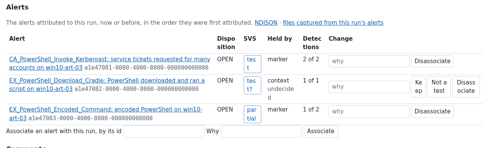

- **test**, held by *marker*: every detection is attributed, at least one by the run's marker.
  Nothing to do.
- **partial**: some detections are from the run and some aren't. Say one file had the marker and a
  second one matched `EX_PowerShell_Encoded_Command` without it: the alert stays in its own queue for
  an analyst to triage the rest.
- **test?**, held by *context*, noted *undecided*: the alert came from the right host in the run's
  window, but without a marker. Decide: **Keep** it (it is the test; a Defender quarantine of the
  test's own script, say) or **Not a test** (it is something else that happened on the host). This is
  required before review.
- **Disassociate** takes an alert out of the run entirely. Fill in the *why* field first.
- An alert the run no longer holds shows why it was removed, and **Associate again** puts it back.

Other notes on a row: *late*, *the cleanup's* (it fired after the launcher said the cleanup began),
*fallback time*, *by hand* and *kept*.

Below the list, *Associate an alert with this run, by its id* attaches an alert ACE didn't attribute;
use it when you know an alert came from the test but it carried no marker and arrived without enough
context.

An alert with the run's marker that came from another host isn't in this list: it is a **marker
mismatch**, and it stays with analysts (see [Test alerts on the alert page](#test-alerts-on-the-alert-page)).

### Step 6: mark it reviewed

When the Review section says nothing stands in the way, press **Review**. ACE then:

1. records the run as *reviewed*, with you as reviewer, and keeps a copy of the result as you
   signed it off (the *As reviewed* column);
2. closes the run's fully attributed open alerts that no analyst owns as `SIMULATED`. The audit log
   and the run's event log name the run and you. Because they now count as TP, their YARA hits are
   kept as TP samples;
3. gives the detections of signatures ignored for the test an FP verdict from you, unless someone
   already set one.

A reviewed run shows its expected signature as a hit with the same under *As reviewed*, and its
alert closed as `SIMULATED` in the `svs` queue.

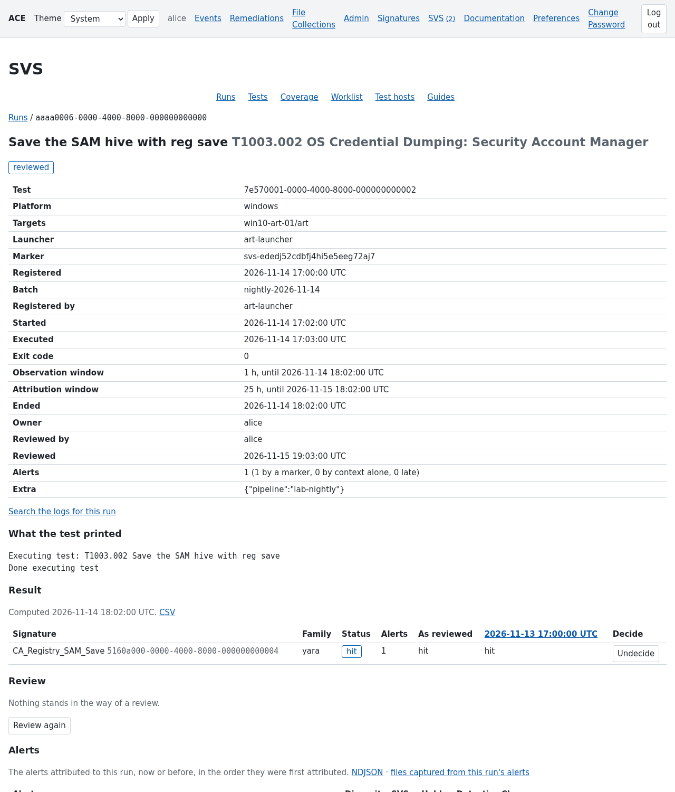

The next run of the same test is judged against your decision, and shows this run's statuses in its
earlier-run columns.

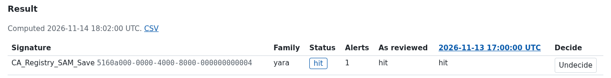

### After the review

- **Changed since review.** A late alert, an association by hand or a disassociation after the
  review marks the run as changed since its review and puts it back in *Needs attention*. Open it,
  look at what changed and press **Review again**, which replaces the earlier sign-off.
- **Comments.** Leave a comment whenever a result needs explaining: a missing signature you are
  chasing, a host problem, a decision you weren't sure about. You can change or delete your own
  comments.

## Ending a run early

A run waits out its whole observation window, and a first run waits for the slowest hunt, which can
be a day or more. When you know nothing more is going to fire (the test plainly failed, or every
expected signature already has), fill in *Why* and press **End now** on a started run's page, or tick
several runs on the list and use *End now* there. The reason is kept with the run and shown as *Ended
early because* on its page.

The run becomes *ended* right away and is reviewed like any other run:

- Its result is computed now. An expected signature that hadn't had time to fire is *missing*, and
  reviewing the run signs that off, so end a run only when you are sure.
- Its test host is free for the next run, unless the test holds its host.
- An alert the test causes anyway is still attributed to the run, as *late*, until its attribution
  window ends. If you already reviewed the run, it shows up as changed since review.

Ending a run is not canceling it: nothing is learned from a canceled run.

## Closing and canceling runs

Not every run deserves a review.

| Action | When | What it does |
|---|---|---|
| **End now** | The run is started and nothing more will fire | The run ends now and waits for review. See [Ending a run early](#ending-a-run-early) |
| **Cancel** | The run is created or started and you want to stop it, and learn nothing from it | The run is canceled. It keeps attributing until its attribution window passes, because the test may have fired anyway, and is closed then. A run that never started is closed at once |
| **Close** | The run ended, was canceled or failed, and nothing should be learned from it | Its fully attributed open alerts become `SIMULATED`, and the run is final. Nothing is learned: no expectations, no samples, no verdicts |
| **Review** | The run ended and its result is worth keeping | See [Reviewing a run](#reviewing-a-run) |

Closing a run that ended needs a reason in the *Why* field, because it was waiting for a review.

When the launcher itself cancels a run before starting it, the run is closed at once and any alerts
it holds are closed within a minute.

A run in *error* tells you the launcher reported a failure, or never started the run. Its page shows
*Failed because* and what the launcher reported. Say the lab proxy blocked the test's download: Bob
takes the run and notes it in a comment. Close it once you know why it failed, or leave it in *Needs
attention* while someone fixes the cause.

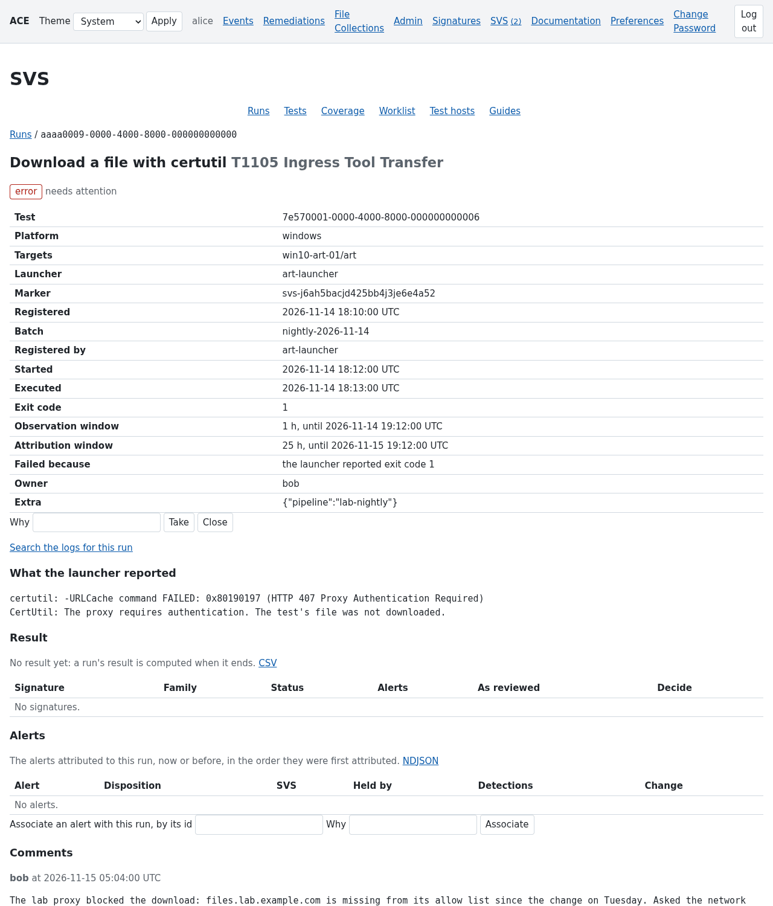

## Test alerts on the alert page

Every alert SVS touched shows an **SVS** section at the top of its page, with its status, the test
runs that hold it (each a link to the run's page, with `svs:run_read`) and its SVS tags. The alert
list shows the status after the alert's description, as a link to the run.

| Status | Means | What to do |
|---|---|---|
| **test** | Every detection is attributed to a test run, at least one by its marker. Once the run is reviewed or closed, ACE has set `SIMULATED` | Nothing. To treat it as a real alert after all, *Disassociate from its test runs* |
| **test?** | Every detection is attributed by its host and time alone | Nothing unless it looks wrong; then *Not a test* |
| **partial** | Some detections are from a run and some aren't. It stays with analysts | Triage the other detections |
| **mismatch** | A marker in the alert doesn't agree with its run: another host, outside the window, or a marker no run has. The section lists each such marker, what is wrong with it and the run it belongs to. It stays with analysts, and the mismatch is never withdrawn | Investigate it as a real alert |

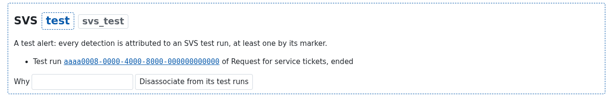

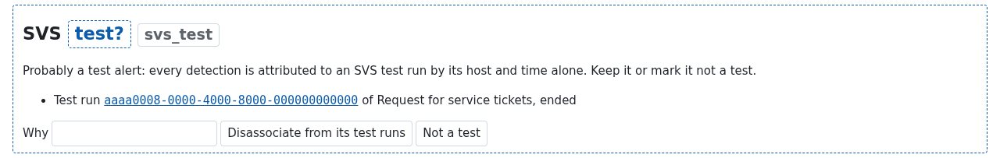

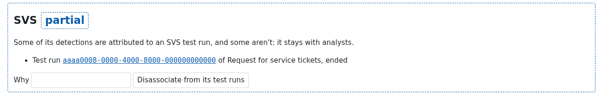

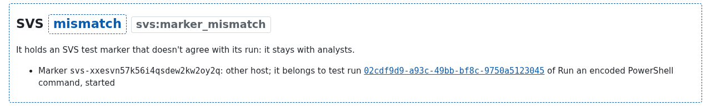

*Disassociate from its test runs* and *Not a test* need `alert:write`. Both take an optional
reason, which each run's event log keeps. Both remove the alert from every run that holds it, send it back to the queue SVS
took it from, and give a `SIMULATED` alert back to analysts as `OPEN`. ACE doesn't attribute it to
those runs again.

> [!IMPORTANT]
> A `SIMULATED` alert is frozen: an analyst can't change its disposition or set verdicts on its
> detections. That keeps what a review signed off reproducible. To work it as a real alert,
> disassociate it first.

## Tests and expectations

[SVS → Tests](/svs/tests) lists the Atomic Red Team catalog by technique, one row per test, with its
platforms, its state, how many runs it has, its latest run and latest review, how many signatures are
expected of it, and how its recent runs did:

| State | Meaning |
|---|---|
| `never_run` | No run of it was ever registered |
| `awaiting_review` | No run of it is reviewed yet, or something was expected of it only after its latest review |
| `no_expectations` | It has a reviewed run, and nothing is expected of it |
| `validated` | Its latest reviewed run hit every expected signature |
| `failing` | Its latest reviewed run missed an expected signature |
| `stale` | It would be validated, but the test or an expected signature's rule changed since that review |

A test is judged on each platform on its own; its state is the worst of its platforms'. The tab
opens on the tests still in the catalog (*Removed* `false`), and its filters are *Technique*, *Name*,
*Platform*, *Executor*, *Repository* and *Removed*. Nothing on it suggests what to run next: that is
your team's call.

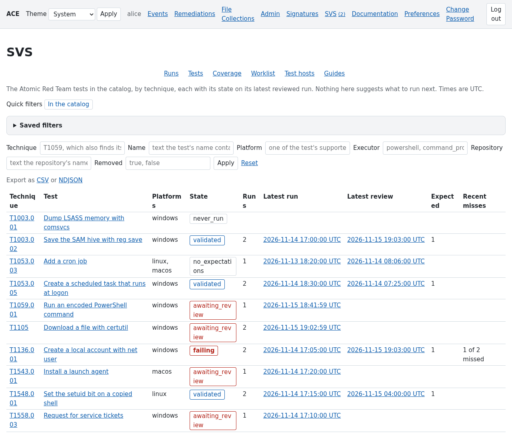

A test's page has its guid (the `test_guid` a launcher registers), its technique, repository, file
and commit, its state on each platform, its description, and its entry from the catalog with its
commands, input arguments and dependencies. Below them are the decisions about it:

- **Observation window**: set minutes here to override the computed window for runs registered from
  now on (`svs:run_manage`); *Remove the settings* goes back to the computed window. Use it when you
  know a test's signatures fire within a minute or two, so its runs end sooner.
- **The test leaves something behind**: tick it in the same form (`svs:run_manage`) when what the
  test leaves can fire later, such as persistence, a scheduled task or a service. Its runs registered
  from then on hold their test hosts until their attribution window ends rather than their
  observation window, so the next run on the host can't take the leftover's alerts.
- **Expectations**: per platform, each signature decided expected or rejected, by whom, when and
  why. *Remove* undoes a decision; the signature becomes a candidate again the next time it fires.
- **Ignores**: for this test, and for every test, with *Stop ignoring* (a global ignore's is for
  `svs:admin`).
- **Its runs**: a link under the test's name opens the Runs list narrowed to this test.

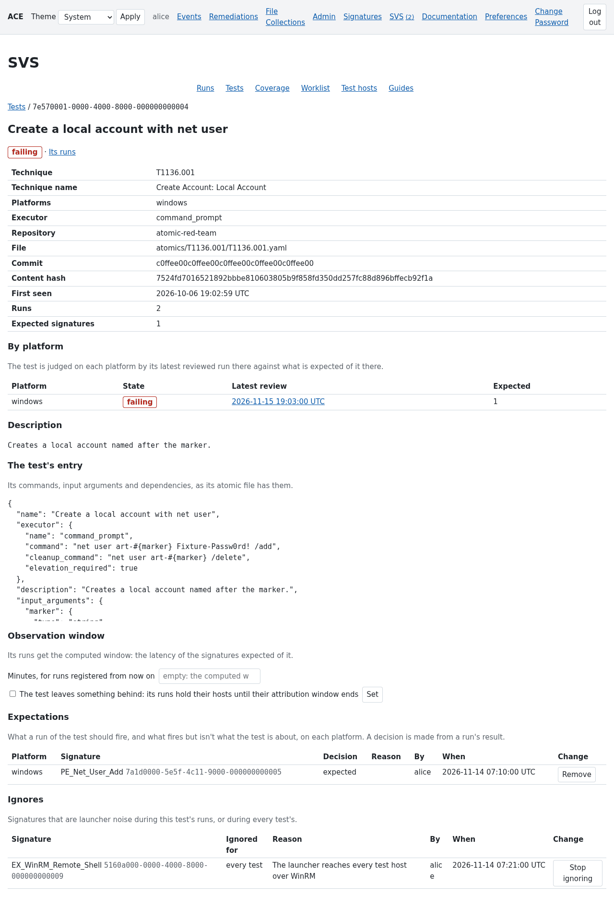

## Debugging a missing detection

A `missing` signature is the most useful thing a run can tell you: something you expected to
detect, you didn't. SVS doesn't build debugging tools; it gives you what you need to search your
own logs.

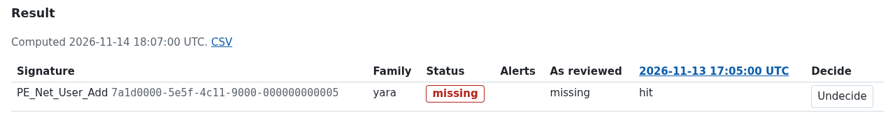

Work through it in this order:

1. **Did the test really run?** Check the event log for the launcher's `executed` call, and the
   facts for the exit code and what the test printed. A test that failed quietly on the host produces
   nothing.
2. **Did the telemetry arrive?** Search your telemetry for the run's marker, which is on the run
   page. ACE's own log records of a run's registration, changes of state and launcher calls carry
   `svs_run`, `svs_marker` and `svs_test`, so a search on `svs_run=…` in your log tool finds them. If
   your administrator set a log search URL, *Search the logs for this run* links straight to it.
3. **Did the signature have a chance?** For a hunt, check in your logs that it ran across the run's
   window: if the hunt didn't search that time, it couldn't fire. A `possibly_suppressed` status
   links to the alert that probably suppressed it, except where the hunter recorded the dropped match
   itself (a hunt that groups or deduplicates its alerts).
4. **Did it run and not match?** For a YARA rule, open the run's alerts from the Alerts section,
   take the files the test produced and scan them against the rule. Files that other rules matched
   on those alerts are on [Samples](/signatures/samples) once the alerts are closed; the *Alert*
   filter takes an alert's id.

Usual causes: the host's logging changed (an agent update or a rebuilt image), the rule is narrower
than the test's command, the hunt didn't cover the window, or suppression. Write what you found in a
comment, so the next person doesn't start over.

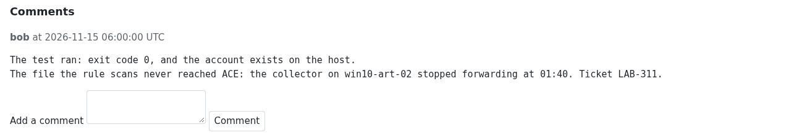

## Writing or fixing a signature from results

Runs tell you where detection is missing or weak. This is the loop that closes the gap.

1. **Find the gap.** A `missing` signature, a candidate nobody wants to expect, a coverage row
   that is *untested* or *failing*, or a worklist row that needs a decision.
2. **Write or change the rule** in your YARA rule repository. Give every rule a `uuid`, because SVS
   tracks rules by it (a rule without one is never tested), and tag it with the ATT&CK techniques it
   claims to detect in `mitre_attack`, comma separated. Keep a rule's `uuid` when you edit it: a new
   uuid is a new rule, with no samples and no history.

```text
rule PE_Net_User_Add
{
    meta:
        uuid = "7a1d0000-5e5f-4c11-9000-000000000005"
        description = "net.exe creating a local account"
        author = "Detection Engineering"
        mitre_attack = "T1136.001"
    strings:
        $a = "net user" nocase
        $b = "/add" nocase
    condition:
        all of them
}
```

3. **Open a pull request.** Where the repository's CI is set up for it, it asks ACE for a validation
   and posts a summary on the pull request with a link to the report (see
   [Reading a validation report](#reading-a-validation-report)).
4. **Read the report** and fix what it found: a regression, a new false positive.
5. **Merge.** ACE scans with the new rules once it has built a ruleset from the merged commit.
6. **Run the test again** and review the run. If the new rule fires, decide it *Expect*.

Hunts follow the same loop through their own repository; their technique tags count for coverage,
but validation replays only YARA rules.

## Reading a validation report

[Signatures → Validations](/signatures/validations) lists every validation, newest first: when it was
asked for, its repository, branch, head commit (with a link to the pull request), state (`queued`,
`running`, `completed` or `failed`), its counts of regressions, new false positives and compile
errors, and who asked for it. Type `true` in the *Has Regressions* filter, or `failed` in *State*, to
find the ones to look at.

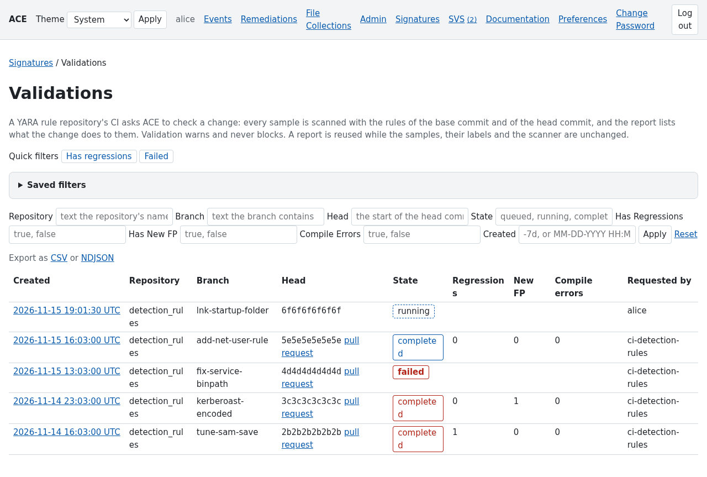

A report replays every stored sample under the change's base commit and its head commit, and sorts
each sample and rule pair the change affects into a category. The report's *Counts* table lists the
categories, the most urgent first; a category's name shows its rows, and the *Category* selector
under *Results* shows several at once.

| Category | Means | What to do |
|---|---|---|
| `regression` | A TP sample the rule matched before and no longer does | Fix the rule, or, if dropping it was the point, retire the sample on its page |
| `regression_unconfirmed` | The same, on a sample whose TP label is weak (inherited on an alert where several signatures fired) | Check whether the sample was ever a real hit for this rule |
| `new_fp` | The rule now matches its own FP sample | Narrow the rule |
| `new_fp_other_rule` | The rule now matches a file that is an FP for another rule | Usually narrow the rule |
| `rule_removed`, `scan_error`, `recovered`, `improvement`, `already_broken`, `new_match_real_hit`, `unlabeled_change`, `known_fp`, `retired`, `not_testable`, `unchanged` | For information | Open the category when it matters |

Above the results, the report says for each commit how many rules it has and in which namespaces,
the files that don't compile and the rules they drop, and whether the ruleset would load at all. Fix
those before merging: a ruleset that won't load leaves production on its previous rules. When a
commit's rules would not load, nothing is compared, and the report says so.

Say a tuning change made `CA_Registry_SAM_Save` miss the SAM dump it used to catch: the row reads
base `match`, head `miss`, on a TP sample, in `regression`. Or a change that broadened the Kerberoast
rule to encoded PowerShell now matches a file that is a false positive for
`EX_PowerShell_Encoded_Command`: that row is in `new_fp_other_rule`.

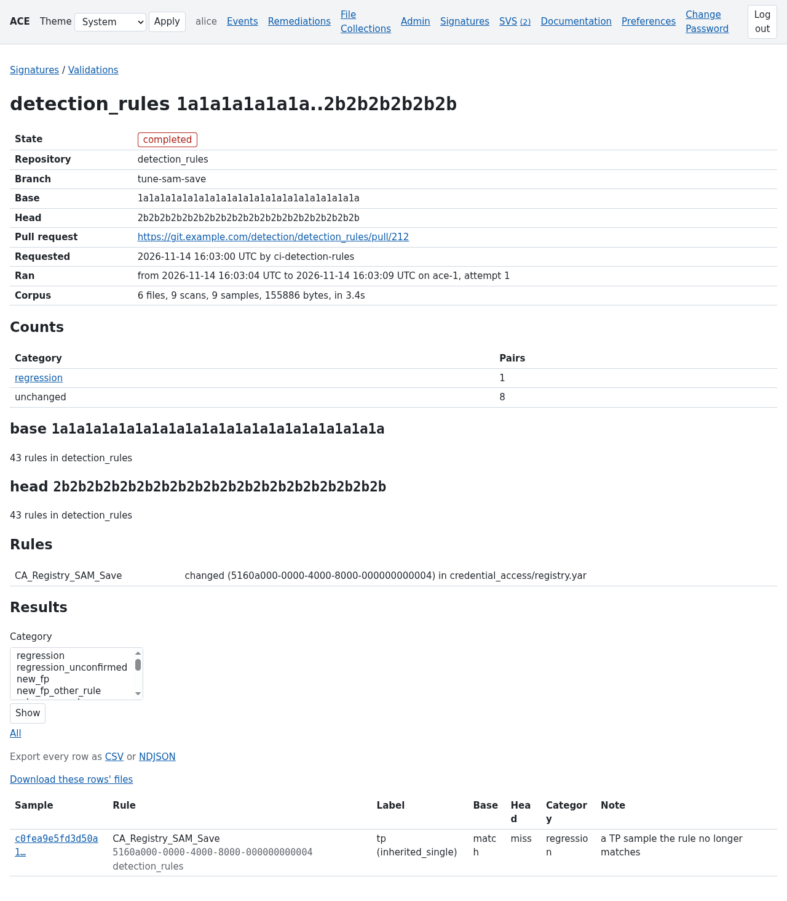

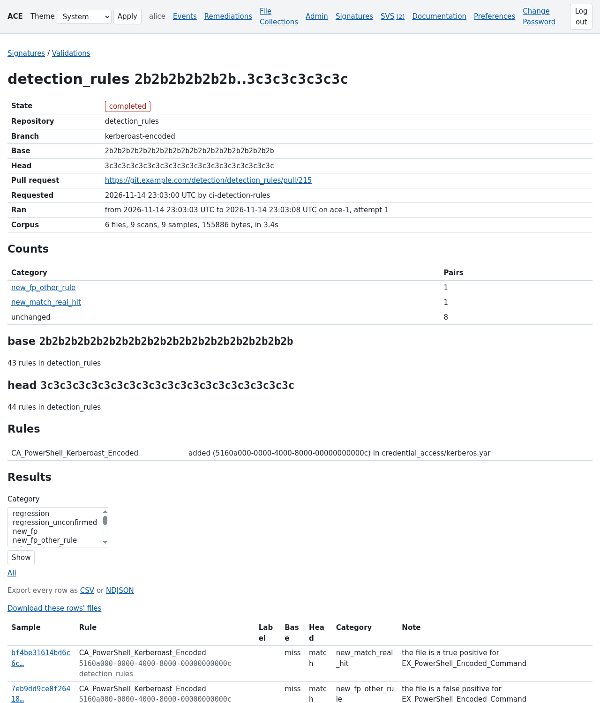

Each row's sample links to the sample's page, where the actions are. With `signature:download`,
*Download these rows' files* downloads the files of the rows shown. The *CSV* and *NDJSON* links
above the table export the report's rows, every one of them or those of the categories chosen
(`/api/svs/v1/yara/validations/{uuid}/results/export/csv` or `.../ndjson`). A validation warns and
never blocks: you decide what to merge.

## Samples and labels

[Signatures → Samples](/signatures/samples) lists every file a YARA rule matched on an alert graded
TP or FP, one row per file and rule. The label comes from the verdicts on the detections behind it,
so changing an alert's disposition relabels its samples. You don't label samples by hand in the
normal course of things; your dispositions do it.

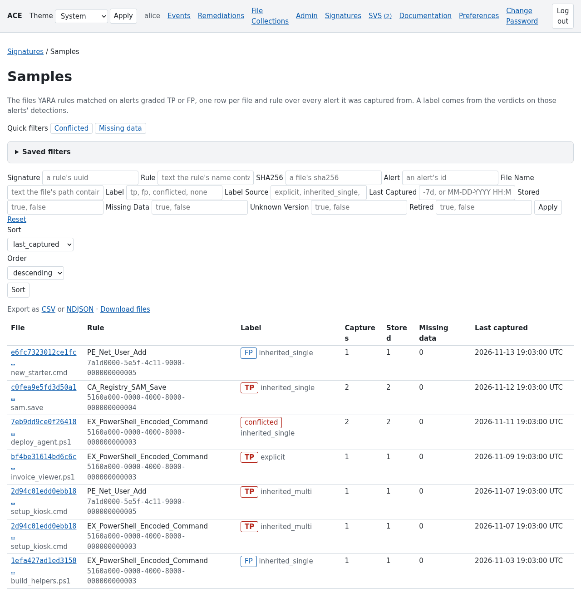

A label is `tp` or `fp`, with how strongly it is known: **explicit** (someone set a verdict),
**inherited_single** (from the alert's disposition) or **inherited_multi** (inherited on an alert
where several signatures fired, so unconfirmed). The strongest strength that has a vote decides. When
votes of that strength disagree, the sample is **conflicted**, and validations can't use it until
someone decides. Say the same `deploy_agent.ps1` was graded FP on one alert and TP on another: its
sample is conflicted.

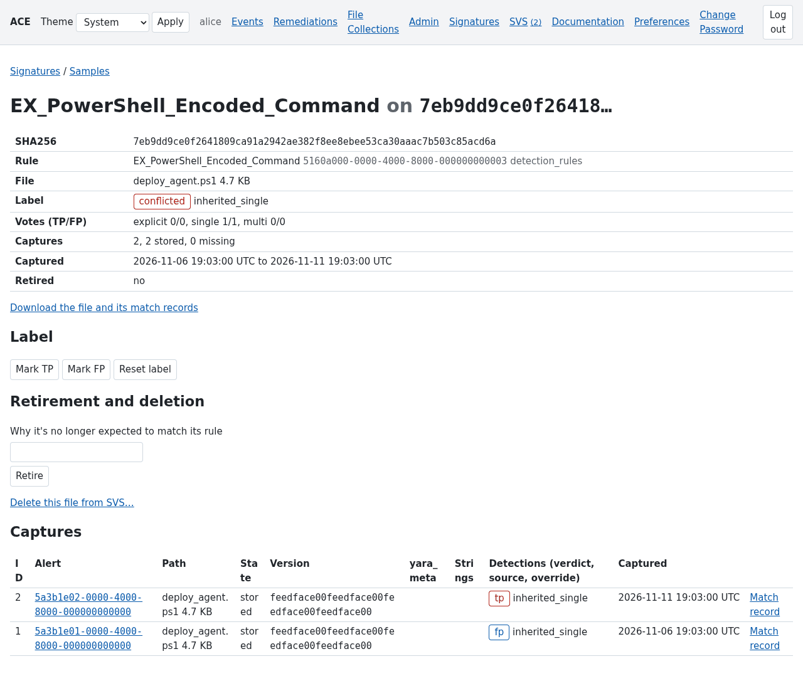

A sample's page shows its votes, every capture with the alert it came from and that alert's
detections with their verdicts, and these actions:

| Action | Permission | Use it to |
|---|---|---|
| **Mark TP** / **Mark FP** | `alert:write` | Store an explicit verdict on every detection behind the sample that can take one. Explicit votes outweigh inherited ones, so this resolves a conflict |
| **Reset label** | `alert:write` | Clear the explicit verdicts, so the dispositions decide again |
| **Confirm TP** | `alert:write` | Store an explicit TP on each unconfirmed TP detection |
| **Retire** / **Unretire** | `svs:admin` | Stop a validation reporting an intended regression on this sample. Retiring needs a reason |
| **Delete this file from SVS…** | `svs:admin` | Remove the file for every rule, for legal or privacy reasons, after a page that asks for a reason; it is never captured again. The alerts' own copies aren't touched |

Type `conflicted` in the *Label* filter to find the samples that need a decision. With
`signature:download`, the list's *Download files* and a sample's *Download the file and its match
records* give you zips protected with the password `infected`.

## Coverage

[SVS → Coverage](/svs/coverage) shows one row per ATT&CK technique and platform, with the count of
rows per state above the list and what the last refresh did. ACE recomputes coverage every two
minutes. The Coverage tab opens on the endpoint platforms (Windows, Linux and macOS) without retired
rows; *Reset* shows everything, and the *State* filter narrows it, for example to `failing`.

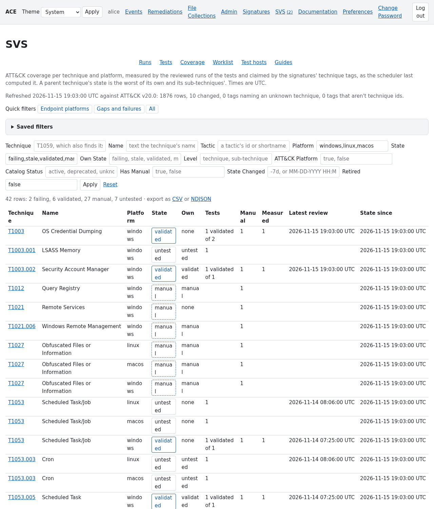

| State | Means |
|---|---|
| failing | A test of the technique missed an expected signature |
| stale | A test would be validated, but something changed since its review, or something expected hasn't been judged by a review yet |
| validated | Its tests' latest reviewed runs hit every expected signature |
| manual | Only a signature's technique tag claims it; no test measures it |
| untested | It has tests, but none counts yet |
| none | Nothing counts toward it |

A row's state is the worst of what counts toward it, and a parent technique includes its
sub-techniques; the *Own* column leaves them out. *Failing* means a test missed something, not that
the technique goes undetected.

A technique's page shows its rows by platform, its sub-techniques, its tests and what each counts
as, the measured and manual signatures, its removed tests, and its daily snapshots of the last two
months.

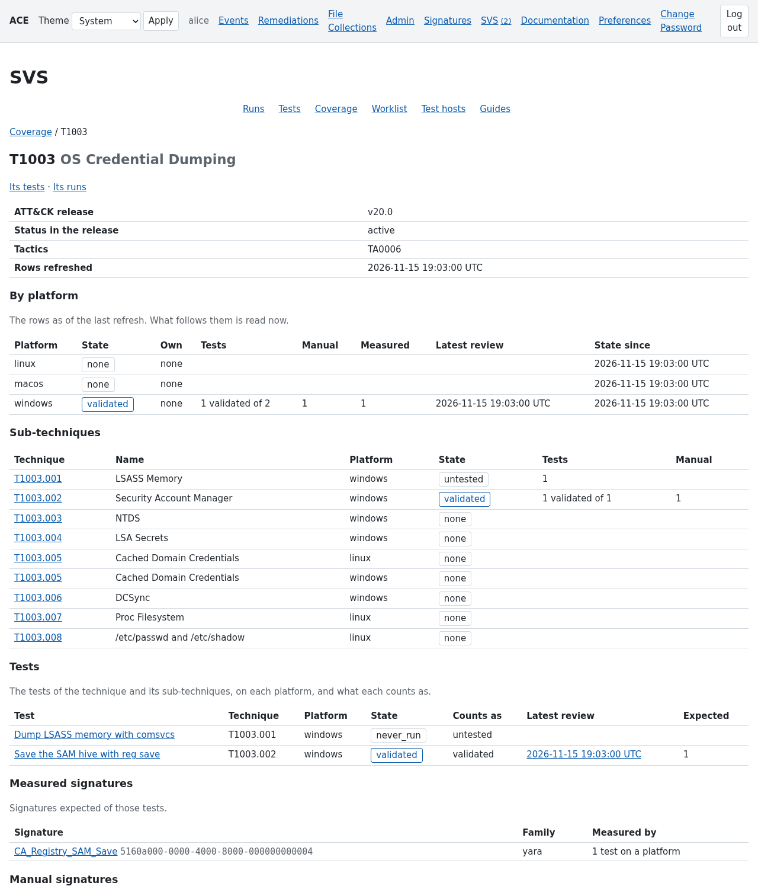

## The worklist

A signature's technique tags are claims. [SVS → Worklist](/svs/worklist) compares them with what
the tests measure, one row per signature and technique. Only signatures that some test measures
appear. Statuses are as of the last coverage refresh.

| Status | Means |
|---|---|
| confirmed | A test measures the technique the tag names, or one of its sub-techniques |
| open | No test confirms the tag, and nobody has decided about it (the view the Worklist tab opens on) |
| kept | Someone decided the tag stays: it covers something no test reaches |
| remove_pending | Someone decided the tag goes, and a pull request will drop it; it stops counting for coverage from the next refresh |
| removed | The tag is gone from the signature |
| undeclared | A test measures the technique, but no tag on the signature names it, for information |
| unknown | The tag names an id the ATT&CK release doesn't have, for information |
| retired | The signature isn't measured any more, or the tag went away undecided |

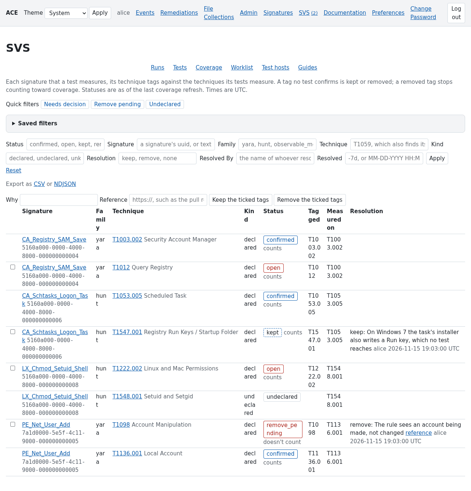

With `svs:run_manage`, tick the rows to decide, fill in *Why*, and press **Keep the ticked tags** or
**Remove the ticked tags**. Both need the reason; *Reference* optionally takes an `https://` link,
such as the pull request that removes the tag.

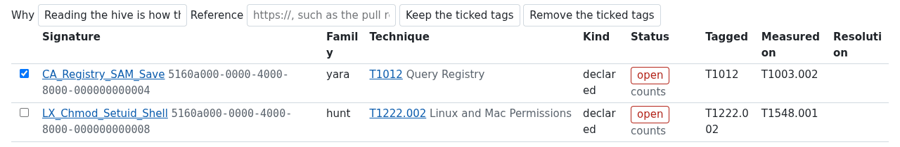

A signature's name opens its own page: every row, including retired ones, and the tests that
measure it. There each row has its own *Keep* and *Remove*, and **Reopen** clears a decision. A row
someone else changed since you loaded the page is refused; reload and decide again.

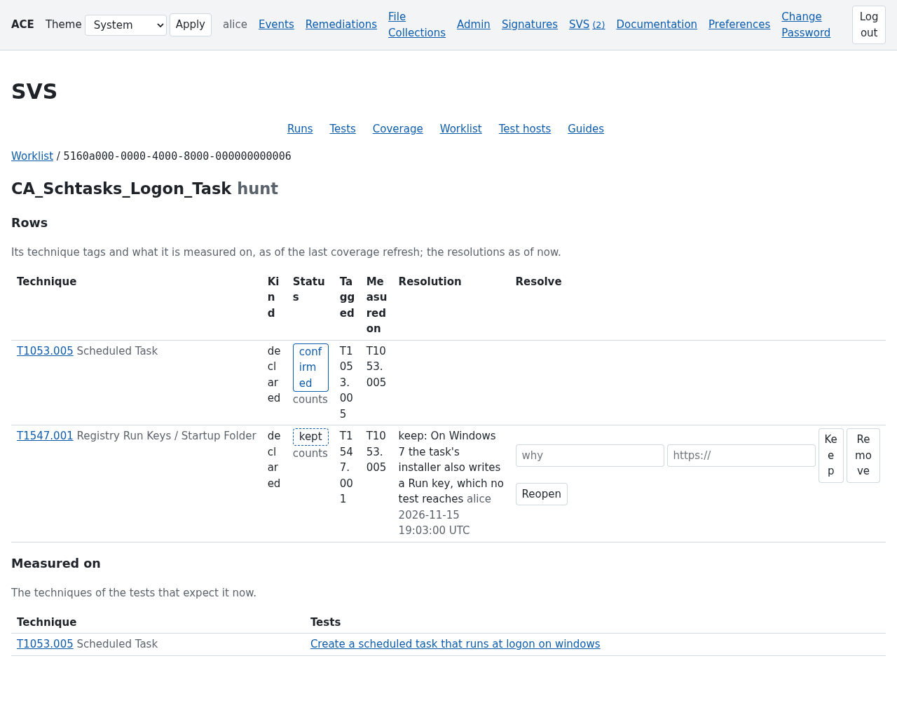

## YARA QA results

A YARA rule with `modifiers = "qa"` in its meta runs in QA mode: it scans everything but never
alerts, and ACE keeps the files it matches for review. Use it to see how noisy a new rule would be
before it can wake anyone up. [Signatures → Yara QA Results](/signatures/yara-qa) lists the rules in
QA mode with how often they matched; a rule's name opens its page, with its versions and its stored
files. When the matches look right, remove the `qa` modifier in a pull request.

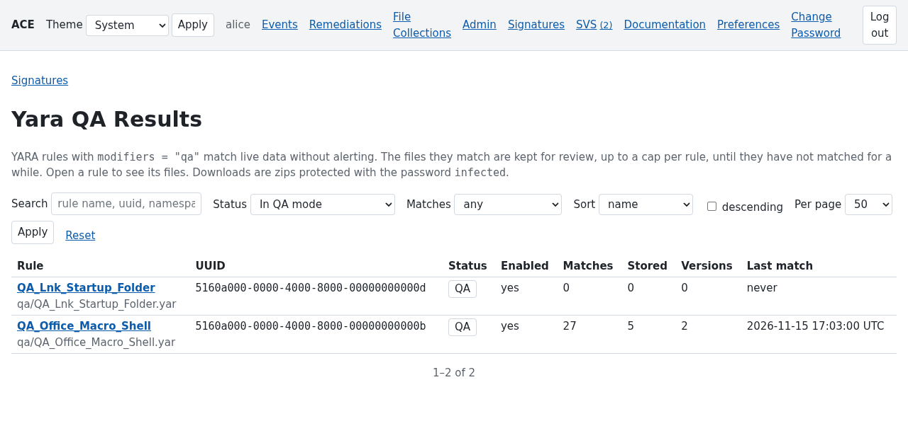

Files are kept per version of the rule, and the version marked *current* is the one loaded now, so
it shows what the rule as it runs now matched. Files are kept up to a cap per rule, until they have
not matched for a while. With `signature:qa_purge` you can also purge files by hand: *Purge
selected…* for the files you ticked, *Purge this version…* for the version you picked, or *Purge
older versions…* for every version but the current one. Each asks you to confirm on a page of its
own, with an optional reason. With `signature:download`, *Download*, *Download selected* and
*Download all* give you the files as zips protected with the password `infected`.

## Exporting data

Every SVS list has *CSV* and *NDJSON* export links, which carry the list's filters. Each is the
address of the API query behind the list (for the runs, `/api/svs/v1/runs/export/csv`), so the same
address works from a script with an API key. Reports are built outside ACE from these, or from the
API directly: `GET /api/openapi.json` on your ACE describes every route and field, with SVS's under
`/api/svs/v1/`.

## Next steps

- New to the ideas behind SVS? Read the [Beginner's guide](beginners.md).
- Setting up test hosts, the launcher's key or CI? See the
  [Administrator's guide](administrators.md).
- Curious how attribution or validation works inside? See the [Developer's guide](developers.md).
